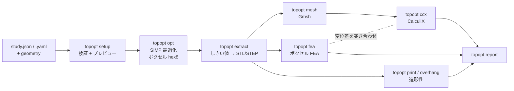
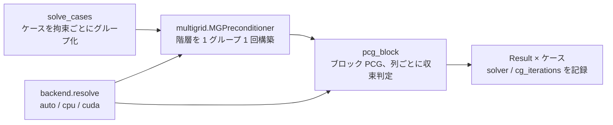

# 構成と移行方針 — 二つの解析経路

> 仕様は [spec.md](spec.md)、作業規約は [../AGENTS.md](../AGENTS.md)。
> このファイルは「なぜ経路が二つあるのか」「何がどのモジュールにあるのか」「何を置き換えるのか」だけを書く。

## なぜ経路が二つあるのか

既存の `topopt` は **CAD カーネルもソルバも外部に持たない**。STL からボクセルグリッドを作り、
自前の hex8 要素と CG ソルバで解く。依存は numpy と scipy だけ。これは意図した設計で、
利点は速さ（設定検証が数秒、最適化が分単位）と可搬性（どこでも動く）。

仕様が要求するのは、それとは別の性質——**独立した検証**。
最適化ループと同じコード・同じ離散化で検証しても、系統誤差は相殺されて見えない。
そこで CalculiX + Gmsh を「正系」として導入する。

**どちらか一方を捨てない。** 速い経路は設計の探索に、正確な経路は最終判定に使う。



| | 高速経路（既存） | 正系（新規） |
|---|---|---|
| 離散化 | 構造化ボクセル hex8 | Gmsh 非構造メッシュ |
| ソルバ | 自前 CG（行列を組まない）＋幾何マルチグリッド前処理。GPU は任意 | CalculiX |
| 依存 | numpy, scipy | + Gmsh, CalculiX, （FreeCAD） |
| 用途 | 最適化ループ、設計の探索、回帰テスト | 最終形状の判定、座屈・固有値、レポートの数値 |
| 速さ | 秒〜分 | 分〜時間 |

**最適化ループは高速経路のまま。** CalculiX を最適化の内側に入れると反復あたりのコストが桁で
上がり、探索が回らなくなる。CalculiX が担うのは §14 の「最終形状の独立再解析」。

**CalculiX 経路は Gmsh に渡した面をそのまま使う（2026-09-08 判明）。** STL の三角形が
そのまま境界メッシュになり、`Mesh.CharacteristicLength*` は内部しか細かくしない。
そのため `topopt ccx` は既定で渡す前に表面を分割する（`ccx.refine_stl`、
`--no-refine` で無効化）。この段を飛ばした「メッシュ収束スタディ」は、
応力を読む場所を一度も細かくしないまま数値だけ動いていた
（[lessons-learned.md](lessons-learned.md) #73）。

## モジュール地図

```
topopt/src/topopt/
├─ voxel.py          STL → 占有グリッド（+Z レイパリティ充填）
├─ hex8.py           非適合モード8節点ブリック要素、FDM 破壊指標
│                    ☑ 直交異方性 D 行列・材料座標回転・最大応力判定（Phase 2 済）
│                    ※ Voigt せん断は [xy, yz, zx]。教科書と違う。b_matrices に従う
├─ solve.py          行列を組まない PCG 線形弾性ソルバ。`solve_cases()` が全ケースをブロックで解く
│                    ☑ Phase 10：前処理とバックエンドは「解き方」だけを決め、答えは変えない
│                    ☑ Phase 12：クラス `Assembled` — 密度場ごとに剛性作用素を1回組み、
│                       任意個の右辺（主解＋応力制約の随伴）を解く。マルチグリッド階層を再利用する
│                    ☑ 2026-09-08：密度が厳密に 0 の要素（obstacle・完全に空いた自由セル）は作用素に
│                       入れない（`drop_void`）。`Result.elements` は従来どおり全 solid 要素を列挙し、
│                       落とした要素はエネルギー・応力 0。要素の構造（DOF 表・生存 DOF・連結成分）は
│                       要素リストの内容ハッシュでキャッシュ。CG の GPU 同期は 1 反復 1 回
├─ multigrid.py      幾何マルチグリッド前処理（2×2×2 粗格子化、要素ごとの Galerkin 積、Chebyshev 平滑化）
│                    ☑ 2026-09-08：GPU では V サイクルを float32 で回す（`mixed`。粗格子の Cholesky と
│                       外側の CG は float64 のまま、CG は flexible 形＝Polak-Ribière の β）。
│                       `--solver cuda:mg64` で全段 float64。粗格子化パターンは要素リストごとにキャッシュ
│                    ☑ Phase 12：粗格子の密 Cholesky が失敗するとき（荷重周りの密度が完全に失われた
│                       density field。`E_min` = 1e-9·E）、対角を最小のシフトで分解できるまでずらす
│                       （`coarse_shift` として記録）。前処理は厳密でなくてよく、CG は物理を変えない
├─ mma.py            ☑ Phase 12：Method of Moving Asymptotes（Svanberg 2007 `mmasub`/`subsolv` の
│                       numpy 直訳）。クラス `MMA`、メソッド `step`。任意個の制約を扱える——
│                       OC 法は体積制約1つしか扱えないため、応力制約を1つ増やすのに要る
├─ stressconstraint.py
│                    ☑ Phase 12：クラス `StressConstraint`。荷重ケースごとに1つ、
│                       「要求安全率 × 破壊指数 ≤ 1」を全域で課す。破壊指数の規則は最終 FEA と同じ
│                       （`hex8.max_stress_failure_index`）を12個の片側線形モードとして書く。
│                       qp緩和・p-norm 集約・随伴感度（`Assembled` 経由でマルチグリッド階層を再利用）
├─ backend.py        配列バックエンド（numpy 基準 / torch+CUDA 任意）と `--solver` の共通引数
├─ materials.py      材料データ — 材料値の唯一の出所
│                    ☑ 直交異方性カード（Phase 2 済）。旧2定数モデルは凍結して併設
│                    ※ material_model() が「どちらを使うか」を一箇所で決める
├─ loadcase.py       study → グリッド上の境界条件
├─ report.py         応力集計と結果 PNG
├─ designspace.py    preserve/obstacle/design_space の設定モデルと検証
│                    ☑ build_volume_report() 印刷範囲検査（Phase 9）
│                    ☑ freedom_report() 最適化の自由度と、preserve が事前に決めた分（Phase 9）
│                    ☑ ground_mask() 接地帯＝設計空間の底面1ボクセル層（Phase 10）
│                    ※ `{"contact": "ground"}` の support だけがここに切り詰められる。
│                       preserve 規則の唯一の例外。転倒は表現できない（known-issues G7）
│                    ※ どちらも validate() の最後で走る。壊れたドメインを
│                       「印刷できない」と報告しても意味がないため順序が決まっている
├─ printers.py       ☑ 印刷範囲の唯一の出所（Phase 9）。materials.py と同じ規約
│                    ※ 機種名でも任意 envelope でも宣言できる。既定を使った場合は
│                       source に「defaulted」と残る。選んだのか黙って入ったのかを区別する
├─ assumptions.py    ☑ 前提条件ページの生成（Phase 9）
│                    ※ 「示していないこと」の節はデータから毎回導出する。
│                       手で保守する注意書きは黙って古くなる
├─ schema.py         study の検証（自前。jsonschema は使わない）（Phase 1 済）
├─ outschema.py      ☑ 出力 JSON の検証（Phase 13）。`schema.py` の逆方向——
│                    各出力の種類ごとにキー表（型・required・意味・書く/読むコマンド）を持ち、
│                    `validate_output()` が未知キーを警告・必須欠落や型違反をエラーにする。
│                    ※ `topopt/docs/output-schema.md` はこの表から生成する（手で編集しない）
├─ manifest.py       再現性情報（Phase 0 済）。出力を持つ実行に必ず1つ
├─ external.py       ☑ 外部ツール検出と終了コード 3（Phase 3-5 共通）
│                    ※ `TOPOPT_GMSH` / `TOPOPT_CCX` に加え `%USERPROFILE%\Tools\gmsh*` /
│                       `calculix*` も自動で探す（2026-09-08）。PATH にもレジストリにも無い
│                       非管理者インストールを前提にしている
├─ printcheck.py     ☑ サポートの着地先検査（重要面接触・密閉空洞）（Phase 5）
├─ slicer.py        ☑ スライサー出力の読み取り（Phase 5、2026-09-08）。純粋関数のみ——
│                      プロセスは起動しない（それは `cli/slice.py`）
│                   ※ 内蔵プリセットの `inherits` を自分で畳む（`Presets.resolve`）。
│                      Bambu / Orca の CLI は継承を解決せず、葉だけ読んでベッド寸法を
│                      既定値に落とす。畳んだ後は `"from": "system"` にする（`"User"` は
│                      「process not compatible with printer」で拒否される）
│                   ※ `filament_by_feature()` が G-code の `; FEATURE:` ごとに押し出し量を
│                      積算する。サポート量はスライサーが報告しないのでこれで出す。
│                      **`G2`/`G3` の円弧も数える**（数え落とすと総量の 86.6% になる）。
│                      機械開始 G-code は絶対 E（`M83` は後から来る）
│                   ※ spec §13.3 の5条件は全部 UNKNOWN で返す。位置の問いにスライサーは
│                      答えられない（`judge()`）
├─ underwater.py     ☑ 静水圧・浮力・簡易抗力（Phase 7）
│                    ※ 既定は開放フレーム。密閉として扱うと部品が無駄に厚くなる
├─ ccx.py            ☑ CalculiX デッキ生成・結果パーサ・釣合い検査（Phase 4）
│                    ☑ **実行検証済（2026-09-08）**。ケースごとの結果（`cases`、支配ケースは
│                       `governing_case`）を出す。メッシュを切る前にシェルを検査し
│                       （`geom.shell_report`）、非閉曲面は拒否／`--repair`（MeshFix）で修復
│                    ※ 全 `*STEP` に `OP=NEW` を付ける（無いと拘束・荷重が持ち越る）
│                    ☑ 2026-09-08：`refine_stl` / `refine_triangles` が既定で表面を
│                       分割してから Gmsh に渡す（`--no-refine` で無効化）。3D は HXT
│                       （`Mesh.Algorithm3D = 10`）。`load_weights` が二次要素向けの
│                       整合節点荷重（既定、`--load-split equal` で旧方式）
│                    ☑ 同日：`mesh_quality` / `mass_properties` / `principal_stresses` /
│                       `tresca` / `strain_energy_density` を追加。`--map volume|surface`
│                       （既定 volume＝ボクセル経路と同じ境界条件、spec §14.4）、
│                       `--ground-tol` 接地拘束、`--exclude-mm` で最悪要素判定から
│                       固定節点近傍を除外、`--voxel-fea PATH` でボクセル FEA と突き合わせ
│                       （`vs_voxel_fea_cases`）。座屈・振動は静解析と別デッキ（`build_cases`）
│                    ※ `parse_dat` / `parse_frd` は実出力に合わせて書き直し済み
│                       （ヘッダの空白・複数ステップ・支持セットごとの反力ブロック。
│                       lessons-learned #76）
├─ generative.py     設計空間モデルを守る SIMP 最適化
│                    ☑ 3条件収束判定・termination_reason（Phase 2 済）
│                    ☑ objective_and_sensitivity() を切り出し（有限差分テスト用）
│                    ☑ Phase 12：`design.stress` が有効なとき `mma.MMA` 経路で解く
│                       （既定は `oc._oc`。OC は体積制約1つしか扱えないため）。
│                       MMA 使用時は目的関数を毎反復1へ再スケールする（対数を MMA が見るため）
│                    ☑ 2026-09-08：`find_pinches` / `heal_pinches` — 稜線・頂点だけで
│                       接するセル（MeshFix が削る「つまみ」、実測21%体積喪失）を、
│                       積層方向の低い側へ橋渡しの1セルを足して塞ぐ。`final_geometry`
│                       （`cli/extract.py` の全候補評価が呼ぶ）の連結成分掃除の直後に
│                       既定で効き、`connectivity.pinches_healed` に件数と体積を残す。
│                       tall_tripod の再抽出：`03_optimization/reanalysis/`（+3 セル）
├─ members.py        密度場から中心線＋幅のリブ抽出
├─ meshout.py        密度場 → STL（角/平滑）と平面BREP STEP
│                    ※ 3つの書き出しは**同じ枠**でボクセルを書く。
│                       平滑化が動かしてよくないのは取合いと接地面の2つ（Phase 10）
├─ finish.py         ☑ 出荷する形＝結果 − 解析した preserve ＋ CAD の preserve − CAD の穴（Phase 10）
│                      格子は解析ドメインではなく、add / cut を含むまで広がる（`cover_pad`、2026-09-10）
│                    ※ 解析ボクセルより細い取合いを残すための段。
│                       **解析はこの形を見ていない**（known-issues G8）
│                       2026-09-08：同名の `add` が preserve の解析ボクセルを置き換え、
│                       最適化した材料だけを細グリッド上で平滑化（CAD・接地層・obstacle は固定）
├─ runtime.py        ☑ ボクセルサイズの値付け（Phase 10）。実際に1回解いて外挿する
│                    ※ 式でのスケーリング則は測って捨てた。セル数ではコストが説明できない
├─ setup_preview.py  解く前の色分け 3D プレビュー
├─ geom.py           三角形スープ：断面・サポート面積・掃引干渉
├─ stepio.py         平面BREP STEP の読み取り
└─ cli/              各コマンド（topopt.cli.main が振り分け）
   ├─ setup / optimize / compare / fea / printability
   │  ※ 2026-09-08：`fea.py` に `run_converge`（`--converge`）。[2H, H, H/2] の3段階を
   │     解いて `ccx.mesh_convergence` で判定する（known-issues A3）
   ├─ overhang / sections / clearance / step2stl
   ├─ ☑ extract.py    opt から形状抽出を分離（Phase 3 済）。finish 段もここが呼ぶ（Phase 10）
   ├─ ☑ ccx.py        Gmsh メッシュ生成＋CalculiX 実行（Phase 4。mesh.py に分けず1つ）
   │                  ※ 2026-09-08：`mesh_context` / `region_nodes` / `ground_nodes` /
   │                     `fix_dofs` / `selected_area_mm2` / `build_cases` / `support_key`
   │                     を追加。上の `ccx.py`（src/topopt）の新フラグをここで配線する
   ├─ ☑ slice.py      ☑ Phase 5（2026-09-08）：`topopt slice`。スライサーを headless で回して
   │                  `slice.json`（`topopt/slice/1`）を書く。**失敗は構造判定に触らない**
   │                  （spec §19.5）——`report.py` の停止条件には入れず、独立の節にする
   ├─ ☑ report.py     統合レポート（Phase 5 済）。UNKNOWN を合格に数えない
   │                  ☑ Phase 13：`--csv` で `report_cases.csv` / `report_checks.csv`
   ├─ ☑ run.py        一括実行（Phase 5 済）。「停止」と「スキップ」を区別する
   ├─ ☑ underwater.py 水中荷重（Phase 7 済）
   ├─ ☑ assumptions.py 前提条件ページ（Phase 9 済）
   └─ ☑ validate.py   ☑ Phase 13：`topopt validate PATH...`。`outschema.py` を呼ぶだけの薄い CLI
```

☑ = 実装済み。★ = これから。※ = 触る前に知っておくこと。

## 外部ツールの扱い

FreeCAD / CalculiX / Gmsh / スライサーは **必須依存にしない**。

- 検出は実行時。見つからなければ終了コード **3** と導入手順を出して止まる
- 既存のボクセル経路は、外部ツールを一切入れていない環境でも従来どおり動く
- `pyproject.toml` の `dependencies` は numpy / scipy のまま。外部ツールは extras でもなく、
  ドキュメントに記載する前提条件とする（pip で入るものではないため）

この方針を崩すと「CI で動かない」「別マシンで再現しない」が始まる。

**このマシンには Gmsh・CalculiX・Bambu Studio（スライサー）が導入済み（2026-09-08）。**
スライサーは `external.py` の `slicer` として検出する（`bambu-studio` →
`C:\Program Files\Bambu Studio`。PATH には無い）。内蔵プリセットは実行ファイルの隣の
`resources/profiles` から読む（`TOPOPT_SLICER_PROFILES` で上書き可）。
**実行ファイルはあるがプリセット木が無い環境は終了コード 3 として扱う**——
使えるスライサーが無いのは事実であって、利用者の入力の誤りではないから。
導入先・検出方法の実際は
AGENTS.md の Tech Stack 表と CLAUDE.md を見ること。方針（必須依存にしない・未導入は
終了コード 3）はこのマシンでの導入で変わらない——`external.py` は依然として実行時検出のままで、
インストール先を固定パスに書き込んでいない。

## ソルバの速さはどこで決まるか（Phase 10、2026-09-05）

最適化 1 反復の費用は「要素数 × CG 反復数 × 1 反復の単価」。このうち**反復数**が支配的で、
Jacobi 前処理では密度場が 0/1 に近づくほど条件数が悪化し、4 mm の `tall_tripod` で 12,044 反復に達した。



2026-09-08 の追加計測（child_jaw_gate、3 mm・99,450 要素のうち obstacle 48,802・5 ケース・
GPU）：最適化 4 反復の壁時計 24.6 s → 9.9 s。内訳は (1) `TorchBackend.where` が Python
スカラーを毎回 `torch.as_tensor` で転送しており、その H2D コピーが GPU の待ち合わせ点に
なっていた（4 反復で 11,558 回・12.5 s）、(2) obstacle が域の 49% を占め、密度 0 のまま
毎 matvec に乗っていた、(3) 自己支持つき OC の厳密体積二分探索が 1 反復あたり `vol_of`
（フィルタ＋AM 掃引＋射影）を 17 回呼んでいた（1.45 s/反復）、(4) GPU の float64 要素積
（(nel·m,24)@(24,24)）が matvec の 2/3（m=3 で 1.5 ms / 2.4 ms。float32 なら 0.23 ms）。
対処は上の `solve.py` / `multigrid.py` / `generative._oc`（Illinois 法・前反復の乗数から
ウォームスタート）の各項。答えは全経路でコンプライアンス相対差 1e-6 以内。

| 経路 | 4 mm・101,808 要素・0/1 密度・1 ケース | 反復 |
|---|---|---|
| CPU Jacobi（旧） | 約 540 s | 12,044 |
| GPU Jacobi | 40 s | 12,044 |
| CPU マルチグリッド | 約 20 s | 74 |
| GPU マルチグリッド（既定） | 2.2 s | 74 |

**設計判断**：
- 粗格子作用素は代数的（pyamg）ではなく**幾何的**に作る。ボクセル格子なので 2×2×2 の親子関係が自明で、
  粗格子の要素行列 24×24 を「子要素の行列 × 固定の転送行列」で厳密に作れる。同じ gather/scatter の matvec が全レベルで使える
- 平滑化は Chebyshev。Gauss–Seidel のような逐次掃引が無いので GPU でも同じコードで動き、対称なので普通の CG の前処理になる
- 固定自由度は補間行列 P の該当行を 0 にする。これで粗格子作用素が拘束つきの細格子作用素と整合し、粗格子側の「死んだ」自由度は単位行になる
- GPU でも float64。GPU に頼るのは帯域であって float32 の演算速度ではない。CPU と GPU の答えは解の許容差内で一致する
- **前処理は物理ではない。** 新しい経路は `tests/test_solver.py` で旧経路と一致することを示してから既定にした

## 何を置き換え、何を残すか

| 対象 | 判断 |
|---|---|
| ボクセル FEA（`hex8` + `solve`） | **残す。** 最適化ループの中身であり、回帰テストの基準 |
| 自前 STEP 書き出し（`meshout`） | **残す。** FreeCAD 未導入環境の唯一の STEP 経路。FreeCAD があればそちらを優先 |
| 自前 STEP 読み取り（`stepio`、平面BREP のみ） | FreeCAD 導入後は補助扱い。取合い寸法の読み取りには引き続き有効 |
| 設計空間モデル（`designspace`） | **残す。** 仕様 §8 の原型であり、新経路も同じモデルを入力に取る |
| `topopt compare` | **残す。** 手で作り直した形が荷重を持つかを見る唯一の手段 |
| 旧 `keep_in` / `keep_out` スキーマ | 互換維持。新規の study では使わない |

## モデルのディレクトリ構成

**1モデル1フォルダ、共用しない**（spec §17.5）。中は実行順に 4 段階:
`01_assumptions/` → `02_setup/` → `03_optimization/` → `04_print/`。

`04_print/` は印刷する人だけが見る場所で、作業ファイルを置かない。
最適化は複数しきい値で複数の STL を出すので、**どれを印刷するのかが
一目で分かる場所**が要る。旧構成では 5 つの STL が作業ファイルと同階層に並び、
選ばれた 1 つが埋もれていた。

| フォルダ | 中身 | 誰が見るか |
|---|---|---|
| `01_assumptions/` | `assumptions.md` / `.json` | 査読者・共著者・1年後の担当 |
| `02_setup/` | 形状 STL・検証プレビュー・`_setup.json` | 設計空間を疑うとき |
| `03_optimization/` | 密度場・収束履歴・FEA 図・候補・`report.md` | 結果を疑うとき |
| `04_print/` | **印刷する STL** ・STEP・プレビュー・`PRINT.md` | 印刷する人 |

`osmo_tripod/` は移行前の構成のまま（`out/` に記録済み run が入っている）。
それらは回帰テストの基準値なので、動かすと基準の出所が消える。

## 座標系と単位

- 単位は内部一貫して **mm / N / MPa**。入力で `units: mm_N_MPa` 以外はエラー
- グリッド原点は出力サマリ JSON に必ず残す（旧方式で残していなかったため、
  `compare` が黙って 0% オーバーラップを報告した事故がある）
- 材料座標は `build_axis`（積層法線 = Z）と `raster_axis` で定義し、グローバル座標へ回転する

## 参考

- 設計空間モデルの全仕様（英語・実装準拠）: [../topopt/docs/design-space.md](../topopt/docs/design-space.md)
- 最適化結果を部品にする手順（英語・実装準拠）: [../topopt/docs/topology-optimization.md](../topopt/docs/topology-optimization.md)
- 過去の失敗と、そこから来た規律: [lessons-learned.md](lessons-learned.md)
## MCP アダプター

2026-10-07：`run`のCCXは完成STLを優先する。`--ccx-geometry analysis`だけが従来の解析形状を選ぶ。
`provenance.py`は大きいSTLを逐次読み取りしてSHA-256を計算し、CCXのstudy・形状とレポートを対応付ける。
レポート生成前に今回のrun_summaryを書き、失敗・省略された段階の古い結果を収集から除く。
`underwater.report`は節点力配列を作らず面の力を集計する。密閉空洞は排水体積に含め、濡れた面から除く。

`topopt/src/topopt/mcp_server.py` は任意依存の stdio サーバー。
既存 CLI を別プロセスで実行し、標準出力をログへ分離します。
独立ワーカーが完了記録を保存するため MCP の再接続後も結果を取得できます。
計算と合否の実装は CLI 側に一元化します。詳細は [mcp.md](mcp.md)。
ジョブ状態は短い末尾ログまたはバイトカーソルによる差分を返し、最大30秒の変化待ちに対応します。
JSONの項目選択は履歴等を会話へ取り込まず必要な値だけ返す転送層であり、数値や合否は変更しません。
