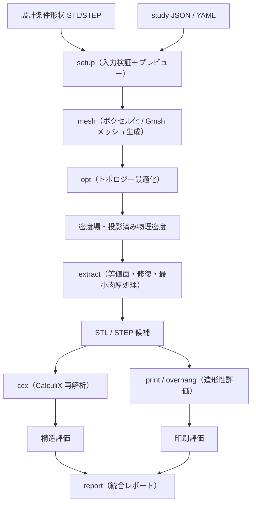

# topopt 構造最適化・解析パイプライン 仕様書

> **ステータス**: 確定（改訂第2版・移行方針反映）・**作成日**: 2026-08-04
> **読者**: 実装するエージェント（Claude Code / Codex 等）と人間の解析担当者。
> 背景と使い方は [../README.md](../README.md)、作業規約と検証コマンドは [../AGENTS.md](../AGENTS.md)、
> 二経路構成と移行方針は [architecture.md](architecture.md)、過去の失敗の記録は [lessons-learned.md](lessons-learned.md)。

実装の**契約書**。各機能の「受け入れ条件」が合格ラインで、AGENTS.md の検証ループで照合する。
仕様を変えたら同期規約に従いこのファイルと関連 docs を同じ変更の中で更新する。

---

## 1. 概要

### 1.1 一言コンセプト

変更禁止形状・材料配置禁止領域・設計可能領域を入力し、FFF方式3Dプリント部品に適した構造を
生成・検証する、ジェネレーティブ設計型の構造最適化 CLI。

### 1.2 目的

以下を一つの再現可能な解析パイプラインとして統合する。

- Preserve Geometry 間を接続するトポロジー最適化
- 構造解析（現行：自前ボクセル FEA / 目標：CalculiX）
- FFF 積層方向と直交異方性材料の評価
- 壁・外周・インフィルを考慮した構造評価
- サポート・オーバーハング・ブリッジ等の印刷可能性評価
- 最適化形状の直接的な STL / STEP 変換
- 最終形状の独立再メッシュ・再解析
- 解析条件・結果・警告・合否の自動レポート

### 1.3 背景

AI Skill に形状生成と構造解析を直接行わせた場合、次が起きた。

- トポロジー最適化結果と最終 CAD 形状が一致しない
- SIMP 密度場の中間密度が大量に残る
- 目的関数と密度収束が区別されていない
- 最適化形状を別 CAD へ作り直し、荷重経路を失う
- 荷重ケース・造形方向・材料異方性の網羅性が保証されない
- 結果の再現性と検証可能性が不足する

そのため解析・最適化処理を独立した CLI ツール（`topopt`）として実装し、
AI Skill はそのツールを正しく操作・検証する役割に限定する（Skill 実装は Phase 8）。

### 1.4 名称

- リポジトリ / プロジェクト名：**TO_printing**
- CLI・Python パッケージ名：**`topopt`**（既存の `pyproject.toml` / エントリポイント / 全ドキュメントがこの名前。改名しない）
- 旧仮称「PrintStruct Optimizer」は使用しない。

---

## 2. 現在地（既存資産の棚卸し）

**この節は仕様の出発点であり、新規プロジェクトではない。**
`topopt/` には動作するツールが既にある。詳細は [../topopt/README.md](../topopt/README.md) と
[architecture.md](architecture.md)。

### 2.1 動いているもの

| 機能 | 実装 | 状態 |
|---|---|---|
| STL → 占有ボクセルグリッド | `voxel.py` | 動作。STL 往復が smoke test で一致 |
| 非適合モード hex8 要素・FDM 破壊指標 | `hex8.py` | 動作。片持ち梁が Euler-Bernoulli と 4.1% 以内 |
| 行列を組まない CG 線形弾性ソルバ | `solve.py` | 動作 |
| 設計空間モデル（preserve/obstacle/design_space/starting_shape）と検証 | `designspace.py` | 動作。仕様の §7 はこの実装が原型 |
| modified SIMP + 密度フィルタ + Heaviside 投影 + 継続法 + OC 法 | `generative.py` | 動作。複数荷重ケース正規化・接続性検査・形状収束判定つき |
| 密度場 → STL（角/平滑）・平面BREP STEP | `meshout.py` | 動作 |
| 解く前の色分け 3D プレビュー | `setup_preview.py` | 動作 |
| 造形性評価（プリンタ適合・向き探索・実サポート面積・最小フィーチャ） | `cli/printability.py`, `cli/overhang.py` | 動作 |
| 再構築形状の同条件 FEA 比較 | `cli/compare.py` | 動作 |
| 自己診断 | `tests/smoke.py` | 9チェック、数秒 |

**元仕様書の §1.3 が「未実装」としていた Heaviside 投影・継続法・感度連鎖律・形状ベース収束判定は、
すでに実装されている。** 仕様はそこから先を書く。

### 2.2 埋めるべき穴（本仕様の主目的）

| 穴 | 影響 | 対応 |
|---|---|---|
| **異方性が剛性に入っていない** | 最適化は等方 `E_xy` で解く。積層方向が荷重経路の探索に影響しない。報告する安全率は「その積層方向前提」に過ぎない | §8 直交異方性材料・§14 CalculiX 再解析 |
| **CalculiX による独立再解析がない** | 最適化と検証が同一コード・同一離散化。系統誤差が相殺されて見えない | §14 |
| **メッシュ収束が自動化されていない** | 報告値が離散化依存かどうかを人が判断している | §15.2 |
| ~~応力制約が最適化に入っていない~~ | 体積率と剛性だけで形が決まる → **Phase 12（2026-09-08）で解消。`design.stress`、§11.6** | Phase 12 済 |
| **統合レポートと manifest がない** | 再現性情報が実行者の記憶に依存 | §16 §17 |
| **最小部材寸法が 2 ボクセルで床打ちする** | `min_mm` が構造ではなくグリッドで決まる | §15.1 |
| **pytest が無い** | 回帰は `smoke.py` の9チェックのみ | §21 Phase 0 |

### 2.3 壊してはならない前提

これらは実際の失敗から得た規律（根拠は [lessons-learned.md](lessons-learned.md)）。
新パイプラインでも同じ規律を守る。

- 単位は内部一貫して **mm / N / MPa**
- `materials.py` が**材料値の唯一の出所**
- **荷重・拘束は preserve の上にしか置けない**
  （唯一の例外：`{"contact": "ground"}` の support は設計空間の底面1ボクセル層に載る。§19.1）
- **preserve を書き戻すのは、密度を下げうる全処理の後**
- 終了コードは「クラッシュ」ではなく「所見」

---

## 3. 成功条件

### 3.1 最低成功条件

- Preserve / Obstacle / Design Space を区別して入力できる
- 全 Preserve Geometry を接続する最適化形状を生成できる
- modified SIMP による複数荷重ケース最適化が収束する
- Heaviside 投影後の密度場から閉じた STL を生成できる
- **CalculiX による最終形状の独立再解析が完了する**
- **直交異方性 FFF 材料を最適化ループと最終解析の両方で扱える**
- X / Y / Z 造形方向を比較できる
- 入力条件と結果を JSON および Markdown で記録できる
- 合否判定の根拠を機械可読形式で出力できる

### 3.2 目標成功条件

- 設計条件から、手作業で別形状を作り直さず印刷候補形状を生成できる
- 最適化前後および候補間の剛性・質量・安全率・造形性を比較できる
- 最終形状のメッシュ収束性を確認できる
- 造形方向ごとの層間破壊安全率を比較できる
- 同じ入力・同じバージョン・同じ seed から同じ結果を再現できる
- 後から作成する Skill が CLI だけを通して安全に操作できる

### 3.3 失敗条件

次のいずれかに該当する場合、解析を成功扱いにしない。

- Preserve Geometry が欠落する / Preserve 同士が接続されない
  （**Design Space の外へ出ているだけなら失敗ではない**。§8.1）
- Preserve と Obstacle が不正に交差する
- 密度収束条件を満たさず最大反復数で終了したのに、収束済みと表示する
- 荷重と反力の釣合い誤差が 1% を超える
- 最終形状を再解析していない / メッシュ収束を確認していない
- 最小壁厚または最小部材寸法を満たさない
- サポート除去不能領域が存在する
- 必須荷重ケースが欠落する
- 材料座標系が未定義のまま異方性解析を実行する
- 安全率判定に最大値とパーセンタイル値を混同する

---

## 4. スコープ

### 4.1 MVP に含む

直交異方性材料・CalculiX 再解析・メッシュ収束・統合レポートまで。

### 4.2 Phase 2（MVP に含めない）

- **水中荷重（静水圧・浮力・簡易水流抗力）** — 元仕様書 §10 の内容一式
- ~~応力制約つき最適化~~ → **Phase 12（2026-09-08）で完了。** §11.6・§21 Phase 12 を見ること
- スライサーの実ツールパス読込み・空間可変インフィル・局所外周数・ラスタ方向最適化
- CFD 連携・流体付加質量・水中固有振動・浸水後材料モデル
- クリープ・疲労・非線形接触
- 分割造形と接合部最適化・マルチマテリアル
- GUI・ツール操作用 Skill（Phase 8）

### 4.3 スコープ外

- 完全な CFD / 流体構造連成
- 非線形大変形・接触を含む落下衝撃解析
- 熱可塑性樹脂の粘弾性・長期クリープ・疲労寿命予測
- 造形中の反り・残留応力
- ノズル経路単位の詳細有限要素モデル
- Fusion 360 Generative Design の自動操作
- 商用クラウド最適化サービスへの依存

---

## 5. 検証対象モデル

### 5.1 主検証モデル：大型三脚

```yaml
reference_model:
  id: large_tripod_v1
  foot_span_mm: 300
  overall_height_mm: 180
  center_mount_diameter_mm: 60
  design_space_max_height_mm: 60
  mounted_mass_kg: 1.0
```

検証目的：

- 3つの離れた Preserve と中央マウントを接続できるか
- 曲げ・圧縮・ねじり・片脚荷重を同時に扱えるか
- 平面的な板ではなく立体的荷重経路を生成できるか
- 造形方向による層間安全率の違いを検出できるか
- 大型形状に対する要素数・計算時間・メモリ使用量を評価できるか

### 5.2 回帰基準モデル：osmo_tripod

`osmo_tripod/` は既存の完走実績（設計空間モデル・4荷重ケース・最適化・FEA・造形性・実物）。
**新パイプラインの各段階は、このモデルで既存結果と比較できること。**
数値が変わる場合は、変わった理由を説明できること（§22.2）。

### 5.3 検証用モデルの背が足りない（2026-08-04 記録 → **2026-08-05 対応済**）

> **対応済。** `osmo_tripod/tall_tripod.scad` として作成した（Phase 6）。
> 実測は `tall_tripod.md` を読むこと。以下は当時の記録をそのまま残す。

**現行の osmo_tripod は小さすぎて、トポロジー最適化の意味が薄い。**
接地円 Ø104 に対しカメラ取付が z=23 mm しかなく、
設計空間の大半が「平たい円板」なので、最適化が探せる荷重経路の自由度が乏しい。
実際、質量を決めているのは LC3x ただ一つで、通常ケースは安全率 11〜20 と余りきっている（§22.2）。

**対策：検証用モデルではカメラ位置を現行より 15 cm ほど高くする。**
支柱が入って曲げモーメントが一桁増え、設計空間が立体になるので、
「材料をどこに置くか」が初めて非自明になる。

| | 現行 | 検証用（予定） |
|---|---|---|
| ヒンジ高さ | 23 mm | **約 173 mm** |
| カメラ上端 | 88 mm | 約 238 mm |
| LC1 のヒンジまわりモーメント | 1,950 N·mm | 桁がひとつ上がる |

> **これは検証用モデルの話であって、実物の部品（`osmo_tripod.stl`）の仕様変更ではない。**
> 現行の低重心3脚はそれ自体が要求どおりの部品なので、置き換えない。
>
> **着手は「必要な実装工程が終わったのち」。** タスクとしては §21 Phase 6 に置いてある。
> Phase 1〜5 の途中でこれに手を出さないこと——検証対象を動かしながら実装すると、
> 数値が変わった理由が「実装のせい」か「モデルのせい」か切り分けられなくなる。

---

## 6. システム構成



構成の詳細（既存ボクセル経路と CalculiX 経路の分担、モジュール地図、移行方針）は
[architecture.md](architecture.md)。

---

## 7. 技術スタック

| 分野 | 採用技術 | 現状 |
|---|---|---|
| 数値計算 | NumPy、SciPy | 導入済（唯一の必須依存） |
| トポロジー最適化 | 自前モジュール（`generative.py`） | 導入済 |
| ボクセル FEA（高速経路） | 自前（`hex8.py` / `solve.py`）＋幾何マルチグリッド前処理（`multigrid.py`） | 導入済（Phase 10、2026-09-05） |
| GPU ソルバ | torch（CUDA ビルド）を `backend.py` が検出して使う | **任意依存**。無ければ numpy。`--solver` / `TOPOPT_SOLVER` で選ぶ |
| 可視化・PNG | matplotlib | 導入済（optional `[plots]`） |
| 等値面・骨格抽出 | scikit-image | 導入済（optional `[mesh]`） |
| **構造解析（正系）** | **CalculiX (`ccx`)** | **導入済（2026-09-08）。`ccx_static.exe`（dhondt.de の公式 Windows ビルド）** |
| **メッシュ生成** | **Gmsh（実行ファイル）** | **導入済（2026-09-08）。公式 zip の `gmsh.exe`（Python API ではない）** |
| **CAD カーネル / STEP** | **FreeCAD + OpenCASCADE** | **未導入。Phase 3 で導入。現状は自前の平面BREP 読み書き（`stepio.py` / `meshout.py`）** |
| メッシュ I/O | meshio | 未導入。Phase 4 |
| 設定 | JSON（現行 study スキーマ）／ YAML（Phase 1 で追加） | 部分 |
| 検証スキーマ | JSON Schema | 未導入。Phase 1 |
| テスト | pytest | 未導入。現状 `tests/smoke.py`。Phase 0 |
| パッケージ管理 | pip + setuptools（`pyproject.toml`） | 導入済。uv は任意 |
| 基準プリンター | Bambu Lab X1 Carbon（ノズル 0.4 mm） | — |
| スライサー評価 | OrcaSlicer または PrusaSlicer CLI | 未調査。Phase 6 |

**FreeCAD / CalculiX / Gmsh は必須依存にしない。** 未導入環境では新コマンドが
「未導入」と明示して終了コード 3 で落ちること。既存のボクセル経路は依存追加後も numpy/scipy だけで動くこと。

---

## 8. 入力仕様

### 8.1 Geometry 分類

| 種別 | 密度 | 何を入れるか |
|---|---|---|
| `preserve` | **1 固定** | ボルト・荷重・位置決め・把持に使う面すべて（マウント取付面、ボス、座金面、足裏、センサ基準面、インサート周辺、荷重導入部、拘束導入部） |
| `obstacle` | **0 固定** | 穴、ナット空間、工具アクセス、ケーブル曲げ空間、可動部包絡、光学視野、水抜き経路、他部品占有空間 |
| `design_space` | 自由 | 最適化が材料を配置できる最大体積。最大造形寸法を超えない。**Preserve を包含しなくてよい**（下記） |
| `optional_starting_shape` | 初期値のみ | ウォームスタート。何も拘束しない。MVP では未指定を既定とする |

規則の全文と根拠は [../topopt/docs/design-space.md](../topopt/docs/design-space.md)（英語・実装準拠）。
本仕様はそこに次を**追加**する。

- Obstacle のクリアランスは指定可能（既存実装済み）。ボクセル未満は切り上げて警告（既存実装済み）。
- **穴あき部品は「実体を preserve・穴を obstacle」で書く。** preserve に穴あき STL を渡すだけでは穴が埋まる。

#### Preserve が Design Space の外へ出るのは正常（2026-08-04 決定）

**Preserve は「設計上変更できないもの」であって、「設計空間の一部」ではない。**
取合いの相手が決めている形（コネクタ、爪、ボス、既製部品との勘合部）は、
最適化が材料を足せる領域の外にはみ出して当然で、それを設定ミスとして扱ってはいけない。

- はみ出した部分は **材料として保持し、そこに材料を足すことはしない**（現行実装の挙動）。
- これは**エラーにしない。警告のままにする。**
  「設計空間が小さすぎるのでは」と気付けることに価値はあるので、黙らせもしない。
- 実例：`gd_mount_study` はメス3枚爪の 13 % が design space（円板 z≤17 ＋ 台座 z≤23）の
  上に出ている。爪は最適化対象ではないが部品としては必要で、荷重の導入部でもある。

> 旧版はここを「Preserve を包含し」と書き、§19.1 と Phase 1 で
> 「警告 → エラーへ変更」を予定していた。**その変更は行わない。**
> 理由は上のとおりで、エラー化すると回帰基準モデルが通らなくなるからではない
> （それは症状であって理由ではない）。
- **Preserve は最終形状へ Boolean union で再結合し、Obstacle は Boolean subtraction する。**

### 8.2 入力ファイル構成

```text
<part>/
├─ study.json          # 現行スキーマ（材料・領域・荷重ケース・design ブロック）
├─ geometry/
│  ├─ design_space.stl (or .step)
│  ├─ preserve/*.stl
│  └─ obstacles/*.stl
└─ out/                # 出力（§17）
```

STEP 入力は Phase 3（FreeCAD 導入）以降。それまでは STL と解析的リージョン定義
（`box` / `cylinder` / `sphere` / `face` / `all` / `invert`）を使う。

### 8.3 解析設定

JSON（`study.json`）または **同一スキーマの YAML**（内部表現は同じ。Phase 1 で実装）。

> **`units` は必須ではなく「宣言されていれば検査する」にした（2026-08-04）。**
> 下の YAML 例では `project.units` を必須と書いているが、実装はそうしていない。
> 理由：他の単位系は実装されていないので、無宣言を拒否しても誤りを1つも防がない一方、
> 既存 study 全件と回帰基準モデルが即座に落ちる。**宣言された値が `mm_N_MPa` でなければエラー**
> ——これは実際に危険（インチの study を mm として黙って解く）なので止める。
> 必須にしたい運用のために `strict_units` を用意してある。
値の意味は [../topopt/docs/design-space.md](../topopt/docs/design-space.md) の `design` ブロック表が正。
本仕様が追加・変更するキーのみ以下に示す。

```yaml
project:
  name: large_tripod_v1
  units: mm_N_MPa          # 必須。他の値はエラー
  random_seed: 0           # 必須。manifest に記録

material:
  id: pla_x1c_reference
  build_axis: Z            # 必須。未指定で異方性解析を拒否
  raster_axis: X           # 任意。ラスタ方向を X/Y のどちらに割り当てるか
  ground_axis: Z           # 任意。接地拘束の「下」。省略時は build_axis（2026-09-08 追加、Phase 6 の造形方向比較用）

printer:
  model: X1 Carbon
  nozzle_diameter_mm: 0.4
  layer_height_mm: 0.20
  candidate_orientations: [X_POS, X_NEG, Y_POS, Y_NEG, Z_POS, Z_NEG]

slicing:
  perimeter_count: 5
  top_layers: 6
  bottom_layers: 6
  infill_percent: 30
  infill_pattern: gyroid
  support_mode: auto

design:                    # 既存キーに追加するもの
  volfrac: 0.35
  filter_mm: 6.0
  material_model: equivalent_solid   # equivalent_solid | shell_core（§12）
  convergence:
    density_change_max: 0.01
    objective_relative_change_max: 0.001
    volume_error_max: 0.001
    consecutive_iterations: 5

validation:
  normal_load_safety_factor_min: 3.0
  abnormal_load_safety_factor_min: 1.5
  reaction_balance_error_percent_max: 1.0
  moment_balance_error_percent_max: 1.0
  displacement_mesh_change_percent_max: 5.0
  stress_mesh_change_percent_max: 10.0
```

---

## 9. 材料仕様

### 9.1 直交異方性 FFF 材料

MVP 材料は PLA。ただし等方 PLA ではなく **FFF 直交異方性材料**として扱う。
`materials.py` を次の形へ拡張する（既存の `E_xy, nu, sigma_xy, sigma_z, rho` は後方互換で残す）。

```yaml
material:
  id: pla_x1c_reference
  type: orthotropic_fff
  condition: dry
  source: <出典。試験報告書名・測定日・印刷条件>

  elasticity:  { Ex_MPa, Ey_MPa, Ez_MPa, Gxy_MPa, Gyz_MPa, Gzx_MPa, nu_xy, nu_yz, nu_zx }
  strength:    { Xt_MPa, Xc_MPa, Yt_MPa, Yc_MPa, Zt_MPa, Zc_MPa, Sxy_MPa, Syz_MPa, Szx_MPa }
  density_kg_m3: <値>
```

**`null` のまま解析を開始してはならない。** 既存の基礎解析・試験データから値を移植し、
出典と印刷条件を必ず記録する。値が無い項目は等方近似で埋めてよいが、
**近似で埋めた事実を JSON と Markdown レポートの両方に出す。**

### 9.2 材料座標系

造形方向ごとに材料座標をグローバル座標へ変換する。

- X, Y：積層面内
- Z：積層法線方向
- ラスタ方向：`raster_axis` で X または Y へ割り当てる

**材料軸未指定の場合、異方性解析を拒否する（エラー）。**

### 9.3 記録すべき材料条件

乾燥状態／短期浸水後／長期浸水後（Phase 2）／使用温度／ノズル温度／ベッド温度／
チャンバー条件／積層高さ／外周数／インフィル条件。

---

## 10. 荷重ケース

### 10.1 大型三脚の基準荷重

| ID | 内容 | 種別 |
|---|---|---|
| LC01 | 中央マウント鉛直荷重 | 通常 |
| LC02 | 中央マウント前方荷重 | 通常 |
| LC03 | 中央マウント後方荷重 | 通常 |
| LC04 | 中央マウント左右荷重 | 通常 |
| LC05–LC07 | X / Y / Z 軸回りモーメント | 通常 |
| LC08 | 片脚鉛直荷重、中央支持 | 異常 |
| LC09 | 片脚鉛直荷重、他2脚支持 | 異常 |
| LC10 | 片脚横荷重 | 異常 |
| LC11 | 片脚着地等価静荷重 | 異常 |
| LC12 | 搭載物自重 | 通常 |

**「種別」は study の各ケースオブジェクトが持つ `load_class` キー（`"normal"` | `"abnormal"`、
未宣言は `normal`）から来る（schema `CASE` テーブル、`loadcase.LoadCase.load_class`。
2026-09-08 実装）。判定に使う要求安全率は `Study.required_safety_factor(case)` が返す：
通常は study の `safety_factor` そのもの、異常は `min(safety_factor, 1.5)`——
study が意図的に低い `safety_factor`（トポロジー探索段階の 2.0 など）を宣言していても、
異常側がそれより厳しい値を要求することはない。`topopt fea` と `topopt ccx` はケースごとに
この基準で判定し、出力に `load_class` と `required_safety_factor` を書く。
`topopt report` にも同じ区別の列がある。タグ付け実績：`osmo_tripod/study_main.json` の
LC3h/LC3x/LC3b/LC5tip、`osmo_tripod/study_drop.json` の両ケース、
`tall_tripod/tall_tripod_study.json` の LC3n/LC3sw/LC3se が `abnormal`。
テスト：`tests/test_load_class.py`（6件）。

### 10.2 荷重正規化

単純なコンプライアンス和を使用しない。各荷重ケースを自身の初期コンプライアンスで正規化する
（既存実装済み）。

$$J=\sum_i w_i \frac{C_i}{C_{i,\mathrm{ref}}}$$

最悪ケースを重視する p-norm または KS 集約を選択できるようにする（Phase 4）。

### 10.3 荷重適用規則

- 荷重・拘束は **preserve 面へのみ**適用する（既存実装が強制。preserve との積集合に自動クリップ、
  完全に外れた場合のみエラー）
- 点荷重を1節点へ集中させない。面または領域へ分布させる
- **拘束領域を厚く取ると構造が短くなる。** 固定領域は必要最小限の厚さにする（[lessons-learned.md](lessons-learned.md) §16）
- 荷重面積・合力・作用点・モーメントを JSON に記録する
- モーメントは可能なら分布偶力として付与する

---

## 11. トポロジー最適化

### 11.1 方式（既存実装）

modified SIMP / hex8 要素 / 解析的感度 / OC 法 / MMA（Method of Moving Asymptotes。
応力制約がある study で使う。§11.6）/ `E_min` / 密度フィルタ / Heaviside 投影 /
ペナルティ・β 継続法 / 複数荷重ケース / 体積率制約 / 最小部材寸法 / Preserve 固定 / Obstacle 除外。

### 11.2 密度処理順序

```text
設計変数 → 密度フィルタ → 任意の対称化 → Heaviside 投影 → 物理密度 → FEM
```

全変換について感度の連鎖律を実装する（実装済み）。
**preserve の書き戻しは、密度を下げうる全処理の後**（実装済み。過去にこれを破って取付面が丸まった）。

MVP では、非微分なオーバーハングフィルタを最適化ループ内へ入れない（既存方針を維持）。

### 11.3 収束判定

現行実装は形状ベース（しきい値をまたいだセルの割合 `tol_change`）で判定している。
**これに加えて**次の3つを全て 5 反復連続で満たしたときのみ `converged: true` とする。

- 最大密度変化 < 0.01
- 相対目的関数変化 < 0.001
- 体積制約誤差 < 0.001

出力（`result.json`）:

```json
{
  "converged": false,
  "objective_converged": true,
  "density_converged": false,
  "volume_converged": true,
  "shape_converged": true,
  "termination_reason": "max_iterations"
}
```

**最大反復数到達を収束と表示してはならない。**

### 11.4 接続性

- 全 Preserve が同一連結成分に属する（実装済み）
- 孤立成分を検出し体積を報告する（実装済み）
- 最小接続厚を検査する（追加）

### 11.5 異方性の導入（本 MVP の中心課題）

現行の hex8 は等方。**直交異方性剛性を入れると最適形状そのものが変わりうる**（インフィル率や
外周数のような一様な `E` の低下では形は変わらない — [lessons-learned.md](lessons-learned.md) §10）。

実装方針：

1. hex8 要素の構成則を直交異方性 D 行列へ拡張する
2. `build_axis` から材料座標 → グローバル座標の回転を作る
3. 感度式に D 行列の異方性を反映する（有限差分でチェック、§22.2）
4. **等方版と直交異方性版の両方を残し、同一 study で結果を比較できるようにする**（`--isotropic` フラグ）

### 11.6 応力制約（Phase 12）

体積率と剛性だけでは形が決まらない場合（強度が支配するとき）向けに、
最適化ループの中で強度制約を課す。`design.stress` で有効化する。

**制約の形**：荷重ケースごとに1つ、「要求安全率 × 破壊指数 ≤ 1」を全域で課す。
破壊指数の規則は最終 FEA と同じ（`hex8.max_stress_failure_index`：材料軸9強度に対する
最大応力則、引張・圧縮は片側、各せん断は自身の強度で判定）を、12個の片側線形モードとして書く。

**要求安全率は荷重ケースごとに違う（2026-09-08、§15.1 と同じ規則）。** 通常ケースは
`stress.safety_factor`（無指定なら study の `safety_factor`）、`load_class: "abnormal"` の
ケースは `min(その値, 1.5)`。落下や片脚引っ掛けを通常荷重と同じ 3.0 で縛るのは、
最終 FEA が 1.5 で判定するものを最適化中だけ2倍厳しく縛ることになり、
**その要求を満たすために体積が volfrac から漂う**（実行不可能な要求の吸収の仕方は下の測定を参照）。
`load_class` を書いていない study は全ケースが通常扱いなので**挙動不変**——
記録済みの run は**密度場も感度もビット単位で同じ**結果になる
（`tests/test_stress_constraint.py`。要約ファイルには値の同じフィールドが増えるだけ）。

三つの部品：

1. **qp緩和**：密度 ρ の要素の応力を ρ^q ×（同じ形の完全材料の応力）として評価する
   （Bruggi 2008）。既定 `relax_q` は 0.5（`penal` より低い）。中間密度が破壊指数を
   過大評価して制約が偽陽性を出すのを避ける。
2. **p-norm 集約**：全要素 × サンプル点（既定 `samples: "all"` で頂点8点＋中心の9点、
   `"centroid"` なら中心のみ）× 12モードを p-norm（既定 `p_norm` 8）で1つの数へ集約する。
   `scale`（適応スケール、既定 `scale_damping` 0.5 で毎反復減衰）を持ち、
   `scale × p-norm` が真の最大値に漸近するようにする（Le, Norato, Bruns, Ha, Tortorelli 2010）。
3. **随伴感度**：ρ^q を通る明示項に加え、荷重ケースごとに1回の随伴線形解を追加する
   （最適化の主解と同じ剛性行列・同じ拘束を使い、主解のマルチグリッド階層を再利用する）。
   反復終了後、書き出す密度場そのものに対して**随伴なしの主解を1回追加**し、
   制約値を測り直す。

**知っておくノブ**（`design` ブロック）：

| キー | 既定 | 意味 |
|---|---|---|
| `stress` | `false` | `true` または `{...}` で有効化。無指定・`false` は挙動不変（記録済み run は全て未変更） |
| `stress.safety_factor` | study の `safety_factor` | **通常**ケースが要求する安全率。異常ケース（`load_class: "abnormal"`）は `min(この値, 1.5)`（§15.1） |
| `stress.p_norm` | 8 | p-norm 集約の指数 |
| `stress.relax_q` | 0.5 | qp緩和の指数。`penal` より低くする |
| `stress.samples` | `"all"` | `"all"`（頂点8＋中心9点）か `"centroid"`（中心のみ） |
| `stress.scale_damping` | 0.5 | 適応スケールの毎反復減衰 |
| `optimizer` | 応力制約が有効なら `"mma"`、無効なら `"oc"` | OC 法は体積制約1つしか扱えないため、応力制約は MMA が必須 |

**何を制約していて、何を制約していないか**——ここが一番大事：

- 制約しているのは**解析グリッド上・密度場に対する、緩和・集約された指数**。
  最終 FEA（しきい値処理後の中実形状の再解析）の安全率ではない。
  `report` の既存 `safety_factor` 条件は引き続き最終 FEA を判定する。
  この二つが食い違うことがある（メッシュ収束の論点、known-issues G9、は両方に掛かる）。
- 要求安全率は**荷重ケースごと**（§15.1）。run の要約の `stress_constraint` ブロックは
  ケースごとに `load_class` と `required_safety_factor` を持ち、`case_safety_factors` に
  同じ並びの一覧が入る。`max_ratio` は**そのケースの要求安全率 × 破壊指数**なので、
  ケース間で `max_ratio` を直接比べても「どちらが危ないか」にはならない——
  比べるなら `min_safety_factor_relaxed`（＝ 要求安全率 ÷ `max_ratio`）を見る。

**拒否する組み合わせ**：

- `stress` と `optimizer: "oc"` の組み合わせは `InputError`（終了コード 2。OC は体積制約1つしか扱えない）。
- `stress` と `--isotropic` の組み合わせは `InputError`（終了コード2）。
  旧2定数モデルの破壊則には材料軸ごとの強度が無く、von Mises を混ぜた別の基準になるため。

**目的関数のスケーリング（MMA 使用時）**：MMA は目的関数の対数を見るので、
毎反復、目的関数を1に再スケールする。理由は実測：正規化コンプライアンス目的は
荷重ケース数から始まり 100×4×4 の試験片で 7×10⁶ まで育つ。MMA の弾性スラック
（制約違反1単位あたり重み1000）は目的関数の勾配が概ね1のオーダーでないと効かない。
再スケールしないと体積制約が 0.646 で終わった（目標 0.400）。

**測定（smoke、記録済みテストではない）**：60×20×10 mm・PLA・先端荷重40 N・volfrac 0.3・
filter 2.5 mm・overhang off・40反復のカンチレバーで、OC 目的関数 0.6426／体積 0.303、
MMA（体積のみ）0.6401／0.300（同じ形）。MMA ＋ 応力制約 SF 2：満たされ、
最終 SF×FI 0.77（制約は反復11〜21で有効、その後無効）。しきい値処理後の中実の
最大破壊指数 0.338（SF 2.96）。**実行不可能な**要求（SF 6。volfrac 0.3 では
完全な中実の梁でも SF ≈ 6.9 しか出ない）では、MMA は体積を 0.419 まで増やし、
それでも SF×FI 1.60（中実解析で SF 3.78）——両方の制約が破れ、体積制約が
実行不可能を吸収した。所要 13.4 s（制約無し 7.3 s。荷重ケースごとに随伴解が1回増える）。

**実案件（osmo_tripod gd_mount）**：4荷重ケース・要求 SF 3.0・25反復・GPU で 107 s。
LC3x（層間せん断 yz）で SF×FI 1.571 と VIOLATED、体積は 0.161 まで漂った。
最終 FEA の LC3x・p99.5 は 2.49（known-issues F3 と整合）。
`topopt report` の判定は FAIL（新しい応力制約条件が一覧に出る）。

**実案件2（tall_tripod、6,720 セル・6ケース・overhang on・volfrac 0.040・80反復・CPU マルチグリッド、
2026-09-08）**：完走（677 s）。要求は通常 3.0／異常 1.5（LC3n・LC3sw・LC3se）。
**6ケース全て SATISFIED、最悪でも SF×FI 0.024（要求ラインの 1/40）——制約は一度も効いていない。**
**同じ study から応力制約だけを外した対照 run**（`optimizer: "mma"` のまま `stress: false`、
同日・同コード）と比べると、体積 292,000 → 291,000 mm³（0.3%）、支配ケースの SF p99.5
90.50 → 91.01（0.6%）で、**どちらも p99.5 の分解能 5〜6%（known-issues E2）より小さい**。
違うのは費用だけで、最適化の所要が 332 → 677 s（約2倍。荷重ケースごとに随伴解が1回増えるため）。
**理由は known-issues G3**：この study の荷重は転倒荷重で決まっていて安全率が2桁余っているので、
強度制約を足しても最初から満たされている。**tall_tripod は応力制約の検証モデルにならない。**
出力：`tall_tripod/archive/phase12_stress_2026-09-08/`（`run/` と `control/`、README 付き）。
記録済みの `03_optimization/`（SF p99.5 最小 76.22）との差 76 → 91 は**応力制約ではない**——
対照が 90.50 を出しているので、OC→MMA と自己支持拘束の導入（記録済み run は overhang なし）の差。

---

## 12. FFF 構造モデル

### 12.1 MVP で扱うもの

直交異方性材料 / 造形方向 / 外周数 / インフィル率 / インフィル種別 / 最小壁厚 /
最小部材寸法 / 積層方向安全率 / 層間せん断安全率。

### 12.2 二つの材料モード

| モード | 内容 | 用途 |
|---|---|---|
| `equivalent_solid`（既定） | 部品全体を印刷条件に対応する等価直交異方性材料として扱う | 高速スクリーニング、トポロジー候補比較、造形方向比較 |
| `shell_core` | 外周壁（壁厚に対応した高密度材料）と内部インフィル（インフィル率・パターンに対応した等価材料）を分ける | 最終候補の詳細解析、外周数の比較 |

**現状の FEA は「完全中実」で変位を報告している。** 5 walls / 25% gyroid は概ね 85% 密度なので、
実物は報告値よりたわむ。`shell_core` はこの差を埋めるためのもので、
MVP 完了までに少なくとも**報告値がどちら前提かをレポートに明記**する。

---

## 13. 印刷可能性評価

### 13.1 評価項目

造形方向 / オーバーハング面積 / サポート体積 / サポート接触面積 / 内部除去不能サポート /
最大ブリッジ長 / 最小壁厚 / 最小部材寸法 / 穴方向 / ベッド接触面積 / 重心高さ / 造形範囲 /
推定材料量 / 推定造形時間。

### 13.2 X1 Carbon 基準（初期暫定値）

```yaml
manufacturing:
  printer: Bambu Lab X1 Carbon
  nozzle_mm: 0.4
  default_layer_height_mm: 0.20
  minimum_wall_mm: 2.4
  minimum_member_mm: 6.0
```

造形試験結果により更新する。

### 13.3 サポート合格条件

- 密閉内部にサポートが生成されない
- 工具が届かない場所へサポートが生成されない
- Preserve の重要座面へサポートが付かない
- 除去時に細い部材を破壊しない
- サポート量を構造性能より優先しない

> `topopt print` の `overhang_pct` は**ベッド接地面そのものを含む**ので平底部品でも数値が出る。
> 切り分けは `topopt overhang`。

**この5条件はスライサーでは判定できない（2026-09-08、Phase 5 スライサー連携で確定）。**
5つとも「サポートが**どこに**付くか」を問うているのに対し、スライサーが出すのは
「サポートが**どれだけ**要るか」だけである。実際に Bambu Studio の 3mf を全部読んでも、
サポートの位置は `Metadata/plate_1.gcode` の `; FEATURE: Support` ブロックの座標としてしか
存在せず、それを「密閉空洞か」「preserve の座面か」に結びつける情報は 3mf の側に無い。
したがって：

- `topopt slice` は **5条件すべてを UNKNOWN として理由つきで記録する**。省略しない
  （省略は「問題なし」と読まれる）。`slice.json` の `checks` がそれ。
- 幾何の判定（密閉空洞・重要面接触）は従来どおり `printcheck.py` がボクセル格子上で行う。
  `topopt run` の `print` 段が書く `printcheck.json` を読む。
- `slice.json` の `pass` は「スライスが通り、ベッドに載った」だけを意味する。
  **§13.3 の合否ではない。** ファイル自身の `note` にそう書いてある。

スライサーが実際に答えられるのは §13.1 の後半——**推定材料量・推定造形時間**、および
サポートに費やされるフィラメント量（総フィラメントに対する割合）——であり、
これらは**スライサーからしか出ない**（メッシュからは導けない）。

| §13.1 の項目 | 出所 |
|---|---|
| 造形方向 / 最大ブリッジ長 / 最小壁厚 / 最小部材寸法 / 穴方向 / ベッド接触面積 / 重心高さ / 造形範囲 | `topopt print`（`printability.py`） |
| オーバーハング面積 | `topopt overhang`（`geom.py`、実角度） |
| サポート体積（部品空間）/ サポート接触面積 / 内部除去不能サポート | `printcheck.py`（ボクセル格子） |
| **推定材料量 / 推定造形時間 / サポートに使うフィラメント量 / 層数** | **`topopt slice`（実スライス）** |

> **サポートの「体積」は2つあり、同じ量ではない。** `printcheck.json` の
> `support_volume_mm3` は部品空間で占める体積、`slice.json` の `support_mm3` は
> 実際に押し出される φ1.75 mm フィラメントの体積（＝捨てる材料）。混同しない。

---

## 14. CalculiX 再解析

### 14.1 なぜ独立して再解析するか

最適化ループと同じコード・同じ離散化で検証すると、系統誤差が相殺されて見えない。
**別ソルバ・別メッシュで解いて同じ結論が出ることが検証**である。

### 14.2 必須解析

- 線形静解析（全荷重ケース）
- 線形座屈解析
- 固有値解析
- 必要に応じた温度荷重解析

### 14.3 必須出力

| 分類 | 項目 |
|---|---|
| 節点 | $U_x, U_y, U_z$、合成変位、反力、反力モーメント |
| 要素 | $\sigma_x,\sigma_y,\sigma_z$、$\tau_{xy},\tau_{yz},\tau_{zx}$、主応力、主ひずみ、von Mises、Tresca、ひずみエネルギー密度 |
| 材料座標 | 積層面内応力、積層法線応力、層間せん断応力、各破壊指数、各安全率 |
| 全体 | 質量、重心、慣性テンソル、コンプライアンス、最大変位、最小安全率、座屈係数、固有振動数、荷重釣合い誤差、モーメント釣合い誤差 |

### 14.4 ボクセル FEA との突き合わせ

同一形状・同一荷重で両者を解き、**変位の差を必ず報告する**。
初期許容差は 15%。超えたら原因（メッシュ・境界条件・材料）を特定してから先へ進む。

#### 2026-09-08 第1回（表面未分割）

**この回は後で原因が判明した（下の第2回・known-issues A6）。** Gmsh が STL の三角形を
そのまま境界メッシュにしていたため、下の「3段階メッシュ収束」は境界を一切細かくしておらず、
引用した数値はいずれも未収束の途中経過に過ぎない。**参考として残すが、最終値として引用しない。**

> **記録として注記（2026-09-08 に決着）：** この節の「ボクセル FEA 1.6 mm hex8」列の
> 数値は、§15.2 の `topopt fea --converge` 実測の「1 mm」結果（39,662 要素）と
> 全ケース・全桁で一致する。ソルバは決定論的なので、**同じ数字は同じグリッド**——
> 第1回の表の「1.6 mm」というラベルが誤りで、実際には 1 mm グリッドの数字である。
> `out/fea_final/` は 0.67 mm（133,682 要素）で別の数字（LC1 0.0231 mm）を持つ。

**実測（2026-09-08、osmo_tripod、`--repair` した STL、CalculiX 2 mm C3D10 対 ボクセル FEA 1.6 mm hex8）：**

| case | ccx 最大変位 mm | voxel 最大変位 mm | 比 | ccx SF p99.5 | voxel SF p99.5 |
|---|---|---|---|---|---|
| LC1 push 30 N | 0.0305 | 0.0393 | 0.78 | 10.15 | 18.14 |
| LC2 crush 150 N | 0.0263 | 0.0410 | 0.64 | 36.6 | 20.4 |
| LC3h | 0.357 | 0.347 | 1.03 | 10.27 | 5.34 |
| LC3x | 2.010 | 2.784 | 0.72 | 5.53 | 2.01 |
| LC3b | 0.237 | 0.254 | 0.93 | 15.9 | 9.21 |
| LC5tip drop | 2.790 | 4.631 | 0.60 | 2.45 | 0.94 |

**15% の許容差が成立したのは 6 ケース中 2 ケース（LC3h・LC3b）だけ。** 残る4ケース
（LC1・LC2・LC3x・LC5tip drop）はボクセル模型のほうが 22〜40 % 柔らかく変位し、
安全率も LC1 を除く3ケースで CalculiX よりはっきり低い（LC1 だけは逆にボクセル側が
高く出ている）。荷重・反力の釣合いはどちらの解でも 1% 以内で通っている。

**3段階メッシュ収束スタディ（2026-09-08、`--converge`。4 / 2 / 1 mm、8,208 / 16,728 / 135,357
節点、4,540 / 10,880 / 99,331 要素 C3D10。1 mm メッシュは約25分・6 GB RAM）：**

| case | 最大変位 4mm | 2mm | 1mm | SF p99.5 4mm | 2mm | 1mm | （参考：voxel 変位 / SF） |
|---|---|---|---|---|---|---|---|
| LC1 push 30 N | 0.0331 | 0.0305 | 0.0268 | 5.26 | 10.15 | 26.3 | 0.0393 / 18.1 |
| LC2 crush 150 N | 0.0299 | 0.0263 | 0.0195 | 32.7 | 36.6 | 53.7 | 0.0410 / 20.4 |
| LC3h | 0.3471 | 0.3574 | 0.2982 | 8.26 | 10.27 | 11.72 | 0.347 / 5.34 |
| LC3x | 2.454 | 2.010 | 0.902 | 5.13 | 5.53 | 8.21 | 2.784 / 2.01 |
| LC3b | 0.2652 | 0.2370 | 0.2097 | 13.2 | 15.9 | 15.0 | 0.254 / 9.21 |
| LC5tip drop | 2.914 | 2.790 | 2.563 | 3.38 | 2.45 | 2.88 | 4.631 / 0.94 |

判定は支配ケース（LC5tip drop）で決まる：**4 mm PASS（SF 3.38）、2 mm FAIL（2.45）、
1 mm FAIL（2.88）**。荷重・反力の釣合いは全ケース・全メッシュで通っている。

**`mesh_convergence` の判定は `pass: false`。** 支配ケースの最大変位は
2.914 → 2.790 → 2.563 mm（変化 4.5 % → 8.9 %、許容 5 %）で、粗いほうの1回は
たまたま許容に収まっているが2回目は超える。最大 von Mises は 38.2 → 23.6 →
109.8 MPa（変化 62 % → 78 %）で、こちらは収まる気配すらない。備考欄は
"the answer is still moving with the mesh"。

**結論：どちらのモデルが正しいかは、この実測だけでは決まらない。**
先に §14.4 の表で引用した CalculiX の2 mm の数値は、この3点の**真ん中**に過ぎず、
CalculiX 側自身がメッシュ収束していない。ボクセル対 CalculiX の食い違いを
「収束したどちらか一方が正しい」と読むことはできない——**両方とも未収束のまま
突き合わせた数字**である。

**疑わしい原因（結論ではなく、最初に確認すべき仮説）：** 荷重・拘束の領域は
「その領域の内側に落ちるメッシュ節点」へそのつど写像されるため、掴む節点数は
メッシュが細かくなるほど**メッシュ要素数より速く**増える。実測（拘束節点数、
4 / 2 / 1 mm）：LC1 48 / 166 / 2549、LC3h 91 / 128 / 1168、LC3x 30 / 116 / 1754、
LC5tip 18 / 50 / 795（LC3x/LC3b/LC3h の荷重節点も同じ 18 / 50 / 795）。
要素数が 4mm→1mm で約8倍増える間に、拘束節点数は最大 15 倍以上に増えている——
**細かいメッシュほど足の広い範囲を掴んでいる**ことになる。これは LC3x の変位が
2 mm→1 mm で 2.01→0.902 mm とほぼ半減している現象と整合する（**境界条件の
写像が細かくなったこと自体が答えを変えている可能性**があり、ソルバの収束とは
別の要因）。→ known-issues A6 に、面パッチや固定領域への写像方法を見直す
候補として記録。
→ known-issues A6、§24。

#### 2026-09-08 第2回：原因判明、シェルを分割してから再計測

**原因（`ccx.write_geo`）。** Gmsh は入力 STL を「離散サーフェス」として扱い、
STL の三角形をそのまま境界メッシュにする——特性長さ（target size）は内部にしか効かない。
実測：osmo_tripod（2048 三角形）は 4 / 2 / 1 mm のどのターゲットでも境界面が
2048 のまま（16,728 節点中、表面節点 4,092）。**第1回の「3段階メッシュ収束」は、
応力が集中する境界を一切細かくしていなかった**——`--map surface` が拾うのは
STL の頂点だけで、osmo_tripod の脚1本あたり 9 節点・36 mm² しかない。

**対策。** `ccx.refine_stl` / `refine_triangles` が、メッシュを切る前にターゲットサイズより
長い辺をすべて中点分割する（両側・閉曲面を保つ・面は動かさない・平面のまま）。
osmo_tripod は 4 mm で 2048 → 12,012 三角形、2 mm で → 40,110 三角形（0.5 秒）。
CLI は既定でこれを行う（`--no-refine` で無効化、サマリの `surface_refinement`）。
Gmsh 自身の `ClassifySurfaces`＋`CreateGeometry` は修復済み osmo STL で
"Invalid boundary mesh (overlapping facets)" となり使えなかった。3次元アルゴリズムを
HXT（`Mesh.Algorithm3D = 10`、`ccx.GMSH_ALGORITHM_3D`）に替えると、4万三角形のシェルが
67 秒で切れた（Delaunay は 12 分待って終わらなかった）。分割はメッシュを約5倍太らせる
（4 mm：44,738 節点／24,308 要素 C3D10。旧 8,208／4,540）。

**分割後 4 mm・ケースごとの突き合わせ（`--voxel-fea`、`ccx.compare_cases`。
ボクセル側は §15.2 の `topopt fea --converge` 実測の 1 mm 結果）：**

`--map volume`（領域の内側に落ちる全節点を拘束する。ボクセル経路と同じ境界条件）：

| case | voxel 最大変位 mm | ccx 最大変位 mm | 比（ccx/voxel） |
|---|---|---|---|
| LC1 push 30 N | 0.0393 | 0.0414 | 1.054 |
| LC2 crush 150 N | 0.0410 | 0.0425 | 1.036 |
| LC3b | 0.2539 | 0.2531 | 0.997 |
| LC3h | 0.3467 | 0.3433 | 0.990 |
| LC3x | 2.7837 | 2.8422 | 1.021 |
| LC5tip drop | 4.6309 | 4.8322 | 1.043 |

**6 ケース中 6 ケースが 15% 以内（最悪 5.4%）。** `--map surface`（表面節点のみ拘束）でも
比 1.087 / 1.078 / 1.073 / 1.056 / 1.095 / 1.167 で **6/6 が 15% 以内**（最悪 14.3%）。
**この相対差は `compare_cases` の定義どおり CalculiX 側の値を分母に取る**
（`diff = |ccx − voxel| / |ccx|`）。ratio（ccx/voxel）から素朴に `|ratio−1|` を取ると
LC5tip の surface 行は 16.7% になり見かけ上 15% を超えるが、**それはこのツールの
判定基準ではない。**

**対照実験（分割なし・`--map surface` のまま、`osmo_tripod/out/ccx_2mm`）：**
**6 ケース中 0 ケースが 15% 以内。** LC5tip は 27.39 mm（ボクセル 3.16 mm）——
9 個の STL 頂点が蝶番のように働いていた。**これで A6 の原因が「境界条件の節点写像が
メッシュより速く太る」という仮説（第1回・旧 §24）から「表面が実際には分割されて
いなかった」に確定した。** 二つは別の測定対象（写像先の節点数と、境界メッシュそのものの粗さ）
であり、旧仮説は本節の下書きとして残すが上書きしない（下記・known-issues A6）。

**既定は `--map volume`**（spec の意図＝ボクセル経路と同じ境界条件に合わせ、実測でも一致度が高い）。
`--map surface` は選択肢として残す。

**安全率（4 mm・`--map volume`。荷重は等分割 `--load-split equal` で測定）：**
p99.5 / 最悪要素で、LC1 11.745 / 0.951 **FAIL（最悪要素）**、LC2 23.717 / 9.159 PASS、
LC3h 5.810 / 1.915 PASS、LC3x 2.278 / 1.140 **FAIL（最悪要素）**、LC3b 9.757 / 6.296 PASS、
LC5tip 0.937 / 0.435 **FAIL**。§15.1 のとおり p99.5 だけでは合格にしない。

**メッシュ品質（`ccx.mesh_quality`）。** 分割後の osmo シェルで、4 mm はスリバー
0.16%／不良 2.9%、2 mm は 0.013%／1.2%（合格基準はスリバー 0.5% 未満かつ不良 5% 未満、
実測メッシュから取った値で仕様値ではない）。細い三角形は OpenSCAD の円柱壁の
扇形分割に由来する。spec §19.4「メッシュ品質不足を検出できる」はこれで実装された。

**3段階メッシュ収束スタディ、分割後シェル（2026-09-08、`topopt ccx --repair --converge --mesh-mm 4 --buckle --frequency --voxel-fea out/fea_conv_auto/osmo_tripod_fea.json`、8 / 4 / 2 mm、12,994 / 44,738 / 216,205 節点、6,329 / 24,308 / 132,126 要素 C3D10、`--map volume`・整合荷重配分。2 mm は座屈デッキ込みで約1時間・11 GB）：**

| case | 最大変位 mm 8 / 4 / 2 mm | SF p99.5 8 / 4 / 2 | 最悪要素 8 / 4 / 2 | 座屈係数 8 / 4 / 2 | voxel 1 mm 変位 / 比（2 mm） |
|---|---|---|---|---|---|
| LC1 push 30 N | 0.0410 / 0.0421 / 0.0398 | 10.04 / 10.42 / 12.03 | 4.02 / 3.16 / 2.96 | 173.6 / 147.9 / 98.9 | 0.0393 / 1.013 |
| LC2 crush 150 N | 0.0525 / 0.0433 / 0.0403 | 14.59 / 23.02 / 23.27 | 9.24 / 8.92 / 8.28 | 152.3 / 70.1 / 59.1 | 0.0410 / 0.982 |
| LC3h | 0.3463 / 0.3587 / 0.3398 | 5.82 / 5.61 / 5.88 | 4.62 / 1.91 / 0.10 | 122.4 / 35.8 / 7.9 | 0.3467 / 0.980 |
| LC3x | 2.8189 / 2.8816 / 2.8176 | 2.55 / 2.26 / 2.26 | 1.65 / 1.13 / 0.83 | 46.0 / 24.3 / 19.4 | 2.7837 / 1.012 |
| LC3b | 0.2561 / 0.2591 / 0.2495 | 9.73 / 9.31 / 9.70 | 7.60 / 6.19 / 5.70 | 102.1 / 94.3 / 92.8 | 0.2539 / 0.983 |
| LC5tip drop | 5.1897 / 4.7853 / 4.7116 | 0.95 / 0.94 / 0.97 | 0.59 / 0.44 / 0.31 | 17.4 / 11.2 / 6.2 | 4.6309 / 1.017 |

**`mesh_convergence` は `pass: true`。** 支配ケース（LC5tip）の最大変位は 5.19 → 4.79 → 4.71 mm
（変化 8.5% → **1.6%**、許容 5%）、von Mises p99.5 は 39.82 → 39.71 → 39.23 MPa
（0.3% → 1.2%、許容 10%）、ホットスポットの移動は 2.9 → 3.0 mm（許容 4 mm＝最細寸法の2倍）。
固有振動数は 3 段階で 1〜3% しか動かない（LC5tip の拘束で 207.7 / 212.5 / 215.3 Hz）。
メッシュ品質は 3 段階とも合格（スリバー 0.16% / 0.16% / 0.013%）。

**ボクセル FEA との突き合わせ（2 mm 対 voxel 1 mm）：6 ケース中 6 ケースが 15% 以内、比は 0.980〜1.017、
最大差 2.0%。** 第1回の「4/6 ケースで 22〜40% 食い違う」は、表面が分割されていなかったことだけで
説明がつく。**CalculiX 側は収束し、その収束値がボクセル 1 mm の値と 2% で一致した**——ボクセル側は
`fea --converge` の判定では未収束（§15.2、p99.5 応力が母集団の大きさで動く）だが、変位は 1 mm で
CalculiX の収束値に達している。

**収束していないもの、2つ。** (1) **最悪要素の安全率**は細かくするほど下がる（LC3h 4.62 → 1.91 → 0.10、
LC5tip 0.59 → 0.44 → 0.31）。荷重・拘束領域の縁の応力特異点を要素が拾っているので、
メッシュの関数であって部品の値ではない——§15.1 が除外距離の記録を要求しているのはこのため
（`--exclude-mm`。既定 OFF なので、この表の最悪要素 FAIL は「特異点をそのまま判定した値」）。
(2) **座屈係数**も下がり続ける（LC5tip 17.4 → 11.2 → 6.2、LC3h 122 → 36 → 8）。最低次モードが
荷重点近傍の局所座屈に移っている可能性があり、2 mm の値をそのまま引用しない（known-issues に記録）。

---

## 15. 判定基準

### 15.1 安全率

| 荷重種別 | 要求安全率（**既定値**） |
|---|---|
| 通常 | 3.0 以上 |
| 異常 | 1.5 以上 |

> **上の表は既定値であり、通常側は study が上書きできる。異常側の 1.5 は上限（天井）で、
> 上書きできるのは下げる向きだけ。**（決定 2026-09-08、§24。実装は
> `loadcase.Study.required_safety_factor`、`materials.MIN_SAFETY_FACTOR`）
>
> ```
> required_safety_factor(case) =
>     safety_factor                 # load_class: "normal"（既定）
>     min(safety_factor, 1.5)       # load_class: "abnormal"
> ```
>
> - **通常荷重**：study の `safety_factor` そのもの。書かなければ 2.0（`loadcase.py` の既定）。
>   `tall_tripod` は 3.0 を宣言していて表と一致する。
> - **異常荷重**（落下・片脚引っ掛けなど）：1.5。ただし study が 1.5 未満の
>   `safety_factor` を意図的に宣言しているときは `min` を取る——
>   **異常ケースが通常ケースより厳しくなることは無い**。
> - **`materials.required_safety_factor()` が返す 4.0 は別の量**。あれは「暫定カード
>   （実測 0 件）で解くならこれだけ見ておけ」という材料側の推奨で、判定に使う値ではない。
>   study が 3.0 を宣言していれば判定は 3.0 で行われ、`report` は推奨との差を注記する
>   （`assumptions.md` の材料節）。**表の 3.0 と暫定カードの 4.0 が食い違うのは仕様どおり**——
>   前者は荷重種別の既定、後者は材料カードの成熟度に対する推奨で、揃えるべきものではない。
>
> この規則を読むのは `topopt fea` / `topopt ccx`（最終形状の判定）と、
> **`design.stress` の応力制約（§11.6、2026-09-08 から荷重ケースごと）**。

**最大値とパーセンタイルを別々に判定する。**

```yaml
strength_checks:
  worst_element:
    minimum_sf: 1.5
    role: local_peak_check
  percentile_99_5:
    minimum_sf_normal: 3.0
    minimum_sf_abnormal: 1.5
    role: bulk_structure_check
```

最悪要素安全率が要求未満なのに、p99.5 だけを根拠に無条件合格としてはならない。
拘束面近傍の特異点を除外する場合は、除外理由・除外距離・**除外節点数**・除外前後の値を記録する。

**実装（2026-09-08、`topopt ccx`）。** 上の規則をコマンドが強制する：最悪要素の安全率が
要求未満なら、p99.5 の値に関わらずそのケースを不合格にする。拘束節点近傍の特異点
（線形モデルではメッシュを細かくするほど応力が発散する場所）を除外したいときだけ
`--exclude-mm D` を渡す（既定は除外なし）。`worst_element_exclusion` が拘束節点から
D mm 以内の**節点**をこの検査からのみ除外し、除外距離・除外節点数・除外前後の最悪安全率を
記録する（フィールド名 `excluded_nodes`）。**除外の単位は節点である**（決定 2026-09-08、§24）。
CalculiX の応力は節点で外挿された値として読み出しており、破壊指標も節点ごとに持っている——
除外するかどうかを判定できる粒度が節点しかないので、規則の側を節点に合わせた。
要素単位の除外は「その要素の節点が1つでも近ければ落とす／全部近いときだけ落とす」という
別の決めごとを増やすだけで、singularity を切るという目的には何も足さない。

**最小部材寸法は 2 ボクセルで床打ちする。** 報告された `min_mm` が 2×voxel ちょうどなら、
それはグリッドが決めた値であり構造の値ではない。`filter_mm / 3` 未満のボクセルで測り直すこと。
また `min_member_optimised`（自由セルのみ）と `min_member`（preserve 込み全体）を混同しない。

### 15.2 メッシュ収束

最低3段階（coarse / medium / fine）で比較する。

```yaml
mesh_convergence:
  acceptance:
    max_displacement_change_percent: 5.0
    p99_5_stress_change_percent: 10.0
    hotspot_position_stable: true
```

最薄部に対して最低3要素、最終解析では推奨4要素以上。

**実装（2026-09-08）。** `topopt fea --converge` と `topopt ccx --converge` はどちらも
`ccx.mesh_convergence` を呼び、上の3条件（変位5%・p99.5応力10%・ホットスポット位置が
最細要素サイズの2倍未満）で判定する（`ccx --converge` の実測は §14.4 第1回、
CalculiX 側は表面分割前のため未収束のまま）。`fea --converge` は `H`（`--voxel` 指定値、
または通常実行が導く値）を中心に `[2H, H, H/2]` の3段階を解く（medium は通常実行の解を
使い回すので実際に解くのは3回）。ケースごとに `<base>_fea_convergence.json`
（スキーマ `topopt/fea-convergence/1`）へ判定を書き、最細段階の結果を通常の
`<base>_fea.json` としても残す。全ケースが最細段階で合格して初めて終了コード 0。

**実測（osmo_tripod、`--voxel 2.0` → 4/2/1 mm、615/4,923/39,662 実体要素）：**

| case | 最大変位 4mm | 2mm | 1mm | SF p99.5 4mm | 2mm | 1mm |
|---|---|---|---|---|---|---|
| LC1 | 0.043 | 0.045 | 0.039 | 13.0 | 14.4 | 18.1 |
| LC2 | 0.041 | 0.040 | 0.041 | 17.3 | 17.1 | 20.4 |
| LC3h | 0.306 | 0.365 | 0.347 | 4.60 | 4.16 | 5.34 |
| LC3x | 2.588 | 2.640 | 2.784 | 1.56 | 1.82 | 2.01 |
| LC3b | 0.253 | 0.252 | 0.254 | 6.07 | 7.81 | 9.21 |
| LC5tip | 3.793 | 4.142 | 4.631 | 0.70 | 0.89 | 0.94 |

**全ケースが収束判定に FAIL する**（p99.5 応力が 13〜32% 動き、ホットスポットが最大 68 mm
移動）。**ボクセル経路も osmo_tripod ではメッシュ収束していない**——CalculiX 経路
（known-issues A6・§14.4）と同じ結論。**留保：** p99.5 は要素数 615 → 39,662 という
母集団の変化そのものが分位点を動かす統計的な効果を一部含みうる（極値側の分位点は
母集団が大きいほど必ず安定するとは限らない）。出力：`osmo_tripod/out/fea_conv_auto/`。
テスト：`tests/test_fea_converge.py`（3件）。

---

## 16. CLI 仕様

### 16.1 コマンド一覧

既存コマンド名を維持し、新機能を追加する。元仕様書の名前との対応も示す。

| コマンド | 内容 | 元仕様書 | 状態 |
|---|---|---|---|
| `topopt assumptions` | 前提条件ページ（荷重・材料・機械・何が固定か） | — | **新規（Phase 9）** |
| `topopt setup` | 設計空間設定の検証＋3Dプレビュー（解かない） | `validate` + `preview` | 実装済 → 検査項目追加 |
| ~~`topopt mesh`~~ | Gmsh による解析メッシュ生成 | — | **独立コマンドにしなかった**：`topopt ccx` の内部段階（`ccx.write_geo` / `run_gmsh`、殻の辺分割込み）。メッシュだけ欲しい用途が無かった（2026-09-08 記録） |
| `topopt opt` | トポロジー最適化 | `optimize` | 実装済 → 異方性・収束JSON追加 |
| `topopt extract` | 密度場 → しきい値候補 → STL / STEP | `extract` | 一部（`opt` 内）→ 独立コマンド化 |
| `topopt fea` | ボクセル FEA（高速経路） | — | 実装済 |
| `topopt ccx` | CalculiX 再解析（正系） | `analyze` | **新規** |
| `topopt print` | プリンタ適合・向き探索・最小フィーチャ | `manufacturability` | 実装済 |
| `topopt overhang` | 指定向きでの実サポート面積 | `manufacturability` | 実装済 |
| `topopt slice` | スライサー CLI を回して実造形時間・実材料量・実サポート量を読む | `manufacturability` | **新規（Phase 5、2026-09-08）** |
| `topopt compare` | 再構築形状の同条件 FEA 比較 | `compare` | 実装済 |
| `topopt report` | 統合 Markdown / JSON レポート | `report` | **新規** |
| `topopt run` | 一括実行 | `run` | **新規** |
| `topopt sections` / `clearance` / `step2stl` | 実寸読み取り・干渉・STEP変換の補助 | — | 実装済 |
| `topopt underwater-loads` | 水中荷重生成 | `underwater-loads` | **Phase 2** |

### 16.2 `topopt run`

```text
setup → mesh → opt → extract → ccx → print → slice → report → publish
```

`slice` は `print` の後（幾何を見てからツールパスを見る）、`report` の前
（レポートが両方を引用するため）。スライサーが未導入なら**スキップ**であって失敗ではない
（`--no-slice` で明示的に飛ばせる）。`--model DIR` のときスライス成果物は `04_print/slice/`
に置く（印刷するものを置く場所だから）。

途中で必須検査に失敗した場合は停止する。
`publish` は選ばれた形状を `04_print/` に出す段階で、**判定を引用する**ので
`report` より後にしか置けない（§17.5）。
`--model DIR` を付けると 4 段階のフォルダ構成で書き出す。

**`--quick`（探索プリセット、2026-09-08）。** 「まず色々なパターンを試し、固まってから
時間をかけて最適化する」ための一括実行。反復数は変えない（継続スケジュールが `--iters` の上に
敷かれるため。短くするなら `--iters` で明示する）。しきい値候補は
0.5 のみ（`--levels` で上書き可）、`ccx` と `slice` は「`--quick` で無効」としてスキップ、
`opt` は平滑 STL・STEP・部材スケッチ・ケース別 FEA 画像を書かず、`extract` はブロック STL
だけを書く（finish 形状・殻検査なし）。**判定を決める段（設定検査・最適化・最終 FEA・
造形性検査・report）は省略しない。** `run_summary.json`・`opt` の要約・`extract` の要約に
`"quick": true` を残し、各段の所要秒数を `stages[].seconds` に記録する。
採用する案は `--quick` なしで回し直す（そのときだけ 3 しきい値・独立再解析・実スライス・
finish 形状が出る）。

### 16.3 終了コード

**終了コードは「クラッシュ」ではなく「所見」**（既存規約）。

| コード | 意味 |
|---|---|
| 0 | 合格 / 有効 |
| 1 | 不合格 / 無効（設定は読めたが判定が NG） |
| 2 | 入力が読めない / 使い方の誤り |
| 3 | 必要な外部ツール（FreeCAD / CalculiX / Gmsh）が未導入 |

### 16.4 `setup` の検査項目

ファイル存在 / 単位 / JSON Schema / Preserve と Obstacle の交差 / Preserve が Design Space 内か /
荷重・拘束が Preserve 上か / 材料物性欠損 / **材料軸欠損** / プリンター条件欠損 / 必須荷重ケース欠損 /
**印刷範囲**（16.4.1）/ **最適化の自由度**（16.4.2）。

#### 16.4.1 印刷範囲（Phase 9）

**最適化を回す前に検査する。** 設計空間がプリンターより大きければ、
最適化が何を出しても印刷できない——それは解いた後に分かることではなく、
**設計空間を描いた時点で確定している**（lessons-learned #42）。
プリンターは study の `printer`（機種名 or `build_volume_mm` を持つオブジェクト）で宣言する。
未宣言なら既定機で検査し、**「既定を使った」ことを出力に残す**。

| 状況 | 判定 | 理由 |
|---|---|---|
| preserve が**どの向きでも**入らない | エラー | preserve は必ず残るので、どの候補形状も入らない |
| preserve が宣言 `build_axis` では入らないが、別の向きなら入る | エラー | その向きで印刷すると層の向きが変わり、**いま回そうとしている異方性解析がその物体を記述しなくなる**（#43） |
| 設計空間が入らない（preserve は入る） | 既定でエラー | 入るか否かは最適化次第＝解いた後にしか分からない。数時間かけた後では手遅れ。`printer.allow_oversize_design_space` で明示的に許可できる |
| 入るが余裕 5 mm 未満 | 警告 | ブリム・エレファントフット補正・プレート端の食いつき |
| `filter_mm` < ノズル2本ぶん | 警告 | プリンターが作れない部材を最適化が出せてしまう |

#### 16.4.2 最適化の自由度（Phase 9）

**トポロジー最適化は、与えられた余地の中でしか答えを出さない。**
余地が消える経路は三つあり、**どれも出力を見ても分からない**ので、setup で数値にする。

| 指標 | 意味 | 閾値 |
|---|---|---|
| `free_fraction_of_domain` | 最適化が決めてよい領域の割合 | < 0.5 警告、< 0.2 強い警告 |
| `preserve_fraction_of_expected_part` | 最終形状の見込み体積のうち preserve の割合 | > 0.5 警告 |
| `free_min_thickness_voxels` | 自由セルの最薄部（ボクセル数） | < 3 警告（穴を開ける余地がない＝位相は外形で決まる） |
| `fixed_points` | 荷重・拘束が載る preserve の位置 | 常に列挙する |

`fixed_points` は**警告ではなく事実の記録**。荷重・拘束は preserve の上にしか置けない規則があるので、
**脚の位置は必ず人間が決めている**。最適化が決めたのは「どう到達するか」だけで、
これは運用として正しい。ただし**黙っていると読み手は最適化された配置だと思う**ので、
`assumptions.md` の「示していないこと」に自動で載せる。

### 16.5 `setup` のプレビュー

Design Space=半透明灰、Preserve=緑、Obstacle+クリアランス=赤、Starting Shape=青、荷重=矢印、
拘束=青、材料軸と造形方向=座標軸（追加）。**解析前に必ずプレビューを生成し、人が見る。**

---

## 17. 出力仕様

```text
out/
├─ manifest.json                 再現性情報
├─ <base>_setup.json / .png / .scad / _preserve.stl / _obstacle.stl / _design_space.stl
├─ <base>_density_raw.npy / _density_phys.npy / _binary.npy
├─ <base>_topo.png               材料深さ・中央断面・収束履歴
├─ <base>_final.stl / _final_smooth.stl / _final.step
├─ <base>_threshold_040.stl / _050 / _060
├─ <base>_fea_N.png              荷重ケースごとの FEA
├─ <base>.json                   設定・体積・接続性・FEA・部材リスト
├─ ccx/                          CalculiX 入力・出力・hotspots.json・mesh_convergence.json
├─ manufacturing/                orientation_comparison.csv・support_report.json
└─ report/                       report.md・figures/
```

> 上のツリーは初期の草案で、実装はサブフォルダに分けずフラットに書く
> （`ccx/` ではなく `ccx_summary.json`、`report/` ではなく `report.md` 直下、等）。
> `manufacturing/orientation_comparison.csv` はまだ無い。**実装済みの CSV**は
> §19.6 の `topopt report --csv`（`report_cases.csv` / `report_checks.csv`）。

### 17.1 `manifest.json`（再現性情報・必須）

Git commit / ツールバージョン / Python バージョン / 外部ツールのバージョン（FreeCAD / CalculiX / Gmsh）/
OS / 入力ファイルのハッシュ / 設定ファイルのハッシュ / 実行日時 / 乱数シード / 実行コマンド。

### 17.2 しきい値候補

最低限 0.4 / 0.5 / 0.6 を比較し、候補ごとに体積・質量・コンプライアンス・変位・安全率・
接続性・最小肉厚・造形性を再評価する。

### 17.3 最終形状生成

```text
物理密度 → しきい値候補生成 → Marching Cubes → 小孤立成分除去 → Taubin smoothing
        → Preserve union → Obstacle subtraction → 穴・座面修復 → 最小肉厚処理
        → 水密性検査 → STL 出力 → STEP 変換
```

許容する後処理：取付面の平面化、ボルト穴公差、インサート穴、フィレット、最小肉厚補正、
水抜き穴、サポート除去性改善、ベッド接触面、分割接合部、工具アクセス。
**主要荷重経路を削除する変更は禁止する。**

> **STEP 出力はボクセルに量子化される。** 実測で 3.50 mm の溝が 3.21 mm、クリアランスが
> 0.50→0.21 mm に落ちた。**取合い寸法は必ず CAD 側の値で作り直し、`topopt compare` で証明する。**
> 詳細は [../topopt/docs/topology-optimization.md](../topopt/docs/topology-optimization.md)。

### 17.4 `assumptions.md` / `assumptions.json`（前提条件・Phase 9）

**トポロジー最適化の結果は、その前提条件の像でしかない。**
荷重を 20 % 変える、脚の位置を変える、逆さに印刷する——どれをやっても
別の形が同じくらい「最適」に出てくる。**形だけでは結果になっていない。**
形と、それを生んだ前提の組が結果になる。だから前提を単独の文書として書き出す。

読み手は**その場にいなかった人**（査読者・共著者・1年後の担当）を想定する。
節の順序は読み手が必要とする順で固定する:

1. 何のための部品か（`part` / `_what` / `_why`）
2. 何に耐えることになっているか — 荷重ケースごとに**それが表すユースケース**と力ベクトル
3. 何でできているか — 材料カード全定数と**その値の出所**
4. 何が作ることになっているか — 機種・実用範囲・造形方向・ノズル・最小肉厚
5. **形のどこまでが事前に決まっていたか** — §16.4.2 の自由度指標と `fixed_points`
6. 何をもって合格とするか — 安全率・変位
7. **この研究が示していないこと**

7 が本題。**検査したことだけを並べた文書は、全部検査したように読める。**
この節は**データから毎回導出する**（`assumptions.limitations()`）。
手で保守する注意書きは黙って古くなり、古い注意書きは無いより悪い——現在の記述として読まれるから。

### 17.5 ディレクトリ構成（1モデル1フォルダ・Phase 9）

**1つのモデルにつき1つのフォルダ。共用しない。**
モデルの中は、パイプラインの段階ごとに分ける。番号は実行順で、
ソート順＝実行順になるように付ける。

```text
<model>/
├─ <model>.scad                  形状の定義（CAD）
├─ <model>_study.json            study 設定
├─ README.md                     このモデルは何か（人間向け）
├─ 01_assumptions/               前提条件      assumptions.md / .json
├─ 02_setup/                     設計空間      *_preserve.stl / _design_space.stl / _obstacle.stl
│                                              *_setup.png / .scad / .json
├─ 03_optimization/              最適化実行    密度場・収束履歴・FEA 図・しきい値候補・report.md
└─ 04_print/                     **印刷用**    印刷する STL / STEP / プレビュー画像 / PRINT.md
```

`04_print/` は**印刷する人だけが見るフォルダ**にする。作業ファイルを置かない。
最適化は複数のしきい値で複数の STL を出すので、
**どれを印刷するのかが一目で分かる場所**が要る（旧構成では 5 つの STL が
作業ファイルと同じ階層に並んでいて、選ばれた 1 つが埋もれていた）。

---

## 18. 自動停止条件

以下は警告ではなくエラー（終了コード 1、`report.md` の冒頭に FAIL として出す）。

```text
FAIL: 単位が不明 / mm_N_MPa 以外
FAIL: 材料物性に未解決の null がある
FAIL: 材料座標系（build_axis）が未定義
FAIL: Preserve と Obstacle が（1セル境界を超えて）交差する
FAIL: 荷重面または拘束面が Preserve に一切属さない
FAIL: 全 Preserve が接続されていない
FAIL: 必須荷重ケースが未実行
FAIL: 反力釣合い誤差が 1% 超
FAIL: モーメント釣合い誤差が 1% 超
FAIL: 密度未収束を収束済みとして扱う
FAIL: 最終形状が非水密
FAIL: 最小壁厚違反
FAIL: 最終形状の再解析未実施
FAIL: メッシュ収束未確認
FAIL: サポートが密閉空洞内に存在
FAIL: 出力 JSON の必須項目が欠損
```

---

## 19. MVP 機能と受け入れ条件

各機能は**実装 → 検証 → ○ になるまで修正**（AGENTS.md の検証ループ）。
`[済]` は既存実装で満たしていることを回帰テストで確認する項目、無印は新規実装。

> **チェック `[x]` を付ける条件は「自動テストが検査していること」。**
> 手で1回確認しただけの項目は付けない——次の変更で黙って壊れるから。
> テスト名を併記する（`pytest` 側の id）。Phase 0 で pytest が入るまで `[x]` は 0 件だった。

### 19.1 設計空間入力（`topopt setup`）

正常系:

- [ ] `[済]` Design Space / Preserve / Obstacle を読み込み、色分け3Dプレビューを生成できる
      （PNG の目視は自動化できないので `[x]` にしない。§22.1 の手動項目）
- [x] `[済]` 複数 Preserve を扱える／Obstacle のクリアランスを適用できる
      → `test_regression_osmo.py::test_setup_is_valid`（preserve 4 ボディ）と
      `test_setup_volumes[obstacle_mm3]` / `[obstacle_declared_mm3]`（宣言 12,984 → 実効 18,090 mm³）
- [x] 単位（`mm_N_MPa`）と寸法を検証し、他の単位系をエラーにする
      → `test_schema.py::test_declared_units_other_than_mm_N_MPa_is_an_error`。
      無宣言は既定で note（`strict_units=True` でエラー化可）
- [x] スキーマによる設定検証が通る／通らない設定を**行番号つき**で指摘する
      → `test_schema.py::test_broken_study_is_caught_with_line_numbers`（11 件を行番号込みで照合）。
      **`jsonschema` パッケージではなく自前**（必須依存を増やさない規約）。仕様の文言もこれに合わせた
- [x] YAML 設定を JSON と同一の内部表現で読める
      → `test_schema.py::test_yaml_and_json_give_the_same_internal_representation`

異常系:

- [x] `[済]` Preserve と Obstacle が（1セル境界を超えて）交差した場合、解析を開始しない
      → `tests/test_spec19_gaps.py::test_preserve_driven_through_an_obstacle_stops_the_setup`
      （`report["ok"]` が false になり、`run_generative` は `--force` なしなら止まる）と、1 セルだけ
      共有する面は警告に留まる反証 `test_an_obstacle_that_only_shares_a_surface_is_a_warning_not_a_refusal`
- [x] `[済]` 荷重・拘束が Preserve に一切当たらない場合、解析を開始しない
      → `tests/test_spec19_gaps.py::test_a_load_that_misses_every_preserve_body_stops_the_setup` /
      `test_a_support_that_misses_every_preserve_body_stops_the_setup`。`{"contact":"ground"}` だけが
      例外であることは `tests/test_ground_contact.py::test_a_ground_support_may_act_on_free_material`
      の反証側が押さえている
- [x] Preserve が Design Space 外にあっても**解析を開始する**（警告のまま。§8.1 の決定）。
      はみ出し体積と割合を警告に出し、材料としては保持する
      → `test_regression_osmo.py::test_setup_is_valid`（爪が 13 % はみ出したまま setup OK）
- [x] 非水密形状を検出し、対象ファイル名を表示する
      → `test_mesh_quality.py`。**開いた稜線のみを警告**し、非多様体だけの CSG 出力は警告しない
      （毎回出る警告は読まれなくなるため。`osmo_tripod.stl` が実際にこれに該当する）
- [x] 形状ファイル欠損時に終了コード 2 と明確なメッセージを返す
      → `test_exit_codes.py`。ソルバのバグを 2 に化けさせないことも併せて検査
- [x] 材料軸（`build_axis`）未指定時に異方性解析を拒否する
      → `Study.require_build_axis()`、`test_schema.py::test_anisotropic_analysis_refuses_a_defaulted_build_axis`。
      **等方解析は従来どおり Z を既定にする**（無害なので）。呼び出し側は Phase 2

印刷範囲と自由度（Phase 9 / §16.4.1・16.4.2）:

- [x] 設計空間がプリンターの実用範囲を超えたら、**最適化を回す前に**エラーで止める
      → `designspace.build_volume_report()`、
      `test_printers.py::test_a_design_space_larger_than_the_machine_stops_the_run`
- [x] preserve がどの向きでも入らない場合、「どの候補形状も入らない」と区別して言う
      → `test_printers.py::test_a_preserve_larger_than_the_machine_is_the_stronger_finding`
- [x] 「別の向きなら入る」を合格として扱わず、`build_axis` の宣言し直しを求める
      → `test_printers.py::test_fitting_only_sideways_is_an_error_that_names_the_conflict`
- [x] 分割前提の部品は `allow_oversize_design_space` で明示的に許可でき、**記録に残る**
      → `test_printers.py::test_an_oversize_design_space_can_be_allowed_but_only_on_the_record`
- [x] 機種名だけでなく任意の `build_volume_mm` を宣言できる（汎用ツールであること）
      → `test_printers.py::test_a_custom_machine_is_a_first_class_citizen`
- [x] プリンター未宣言は「既定を使った」と分かる形で出力に残る
      → `test_printers.py::test_an_undeclared_printer_is_labelled_as_defaulted`
- [x] 印刷範囲の数値が**一箇所**にしかない（`materials.py` と同じ規約）
      → `test_printers.py::test_one_module_owns_the_build_volumes`
- [x] 設計空間が狭すぎる／preserve が支配的／自由セルが薄すぎる場合に数値で警告する
      → `designspace.freedom_report()`、`test_printers.py` の自由度 4 件
- [x] 荷重・拘束の位置が preserve で固定されていることを、位置つきで明示する
      → `test_printers.py::test_the_fixed_support_positions_are_named_not_merely_counted`

接地拘束（Phase 10 / 2026-08-06）— **preserve 規則の唯一の例外**:

- [x] `{"contact": "ground"}` の support は preserve ではなく**設計空間の底面1ボクセル層**に
      切り詰められ、自由セルの上でも有効になる
      → `test_ground_contact.py::test_a_ground_support_may_act_on_free_material`
      （同じ region から `contact` を外すと従来どおりエラーになる反証テストつき）
- [x] 接地帯は `build_axis` の最小側1ボクセルだけで、その上には及ばない
      → `test_ground_contact.py::test_ground_band_is_one_voxel_on_the_lowest_face`
- [x] **拘束するのは接地面の節点だけ**。1ボクセル上の節点面を拘束しない
      （それをすると宙に浮いた脚が完全拘束になり、浮いた部品を「支持されている」と判定する）
      → `test_ground_contact.py::test_ground_support_fixes_the_plate_and_not_the_layer_above`
- [x] 接地面に届かない region を `contact: ground` と書いたらエラーで止める
      → `test_ground_contact.py::test_a_ground_support_that_misses_the_plate_is_an_error`
- [x] 接地拘束を知らない呼び出し側は、黙って preserve 版に落ちずに例外で落ちる
      → `test_ground_contact.py::test_ground_support_needs_the_band_to_be_supplied`
- [x] 実際に何の上に立ったか（接地面・面積・パッド数）をサマリに残す
      → `generative.measure()` の `ground_contact`、
      `test_ground_contact.py::test_measure_reports_what_the_shape_stands_on`
- [ ] **転倒は表現できない**（両側拘束のため）。閉形式で別に見る運用とし、
      その旨を `assumptions.md` に残す → known-issues G7。**運用でカバー中、機能としては未着手**

接続してよい面の宣言（`attach`、2026-09-08）:

- [x] preserve ボディごとに `attach`（面 `"+X"`〜`"-Z"` / region / その配列）を書くと、
      それ以外の表面に非接触殻（1 ボクセル、`attach_standoff_mm` で厚く）が付き、
      殻は setup 以降 obstacle として扱われる。`attach` を書かないボディは従来どおり
      → `test_attach.py::test_attach_face_keeps_only_that_face_free` /
      `test_without_attach_every_face_is_joinable`
- [x] 面は「そのボディ自身の面から一歩出たセル」であって空間の平面ではない。region は
      ボディに接するセルだけに切り詰められる
      → `test_attach.py::test_attach_accepts_a_region_and_clips_it_to_the_shell` /
      `test_a_thicker_standoff_widens_the_shell_and_the_column`
- [x] 届かない面・空リストは setup エラー（そのボディに何も繋がらない）
      → `test_attach.py::test_a_face_that_cannot_be_reached_is_a_setup_error` /
      `test_an_empty_attach_list_is_a_setup_error`
- [x] obstacle に `attach` を書いたら拒否する → `test_attach_on_an_obstacle_is_refused`
- [x] 殻は密度場・しきい値後の形のどちらにも材料を持たない
      → `test_the_shell_survives_the_threshold_and_the_optimiser_respects_it`
- [ ] プレビューの橙（attach zone）は目視（§22.1 の手動項目）。tall_tripod v5 で確認済

ボクセルサイズの値付け（Phase 10 / 2026-08-06）:

- [x] `topopt setup` がグリッド構築後に**実際に1回 FEA を解いて**、`--iters` 反復ぶんの
      所要を範囲つきで出す（式で外挿しない。記録済み run はセルあたりコストが2倍以上ばらつく）
      → `topopt/src/topopt/runtime.py`、`--no-estimate` で無効化可
- [ ] 見積の校正値（`SPREAD`）を run が増えるたびに測り直す → 現在 2 点で 0.54 / 1.35

### 19.2 トポロジー最適化（`topopt opt`）

正常系:

- [x] `[済]` 複数荷重ケースを各自の初期コンプライアンスで正規化して最適化できる
      → `tests/test_spec19_gaps.py::test_each_load_case_is_normalised_by_its_own_first_compliance`
      （荷重が 20 倍違う 2 ケースで、初回目的関数がちょうどケース数になる。倍率を付けてあるのは、
      これを恒等式ではなく検査にするため）
- [x] `[済]` Preserve 密度が全反復で 1、Obstacle 密度が全反復で 0 を維持する
      → `test_smoke.py::test_check[preserve stays 1]` / `[obstacle stays 0]`（impose 直後）と
      `[preserve survives the run]` / `[obstacle stays empty]`（フィルタ・射影・対称化・しきい値の後）
- [x] `[済]` Heaviside 投影とペナルティ・β 継続法が動作する
      → `tests/test_spec19_gaps.py::test_the_heaviside_projection_and_its_continuation_do_what_they_claim`
      （0.5 が beta によらず不動点であること、beta で鋭くなること、`dproject` が中心差分と一致すること、
      継続法が与えられた反復数の中で終値に届くこと）
- [x] `[済]` 全 Preserve が最終形状で接続される／孤立成分の体積を報告する
      → `tests/test_spec19_gaps.py::test_every_preserve_body_reached_by_material_is_connected` と
      `test_an_island_is_dropped_and_its_volume_reported`（報告して終わりではなく、実際に落ちている
      ことまで見る）
- [x] 直交異方性剛性で解ける（`--isotropic` で従来挙動に戻せる）
      → `test_orthotropic.py::test_isotropic_and_orthotropic_reach_different_designs`。
      形が動かないなら配線されていない、を検査にしてある。
- [x] 感度が有限差分と 1% 以内で一致する（等方・異方性の両方）
      → `test_sensitivity.py`。実測は 0.2% 以内。5種の変異注入で赤くなることを確認済み。
- [x] 収束理由を `converged` / `*_converged` / `termination_reason` として JSON へ出力する
      → `test_convergence.py`。反復ごとの4条件の実測値も `history[].criteria` に残す
      （止まった run を、print を足して回し直さずに診断できるように）。

応力制約（Phase 12 / §11.6）:

- [x] 荷重ケースごとに緩和・集約した破壊指数を随伴感度で解ける（中心差分と 2e-4 以内で一致）
      → `test_stress_constraint.py`（17件）。`evaluate` そのものを中心差分で差分。
      centroid/all サンプル × penal 1/3 の組み合わせで検査
- [x] 要求安全率が荷重ケースごとに決まる（通常＝設定値、異常＝`min(設定値, 1.5)`）
      → `test_stress_constraint.py`：`parse_stress` の表（3.0/1.5、1.2 への引き下げ、
      6.0 でも異常は 1.5）、要求を半分にすると `max_ratio` がちょうど半分になること、
      要約に `case_safety_factors` とケースごとの `load_class` /
      `required_safety_factor` / `min_safety_factor_relaxed` が残ること
- [x] `load_class` の無い study は挙動が変わらない
      → `test_stress_constraint.py`：全ケース同値の `case_safety_factors` を渡した
      `StressConstraint` が、渡さないものと `value` / `max_ratio` は完全一致、
      `grad` は `np.array_equal`。実案件でも確認（gd_mount に `stress` を足して 5 反復、
      `case_safety_factors` は `[3.0]×4`、LC3x が VIOLATED で §11.6 の記録と同じ向き）
- [x] MMA が Svanberg (2007) の公開解に一致する
      → `test_mma.py`（4件）。5変数梁 x*=(6.016, 5.309, 4.494, 3.502, 2.153)、f*=1.340。
      2つの活性制約が両方守られること、実行不可能な初期点から可行に落ちること、
      感度が0の変数が動かないことも検査
- [x] MMA 使用時も体積制約が保持される
      → `test_stress_constraint.py`：feasible SF 2 の end-to-end で体積が目標の 2% 以内。
      体積制約のみの MMA は OC と目的関数 10% 以内で一致
- [x] `stress` と `--isotropic`、`stress` と `optimizer: "oc"` の組み合わせを拒否する
      → `test_stress_constraint.py` の refusal 群
- [x] `topopt report` の応力制約停止条件が正しく判定を出す
      → `test_stress_constraint.py::test_report_condition_reads_the_summary`（満たされた run は PASS、破れた run は FAIL、制約なしの run は判定対象外）
      （`report.py` の `stress_constraint` 条件、not applicable は無効 run で数えない）。
      **専用のテストは確認していない**ので `[x]` にしない
      （`test_stress_constraint.py` は end-to-end で JSON の値までは見ているが、`report` 自体は経由しない）

異常系:

- [x] 最大反復到達時に `converged=false` と `termination_reason="max_iterations"` を出力する
      → `test_convergence.py::test_hitting_the_iteration_cap_is_not_convergence`
- [x] 特異剛性または CG 不収束時に停止し、終了コード 1 を返す（2026-09-08）
      → `solve.SingularStiffness`（支持なし／全 DOF 拘束／荷重を受ける物体がどの支持とも節点を
      共有しない＝浮遊体。26 近傍連結成分で判定し、ラベルはグリッドに1回だけ載せる——`Assembled`
      は毎反復作り直されるので、毎回ラベリングすると全領域の連結成分計算がホットパスに乗る）と
      `solve.SolverDidNotConverge`（**初回反復**の CG が全ケース不収束なら停止。以降の感度は全部
      作り話になる。初回さえ収束すれば挙動は従来とビット単位で同一なので、記録済み run は影響を
      受けない）。`cli/optimize.py::main` が捕まえて**終了コード 1** を返し（2 ではない——study は
      読めている）、`<base>.json` に `termination_reason` と `pass: false` を残す。run 途中で
      不収束に転じた場合は形が残るので走り切らせるが、`checks` の `solver` 行が不合格になり
      終了コードは 1
      → `tests/test_opt_verdict.py`（`test_a_case_with_a_load_and_no_fixed_node_is_singular`、
      `test_holding_every_dof_is_singular_too`、`test_a_load_on_a_body_nothing_holds_is_singular`、
      反証の `test_a_loaded_body_that_is_held_is_not_reported_as_adrift`、
      `test_a_singular_study_exits_one_and_says_why`、
      `test_cg_that_stopped_converging_mid_run_is_not_a_pass`）
- [x] 体積制約違反時に合格扱いしない（2026-09-08）
      → MMA ＋ 応力制約で要求が実行不可能なとき、`converged` は false のままで、体積が
      `volfrac` から漂って記録される（SF 6 の実験：体積 0.419、SF×FI 1.60）。
      `generative.volume_check` が最終形状の `volume_fraction_of_free_cells` を
      `settings.volfrac_of_free_cells` と突き合わせる。許容は**既存の収束判定と同じ**
      `generative.VOLUME_TOLERANCE = 0.02`（継続法が beta 倍化のたびに体積を動かすため。
      新しい数字を発明していない）。片側判定——目標を下回るのは指示より良い仕事であって不合格ではない。
      `cli/optimize.py::run_checks` が connectivity / volume constraint / solver / final FEA の
      4 行を `<base>.json` の `checks` に書き、`pass` と**終了コードが同じ判定**になった
      （以前は終了コードだけが `main` で別に計算され、ファイルには判定が無かった）。
      **落ちた最終 FEA も合格にしない**——旧 `all(... if "error" not in s)` は「解析できなかった」
      項目をちょうど読み飛ばしていた
      → `tests/test_opt_verdict.py`（`test_a_run_that_overshot_its_volume_is_not_a_pass`、
      `test_the_tolerance_is_the_one_the_convergence_test_already_uses`、
      `test_coming_in_under_the_target_is_not_a_failure`、
      `test_a_final_fea_that_fell_over_is_not_a_pass`、
      `test_the_recorded_runs_still_have_no_failed_solves`）。
      記録済み 2 run で確認：gd_mount 0.1507 対 0.15、tall_tripod 0.0400 対 0.04 でどちらも合格
      （＝この行を足しても記録済み run の終了コードは変わらない）
- [x] `[済]` 孤立 Preserve が存在する場合に失敗する
      → `tests/test_spec19_gaps.py::test_a_preserve_body_nothing_reaches_fails` と、それが run の判定と
      終了コードに届くことを見る `tests/test_opt_verdict.py::test_a_disconnected_result_still_fails`

### 19.3 形状抽出（`topopt extract`）

正常系:

- [x] 0.4 / 0.5 / 0.6 のしきい値候補を生成し、候補ごとに §17.2 の指標を再評価できる
      → `topopt extract`（`tests/test_extract.py`）
- [x] `[済]` Preserve を欠落なく再結合し、Obstacle を再減算できる
      → `tests/test_spec19_gaps.py::test_extract_puts_preserve_back_and_takes_the_obstacle_out`
      （密度場が obstacle の中だけ 1 でも、しきい値後に preserve は全部残り obstacle は全部消える）
- [x] `[済]` 水密な STL を生成し、STEP へ変換できる
      → `tests/test_spec19_gaps.py::test_the_written_shape_is_a_watertight_stl_and_a_step`
      （書き手を信じず稜線を数える。STEP は面数・開いた稜線 0・ISO-10303-21 の枠まで見る）
- [x] 最小肉厚を測定し、`min_member_optimised` と `min_member` を別々に報告する
- [x] `min_mm` が 2×voxel ちょうどのとき「グリッド律速」と明示する
      → `extract.thickness_report`（`tests/test_extract.py`。丸めで発火しない件の回帰つき）
- [x] ボクセル配列の辺・角だけで接する非多様体接続（pinch）を抽出前に埋める（2026-09-08）
      → `generative.find_pinches` / `heal_pinches`。稜または頂点だけで接する2セルの間に、
      建築軸沿いで最も低い（obstacle でない）橋渡しセルを1つ埋め、
      `pinches_healed` / `pinches_healed_mm3` / `pinches_left` を connectivity に記録する
      → `tests/test_pinch.py`（7件。記録済み tall_tripod 配列に対する
      `test_the_recorded_tall_tripod_result_has_exactly_three_pinches` を含む）

異常系:

- [x] 孤立メッシュ・自己交差を検出できる（2026-09-08）
      → `geom.mesh_components`（`by="vertex"` が**物体**の数、`by="edge"` が整合シェルの数）と
      `geom.self_intersections`（空間ハッシュ＋Möller の三角形交差）。**貫通のみ**を数え、同一平面・
      辺接触・welded 頂点を共有する対は数えない——ボクセル出力は同一平面の隣接だらけで、それを
      数える検査は初日に切られる。`geom.shell_report` が `components` / `edge_components` /
      `self_intersections` を返し（`closed_shell` の定義は不変なので `ccx` の拒否判定は従来どおり）、
      `topopt extract` が書き出した各 STL ぶんを `shell` ブロック（`outputs` と同じタグ）に残す。
      三角形 60,000 枚／セル挿入 200 万を超えると「未検査」と書いて返す
      → `tests/test_shell_checks.py`（12件）。実測：`osmo_tripod/out/osmo_tripod.stl`（2,052 三角形）と
      `tall_tripod/.../tall_tripod_study_t40.stl`（1,408）はどちらも 1 物体・自己交差 0（0.1 秒）、
      40,110 三角形の分割済みシェルで 1.4 秒。**記録済み gd_mount の抽出結果は 3 物体**
      （`connectivity.components` と一致）。**出荷している `tall_tripod/04_print/tall_tripod.stl` は
      開いた稜線 2,502・edge_components 65 だが物体は 1・自己交差 0**——`write_blocky_stl(merge=True)`
      の T 字接合であって穴でも分割でもない（`test_a_merged_blocky_export_is_one_body_with_many_shells`）
- [x] Boolean 失敗時に元形状を破壊しない（2026-09-08）
      → `finish.build` は再サンプル直後の形を控えておき、add / cut のどれかが例外を投げたら**全部
      巻き戻して**解析した形そのものを結果にし、`info.error` と `rolled_back` を残す。直前の成功地点
      ではなく全部戻すのは、「取合いを足してその穴を開ける」が 1 つの意図だから——穴の無い取合いを
      出荷すると、完成品に見えて間違っている
      → `tests/test_shell_checks.py`（`test_a_failed_boolean_leaves_the_uncut_shape`、
      `test_the_written_file_is_the_rolled_back_shape`、反証の `test_a_boolean_that_works_is_untouched`）
- [x] `[済]` 平滑化による Preserve 侵食を防止する
      → 2段階で検査する。**密度場**は `test_smoke.py::test_check[preserve survives the run]` /
      `[obstacle stays empty]`（フィルタ・射影・対称化・しきい値の後で 1 と 0）。
      **平滑化そのもの**は `test_meshout_preserve.py`（marching cubes ＋ Gaussian の後に
      STL をボクセル化し直して preserve 内部セルが残っているかを見る）。
      後者には対の反証テストも置いた：`floor_mask` を外すと実際に侵食されることを確認しており、
      **機構を消してもテストが通る状態**にならないようにしてある。

書き出す形が立つ平面（Phase 10 / 2026-08-06）:

- [x] blocky / smooth / STEP の3つが**同じ枠**でボクセルを書く
      （voxel (i,j,k) ＝ `origin + [i,j,k]*h` 〜 `origin + [i+1,j+1,k+1]*h`）
      → `test_meshout_ground.py::test_smooth_and_blocky_agree_on_where_the_part_is`。
      **実際に h/2 ずれていた**（marching cubes の index を隅と読んでいた）
- [x] smooth STL の法線が外向きである
      → `test_meshout_ground.py::test_smooth_normals_point_out_of_the_solid`。**裏返っていた**
- [x] smooth STL が**解析した mask の bounding box を出ない**
      （`printcheck` はその box に対して「プレートに入る」と判定しているので、
      はみ出したメッシュは何に対しても検査されていない）
      → `test_meshout_ground.py::test_smooth_mesh_stays_inside_the_analysed_envelope`
- [x] 接地しているセルは平滑化で浮き上がらない（`floor_mask` に `preserve | (mask & ground)`）
      → `test_meshout_ground.py::test_feet_that_are_not_preserve_still_reach_the_plate`。
      **preserve だけでは足が 4.11 mm 浮いた**
- [x] 接地面が平ら（クランプで潰した縮退三角形は落とす）
      → `test_meshout_ground.py::test_the_bottom_face_is_flat_on_the_plate`

取合いを CAD 寸法で戻す（`finish` 段。Phase 10 / 2026-08-06）:

- [x] 解析グリッドの結果を**整数倍で複製**して細グリッドに載せる（ずらさない・補間しない）
      → `test_finish.py::test_resampling_alone_does_not_move_the_shape` /
      `test_refine_factor_is_a_whole_number`
- [x] 解析ボクセルより細い取合いが出荷ファイルに残る
      → `test_finish.py::test_a_slot_narrower_than_the_analysis_voxel_survives`
      （10 mm グリッドの結果に 2.4 mm の溝が出る）
- [x] **足す → 引く**の順（逆だと穴が埋め戻される）
      → `test_finish.py::test_cuts_are_applied_after_adds`
- [x] 払えない細かさは試さずに拒否する → `test_finish.py::test_an_unaffordable_finish_grid_is_refused_not_attempted`
- [x] 再サンプルで増えた同一平面の面をまとめて出す（形は変わらない）
      → `test_finish.py::test_merged_stl_is_the_same_solid_with_fewer_triangles`
- [x] `PRINT.md` が「どちらが正確でどちらがそうでないか」に文面を差し替える
      → `publish.render()`。**解析は粗いほうの取合いを見たまま**であることを明示する

解析した preserve を CAD で置き換え、最適化した材料だけを平滑化する（2026-09-08）:

- [x] preserve ボディと同名の `add`（または `"replaces"`）は、そのボディの解析ボクセルを捨てて
      CAD で置き換える。最適化した材料が触れていた 1 ボクセルは橋として残り、ボクセル面と
      CAD 面のずれ（最大 1 解析ボクセル）で部品が二つに分かれない
      → `test_finish.py::test_a_replaced_preserve_body_drops_its_analysed_voxels`
- [x] `replaces` の無い `add` は従来どおり union のみ
      → `test_finish.py::test_without_a_replaces_entry_the_old_union_behaviour_stands`
- [x] 平滑化（`smooth_mm`、既定 auto = **解析ボクセル1つ**）は最適化した材料だけを丸め、
      CAD ボディは 1 セルも欠けず、CAD の穴は開いたまま、接地層は残り、しきい値は体積が
      解析した階段形と一致する値を選ぶ
      → `test_finish.py::test_smoothing_rounds_the_strut_and_leaves_the_cad_head_exact`
- [x] 平滑化は obstacle（`attach` の非接触殻を含む）に材料を押し出さない
      → `test_finish.py::test_smoothing_stays_out_of_obstacles`
- [x] 出荷ファイルは等値面（`_finish.stl`、水密・1 ボディを `extract` が殻検査で確認）、
      ボクセル版は `_finish_voxel.stl`。scikit-image が無ければボクセル版だけ
      → tall_tripod v5 実測：154,036 三角形、水密、自己交差なし、体積変化 0.00 %
- [ ] 平滑化後の形で CalculiX を回し、階段形との安全率差を測る（未実施。`--quick` なしの run で）

CAD ボディの面を動かさない（2026-09-09。#90 の平滑化が残していた欠陥）:

- [x] CAD ボディはガウスに入れない。占有率（そのセルを CAD がどれだけ埋めるか）として
      合流させ、体積一致で選んだしきい値 `level` に `+ (level - 0.5)` で載せ替える。
      **セルを 1 に固定するだけでは面が外へ動く**——実測（tall_tripod v5 出荷 STL、
      解析 3 mm・finish 1.0 mm・σ 1.5 mm）ナット側の爪の外面 11.00 → 11.34 mm、
      CAD 頭部 322 mm³ が丸め落ち
      → `test_finish.py::test_smoothing_does_not_grow_the_cad_body`
- [x] CAD の面ちょうどで終わる袋穴に膜が張らない（v5 はここでナットポケットが塞がり、
      出荷 STL の口 3,228 本のうち 758 本が閉じていて締結できなかった）
      → `test_finish.py::test_a_pocket_that_opens_on_a_cad_face_stays_open`
- [x] グリッドに乗らない CAD 面がセル境界に貼り付かない（占有率の刻みは
      finish ボクセル / `occupancy_samples`、既定 3）
      → `test_finish.py::test_a_cad_face_off_the_grid_lands_where_cad_put_it`、
      `::test_occupancy_is_the_fraction_of_the_cell_the_solid_fills`
- [x] `cut` も同じ扱いにして、穴が丸めで太らない
      → tall_tripod v6 実測：爪 4.00 / 2.00 / 7.00 mm、溝 4.25 mm（すべて CAD の値）
- [x] 精度は 2 つに分けて報告する。`feature_tolerance_mm`（finish ボクセル 1 つ）は
      ボクセル版と最適化した本体に、`smooth.cad_tolerance_mm` は出荷する等値面の CAD 面に。
      `PRINT.md` は両方を、どちらが何に効くかつきで出す
      → `publish.render()`、`smooth_mm: false` の study では占有率の経路が無いので
      `cad_tolerance_mm` も出ない（CAD 面は finish ボクセルに量子化される）

出荷する形が、本当に出荷する形になっている（2026-09-10、v7 の差し替えで表面化）:

- [x] finish グリッドは `add` / `cut` ボディを丸ごと含むまで**解析ボクセル単位で**広がる。
      壁を越えたボディを黙って切らない。広げた量は `info.grid_grown_voxels` に出す
      （0 でなければ「FEA が見ていない mm を出荷している」宣言でもある）
      → `finish.cover_pad`、`test_finish.py::test_a_cad_body_taller_than_the_domain_is_not_clipped` /
      `::test_a_cad_body_inside_the_domain_does_not_grow_the_grid`
- [x] `slice`・造形範囲の表・`preview_orientation.png` は**出荷する形**を測る。
      解析グリッドの本体（publish が `*_raw.stl` と名付けたファイル）ではない。
      `ccx` だけは解析した形のままにする（別ソルバでの突き合わせが目的なので）
      → 実測（tall_tripod v7）：raw 6h25m / 188.89 g に対し出荷 7h14m / 303.25 g
      → `cli/run.py::_chosen_stl(prefer_finished=)`、
      `test_run_layout.py::test_the_sliced_and_measured_mesh_is_the_finished_one`
- [x] 絵が描けなかったら、前の run の絵を残さない。消して PRINT.md に書く
      → `test_publish.py::test_a_preview_that_cannot_be_drawn_takes_the_stale_one_with_it`

平滑化が実際に滑らかで、出荷する形が目で確かめられる（2026-09-09）:

- [x] `auto` は解析ボクセル1つ。半分では階段が「数珠つなぎの瘤」に丸まるだけで、
      利用者からは「最適化した部品がかくかくしている」と見える
      → `test_finish.py::test_auto_smoothing_is_a_whole_analysis_voxel`
- [x] finish 段が走った run の `04_print/` に `*_smooth.stl` を置かない
      （preserve ごと丸めた形なので、取合いが潰れている）。03_optimization には残す
      → `test_publish.py::test_the_preserve_rounding_smooth_stl_is_not_published_beside_the_part`、
      `::test_a_run_without_a_finish_stage_still_publishes_its_smooth_stl`
- [x] `04_print/preview_print.png` に出荷する形そのものの陰影図を3方向で出す。
      フラットシェーディング（面の粗さを隠さないため）、matplotlib が無ければ黙って飛ばす
      → `meshout.write_mesh_preview`、`publish.publish`
- [x] 接地面は畳み込みの前に鏡像する。セル固定だと解析グリッドの footprint が固定され、
      滑らかな本体が 1 セル厚のギザギザのスカートの上に立つ。鏡像なら輪郭は本体と揃い、
      浮きもしない → `test_finish.py::test_the_first_layer_keeps_the_smoothed_outline`
- [x] 接合部は両方のボディを含むぼかしへ寄せる（重み＝最適化材料自身のぼけ値）。
      CAD 面はそのまま、支柱は着地直前で細らない。**効かせる範囲は集合で書く**——
      両方のボディから `bridge_mm` 以内だけ。重みの減衰まかせだと CAD の周りに襟が育ち、
      「座布団の上に部品が載った」形になる（lessons-learned #95）
      → `test_finish.py::test_the_joint_is_filleted_rather_than_necked`（到達範囲も検査）
- [x] `attach` の非接触殻は `bridge_mm`（既定＝解析ボクセル1つ）まで埋めてよい。
      取合いが土台より広いぶんが宙に浮くのを塞ぐ。`bridge_mm: false` で従来どおり
      → `test_finish.py::test_the_attach_stand_off_under_a_cad_body_is_bridged`
- [x] 埋めてよいのは殻だけ。利用者が宣言した obstacle と `cut` の周りには入らない
      → `test_finish.py::test_a_clearance_the_user_declared_is_not_bridged`、
      `::test_a_pocket_that_opens_on_a_cad_face_stays_open`
- [x] 書き出す前に頂点をセルの 1e-4 に量子化し、角が一致した三角形を捨てる。
      STL の float32 で同じ点が別の値に落ちると閉じた殻に穴が開く（実測 3 本／44.4 万辺）
      → `meshout.write_smooth_stl`
- [x] `PRINT.md` は2つの公差を両方、どちらが何に効くかつきで出す
      → `test_publish.py::test_the_page_quotes_the_cad_tolerance_as_well_as_the_voxel_one`

### 19.4 構造解析（`topopt ccx` / `topopt fea`）

正常系:

- [x] 直交異方性材料で CalculiX 解析が完走する — **実行検証済（2026-09-08、2回目は表面分割ありで再検証）**。
      1回目：osmo_tripod（`--repair` 後の STL、2 mm、16,728 節点／10,880 要素 C3D10）で6ケース完走。
      2回目：分割後シェル・4 mm（44,738 節点／24,308 要素 C3D10）で6ケース完走
- [x] §14.3 の全応力成分・全体量を出力できる（2026-09-08）
      ケースごとの最大変位・**応力6成分の最大/最小**・反力・反力モーメント・**支持セットごとの反力と
      反力モーメント**・モーメント誤差・コンプライアンス・主応力最大/最小・**主ひずみ最大/最小**・
      Tresca 最大・ひずみエネルギー密度最大・von Mises 最大/p99.5・**材料軸の応力6成分と破壊モード別の
      破壊指数・安全率（および支配モード名）**・材料軸破壊指数最大/p99.5・座屈係数（最小の正値）・
      安全率（p99.5・最悪要素）、run 単位で質量・重心・慣性テンソル（`ccx.mass_properties`、厳密
      四面体積分）・メッシュ品質・支持セットごとの固有振動数を出力
      → `tests/test_ccx_mesh.py`（`test_box_mass_properties_match_the_closed_form`、
      `test_inertia_is_integrated_not_lumped_at_the_tet_centroids`、
      `test_uniaxial_stress_has_one_principal_and_tresca_equal_to_it`、
      `test_strain_energy_uses_tensor_shear_not_engineering`、
      `test_principal_strains_come_back_largest_first`、
      `test_principal_strains_read_the_shears_as_tensor_components`、
      `test_a_reaction_is_split_per_support_set`、`test_frd_carries_strain_and_reaction_per_step`、
      `test_buckling_factors_survive_the_spaced_out_header`、
      `test_frequencies_are_the_cycles_per_time_column`）と、**実際の `ccx_summary.json` に
      書かれていること**を見る
      `tests/test_ccx_cli.py::test_a_small_box_runs_end_to_end_with_buckling_and_frequency`
      （計算されて書かれない数値は出力ではない）。
      実測（osmo_tripod、4 mm 分割シェル）：質量 49.34 g、座屈最小係数 5.62（LC5tip、2 mm 未分割 run）。
      **主ひずみは frd の `TOSTRAIN` がテンソルせん断であることに合わせてそのまま固有値を取る**
      （`ccx.principal_strains`。工学せん断だと思って半分にすると単軸検査では見えず、せん断で最大 2 倍ずれる）。
      **支持セットごとの反力**を出すのは、合計 1 つだと「片足が全部背負っている二脚」と「均等な二脚」が
      同じに読めるため。**§14.2 の温度荷重解析は未着手**（§14.3 は温度出力を求めていないので、この項目とは別）
- [x] 積層法線・層間せん断の破壊指数と安全率を出力できる
      → `hex8.max_stress_failure_index`（`tests/test_orthotropic.py`）
- [x] 荷重と反力の釣合い誤差を計算し、1% 以内であることを検査できる
      → `ccx.equilibrium_error` / `moment_error`（`tests/test_ccx.py`）。
      実行検証済：osmo_tripod 6ケース全てで釣合いが通った。重力ケースは反力合計が
      拘束節点上の物体力を差し引いた値（`netted_bound_N`）と 1%＋その値の範囲で一致する
      → `tests/test_ccx_cli.py::test_a_gravity_case_is_balanced_against_the_netted_body_force`
- [x] 3段階メッシュ収束を実行し、§15.2 の判定を出力できる（CalculiX 側）
      → `ccx.mesh_convergence`（`tests/test_ccx.py`、`tests/test_ccx_mesh.py::test_convergence_is_judged_on_the_p99_5_stress`
      ほか）。**実行済（2026-09-08、分割後シェル、8/4/2 mm）：`pass: true`**——支配ケースの
      変位変化 1.6%、p99.5 応力 1.2%、ホットスポット移動 3.0 mm（§14.4 第2回の表）。ボクセル側の3段階収束は
      `topopt fea --converge` として別に自動化した（§15.2、`tests/test_fea_converge.py`）
- [x] デッキの `*SOLID SECTION` が Gmsh の書く要素セット名を指す
      → `ccx.MESH_ELSET = "part"`（`test_the_deck_points_at_the_element_set_gmsh_writes`）
- [x] 各 `*STEP` が前段の拘束・荷重を持ち越さない
      → `*BOUNDARY, OP=NEW` / `*CLOAD, OP=NEW`（`test_every_step_resets_its_boundary_and_load`）
- [x] 多段階（複数荷重ケース）の `.frd` をケースごとに分けて読める
      → `parse_frd` の `steps`（`test_frd_parser_keeps_every_step_apart`、
      `test_a_single_step_file_without_headers_is_step_one`）
- [x] 汚れた（非閉曲面の）STL を検出し、`--repair` で修復できる
      → `geom.shell_report` ＋ `--repair`（MeshFix 経由）
      （`test_a_dirty_shell_is_refused_before_meshing`、`test_a_dirty_shell_is_repaired_when_asked`）
- [x] 通常荷重と異常荷重を区別し、それぞれの要求安全率で判定できる（2026-09-08）
      → `loadcase.LoadCase.load_class` / `Study.required_safety_factor`（通常は study の
      `safety_factor`、異常は `min(safety_factor, 1.5)`）。`topopt fea` と `topopt ccx` が
      ケースごとにこの基準で判定し、`load_class` / `required_safety_factor` を出力する
      → `tests/test_load_class.py`（6件）
- [x] メッシュを切る前にシェルの辺を分割し、境界メッシュを実際に細かくできる（2026-09-08）
      → `ccx.refine_stl` / `refine_triangles`。ターゲットサイズより長い辺を中点分割
      （両側・閉曲面を保つ・面は移動しない）。CLI は既定で実行、`--no-refine` で無効化、
      サマリの `surface_refinement` に前後の三角形数を残す
      → `tests/test_ccx_refine.py`（`test_no_edge_is_longer_than_the_target_afterwards`、
      `test_the_shell_stays_closed_and_keeps_its_volume`、
      `test_every_new_vertex_lies_on_the_original_surface`）。
      実測：osmo_tripod 2048 → 12,012 三角形（4 mm）、→ 40,110（2 mm、0.5 秒）
- [x] `{"contact": "ground"}` の接地拘束を CalculiX 経路で解ける（2026-09-08。A2・G7 の限界を解消）
      → `cli/ccx.py` が `loadcase._plane_nodes_of` と同じ規則（`--ground-tol`、既定 0.05 mm）で
      領域内の接地面節点だけを選ぶ。接地面に節点が無ければ終了コード 2
      → `tests/test_ccx_cli.py`（`test_ground_contact_keeps_only_the_lowest_plane`、
      `test_a_ground_region_above_the_plane_is_refused`）。tall_tripod を初めて CalculiX で
      再解析した（§14.4 の説明外の記録。詳細は known-issues G7）
- [x] 重力荷重を解ける（2026-09-08）
      → ケースの `gravity` が `*DLOAD ... GRAV`（要 `*DENSITY`）になる。
      **ortho カードの中実密度を使う。ボクセル経路のインフィル減衰密度とは違う**
      （既知の差としてサマリに記録）
      → `tests/test_ccx_cli.py`（`test_the_gravity_vector_is_mm_per_second_squared`、
      `test_the_weight_matches_the_measured_box`、
      `test_a_gravity_case_is_balanced_against_the_netted_body_force`）
- [x] 荷重を2次要素の一貫重みで配分できる（2026-09-08）
      → `ccx.load_weights`（C3D10 体積力は角 −1/20・辺中点 1/5、TRI6 面力は角 0・辺中点 1/3）を
      領域に完全に含まれる要素／境界面に体積・面積で重み付けして適用、`--load-split equal` で
      旧・等分割に戻せる。→ `tests/test_ccx_loads.py`（4件：重みの値・合計 1・
      要素より小さい選択は等分割へ退避・合力の厳密一致）。
      等分割が角節点にだけ荷重を乗せて最悪要素の安全率を歪めることは実測で確認した
      （§14.4 第2回の LC1/LC3x の最悪要素 FAIL は等分割時の値）
- [x] ボクセル FEA と CalculiX の変位差を報告できる（§14.4）— **2026-09-08、原因判明**
      → `compare_with_voxel`（run 単位）、`--voxel-fea` / `compare_cases`（ケースごと）。
      1回目（表面未分割）：6ケース中2ケース（LC3h・LC3b）のみ 15% 以内。
      **原因は Gmsh が STL の三角形をそのまま境界メッシュにしていたこと**——分割前は
      4/2/1 mm のどのターゲットでも境界面が同じ 2048 枚のままだった。`ccx.refine_stl` で
      シェルを分割してから再計測すると、分割後 4 mm・`--map volume`（既定）で
      **6ケース中6ケースが 15% 以内**（最悪 5.4%）、`--map surface` でも 6/6（最悪 14.3%）。
      分割なし・`--map surface` の対照実験は 0/6（LC5tip 27.39 mm 対 ボクセル 3.16 mm）
      → `tests/test_ccx_mesh.py`（`test_cases_pair_on_the_first_token_of_the_name`、
      `test_every_case_is_reported_not_only_the_governing_one`、
      `test_an_unpaired_case_is_named_not_dropped`、`test_all_cases_agreeing_is_a_pass`）
- [x] 線形座屈解析と固有値解析が完走する — **2026-09-08、既知解と照合して物理的妥当性も確認**。
      別デッキ（`<tag>_buckle_<i>.inp` / `<tag>_freq_<j>.inp`）として1荷重ケース・1支持セットごとに
      1本ずつ回す。`parse_dat` を実際の CalculiX 2.23 出力の書式（見出しがスペース区切り＋空行、
      frd の `100C` ステップ欄が `7MODAL` のように桁の前へ文字が付く）に合わせて書き直した
      → `tests/test_ccx_mesh.py::test_box_runs_static_buckle_and_frequency_for_real`、
      `tests/test_ccx_cli.py::test_a_small_box_runs_end_to_end_with_buckling_and_frequency`。
      **物理的妥当性（2026-09-08）**：`tests/test_ccx_physics.py` が 60 × 6 × 6 mm の PLA 片持ち梁
      （x = 0 面を完全拘束、2 mm C3D10、シェルは `ccx.refine_stl` で 12 → 500 枚超に分割してから
      Gmsh へ渡す）を切って、**同じメッシュで**3 つの閉形式と突き合わせる（I = 108 mm⁴、A = 36 mm²、
      E・ν・ρ は `materials.get_material("PLA")` から読む。許容 10 %、実測はいずれも 0.3 % 以内）：
      たわみ `F L³/3EI` 2.2222 mm 対 FEM 2.2148 mm（**−0.3 %**）、
      座屈 `π²EI/(4L²)`（固定‐自由、K = 2）222.1 N 対 FEM 221.9 N（**−0.1 %**、係数 22.19 × 10 N）、
      1 次固有振動数 `(1.875²/2π)√(EI/ρAL⁴)` 418.7 Hz 対 FEM 418.6 Hz（**−0.0 %**）。
      振動数の単位鎖（`material_block` は tonne/mm³ で書く）が 10⁹ ずれると静解析は完璧なまま
      2 桁外れるので、この 3 つ目が `material_block` の docstring が警告する誤りを捕まえる検査になる。
      正方形断面なので 1 次曲げが 2 重根になることも反証として検査している
      （`test_a_square_section_has_a_pair_of_first_bending_modes`）

異常系:

- [x] 材料軸未指定時に解析を拒否する → `Study.require_build_axis()` を `cli/ccx.py` が呼ぶ
- [x] CalculiX 未導入時に終了コード 3 と導入手順を示す
      → `external.ToolMissing`（`cli/__init__.py` で一元的に 3 へ）。
      実測: `topopt ccx --check` が 3 を返し、OS ごとの導入コマンドを表示する。
      **導入後の実測**：`--check` が Gmsh・CalculiX とも「導入済」と報告する
      （`%USERPROFILE%\Tools\gmsh*` / `calculix*` を `external.py` が検索する）。
- [x] CalculiX 不収束時に合格扱いしない → `ccx.converged()`。
      **CalculiX は発散しても終了コード 0 を返す**ので、判定は出力テキストで行う。
- [x] 汚れた STL を修復せずには解析しない → `--repair` 無指定なら終了コード 2、
      pymeshfix 未導入で `--repair` 指定なら終了コード 3
      （`test_a_dirty_shell_is_refused_before_meshing`、`test_a_dirty_shell_is_repaired_when_asked`）
- [x] メッシュ品質不足を検出できる（2026-09-08）
      → `ccx.mesh_quality`（q = 12(3V)^(2/3)/Σedge²、スリバー 0.5% 未満かつ不良 5% 未満で合格。
      **しきい値は実測メッシュから取ったもので仕様値ではない**）
      → `tests/test_ccx_mesh.py`（`test_a_regular_tet_scores_one`、
      `test_a_flattened_tet_scores_near_zero_and_fails`、
      `test_the_box_mesh_passes_the_quality_check`、
      `test_an_inverted_element_is_judged_on_its_shape_not_raised_on`）。
      実測（分割済み osmo シェル）：4 mm スリバー 0.16%／不良 2.9%、2 mm 0.013%／1.2%
- [x] 安全率不足時にホットスポット座標を出力する → `cli/ccx.py` の `hotspot`。
      実行検証済：osmo_tripod の LC5tip（1回目 SF 2.45、要求 3.0）で座標が出た
- [x] p99.5 だけで最悪要素の不合格を隠さない（2026-09-08）
      → `topopt ccx` は最悪要素の安全率が要求未満なら p99.5 に関わらず不合格にする
      → `tests/test_ccx_cli.py`（`test_the_p99_5_never_carries_a_failing_worst_element`、
      `test_a_case_clears_when_both_numbers_do`、
      `test_a_missing_worst_element_fails_rather_than_abstains`）。
      **除外は `--exclude-mm D` を明示したときだけ**、拘束節点から D mm 以内の**節点**を
      最悪要素検査からのみ除外し、除外距離・除外節点数・除外前後の値を記録する（§15.1）
      → `tests/test_ccx_cli.py`（`test_the_exclusion_zone_is_recorded_before_and_after`、
      `test_excluding_everything_leaves_the_worst_element_standing`）

### 19.5 印刷可能性（`topopt print` / `overhang`）

正常系:

- [x] X / Y / Z 各造形方向を評価し、サポート体積を比較できる（2026-09-08、tall_tripod で実施：
      サポート体積 Z 341,000 / Y 713,000 / X 1,382,000 mm³。`tall_tripod/archive/phase6_2026-09-08/`）
- [x] `[済]` 最小壁厚を検査し、ベッドサイズ内に収まるか判定できる
      → 壁厚は `tests/test_spec19_gaps.py::test_a_wall_thinner_than_two_perimeters_fails_the_min_feature_check`
      （ノズル 2 本ぶん 0.8 mm に対し 0.6 mm の十字断面。**板だけの形は測れない**——`local_thickness` は
      距離変換の稜線を読むので、自分の bounding box を埋め尽くす板には距離を測る空隙が無く、
      配列サイズを返す）。ベッド判定は `tests/test_printers.py::test_a_part_that_fits_keeps_every_candidate_it_had`
      と `test_nothing_fitting_is_a_fail_and_not_a_quiet_pass`
- [x] 重要面（Preserve の座面）へのサポート接触を検出できる
      → `printcheck.support_on_critical_faces`（`tests/test_printcheck.py`）

異常系:

- [x] 内部除去不能サポートを検出できる
      → `printcheck.enclosed_support`（`tests/test_printcheck.py`）
- [x] `[済]` 最小部材寸法違反を検出できる
      → `tests/test_spec19_gaps.py::test_a_member_under_the_filter_radius_is_reported_as_such`
      （`filter_mm` が支配するのは最適化セルだけなので `min_member_optimised` で見る。同時に、
      2 × voxel ちょうどならグリッド律速と明示されることも検査する）と
      `tests/test_extract.py::test_two_voxel_thickness_is_flagged_as_grid_limited` /
      `test_the_rounding_in_min_member_size_does_not_hide_the_floor`
- [x] **スライサー実行失敗を構造合格と混同しない（2026-09-08、Phase 5 スライサー連携）**
      → `cli/slice.py` / `cli/report.py`。3つの規則で担保している：
      (1) `topopt slice` の失敗は `slice.json` に `error` を記録して `pass: false`・
      終了コード 1。クラッシュもタイムアウトも「ベッドに載らない」も同じ扱いで、
      **例外にしない**（`tests/test_slicer.py::test_a_part_too_big_for_the_plate_is_exit_1_with_the_reason`）。
      (2) スライサーは `report.py` の `CONDITIONS`（＝合否を決める停止条件）に**入れていない**。
      `report.json` に `slicer` ブロックを別に持ち、`report.md` には独立した節を出す。
      だから**スライサーの有無・成否が構造判定を上下に動かすことはない**
      （`test_a_missing_slice_does_not_change_the_structural_verdict`）。
      (3) `slice.json` が無いときレポートは UNKNOWN と明記する。造形時間・材料量は
      他のどこでも推定していないので、黙って空欄にすると「問題なし」と読まれる。
      **`topopt run` でも `slice` はスキップ（未導入）と失敗（終了コード 1）を区別し、
      どちらも `valid_through` を切り詰めない**——構造の段階は依然として有効だから。
- [x] **実スライスで造形時間・材料量・サポート量を出せる（2026-09-08、Phase 5）**
      → `topopt slice part.stl --out DIR`。`slice.json`（schema `topopt/slice/1`）に
      `print_time_s` / `filament_g` / `filament_mm3` / `support_filament_g` / `support_mm3` /
      `layers` / `bed_fits` / スライサー自身の警告を記録する。実測（Bambu Studio 02.05.00.66、
      X1C・0.20mm Standard・Bambu PLA Basic、`--supports auto`）:
      `osmo_tripod.stl` 36分39秒 / 18.25 g / サポート 0 g / 162層、
      `tall_tripod_study_t40.stl` 4時間7分42秒 / 169.53 g / **サポート 48.58 g（28.7%）** / 1035層。
      **サポートに使うフィラメント量はスライサーが一切報告しない**ので、G-code の
      `; FEATURE: Support*` ブロックを積算して出している。その積算がスライサー自身の
      総フィラメント長を**再現したときだけ**報告する（実測 0.0000% 差）——
      自分で検算できない数字は出さない（`slicer.filament_by_feature`）
- [x] 造形不可能方向を候補から除外できる（2026-09-08）
      → `cli/printability.py::analyse`。プリンター範囲に入らない向きは `orientations`（＝候補）から
      外し、超過量を軸ごとに書いた `note` 付きで `excluded_orientations` に残す（「除外」と「言及しない」
      は別）。スコアに +1e6 を足して並べていた旧実装は、何も入らないとき**入らない向きが表の一番上に
      来て**、そのオーバーハング率が読まれる状態だった。全滅した場合 `best_orientation` は `{}` になり、
      サポート判定は「0 % で合格」ではなく「測っていない」で不合格
      → `tests/test_printers.py`（`test_an_orientation_that_does_not_fit_is_not_a_candidate`、
      `test_an_excluded_orientation_says_by_how_much_and_on_which_axis`、
      `test_nothing_fitting_is_a_fail_and_not_a_quiet_pass`、反証の
      `test_a_part_that_fits_keeps_every_candidate_it_had`）

### 19.6 レポートと再現性（`topopt report` / `run`）

正常系:

- [x] `manifest.json` に §17.1 の全項目を記録する
      → `manifest.py`。git commit / ツール版 / Python / 外部ツール版 / OS / 入力ハッシュ(sha256) /
      日時 / 乱数シード / 実行コマンド。**取得できなかった項目は `null` ＋ `*_note` で理由を書き、
      それらしい値を作らない**（この環境では git 未初期化・外部ツール未導入なので実際に null）。
      検査は `test_manifest.py`（§17.1 の全項目が存在すること、null には必ず理由が付くこと、
      設定ファイルが実際に sha256 されること、出力ディレクトリを入力に数えないこと）
- [x] `report.md` が解析条件・結果・警告・合否を1ファイルにまとめる
      → `cli/report.py`（`tests/test_report.py`）
- [x] FAIL がある場合、`report.md` の冒頭に FAIL 一覧が出る
      → `test_report.py::test_failures_come_before_the_reassuring_numbers`
- [x] **`topopt report --csv` で表形式（CSV）を出力できる（2026-09-08、Phase 13）**
      → `cli/report.py::write_csv`。`report_cases.csv`（荷重ケースごとに1行：
      ボクセル FEA と CalculiX の安全率・変位を並べ、片方しか回っていなければ空欄）と
      `report_checks.csv`（spec 18 の停止条件ごとに1行：name / pass / detail）の2枚を
      `report.json` の隣に書く。UTF-8・`\n` 改行。検査は `tests/test_report_csv.py`
      （ケース対応づけ・空欄規則・`report.json` との pass 一致・改行コード）
- [x] 同一入力・同一バージョン・同一 seed で再実行すると同一結果になる（2026-09-08）
      → `tests/test_reproducible.py`。同じ study を 2 回回し、密度配列 3 種を**ビット単位で一致**
      （`np.array_equal`。許容差を置くと、乱数が混入した run を通したうえでその量を測るだけになる）、
      `history` / `cg_iterations` / サマリの全数値も一致することを検査する。**`--solver cpu:jacobi`
      で回す**——CUDA のリダクション順はドライバ任せで、GPU 同士はソルバ許容差までしか一致しない。
      **`random_seed` を読む処理は現在どこにも無い**：乱数は `multigrid.estimate_lam_max` の
      `backend.randn(..., seed=0)` だけで固定値なので、seed を宣言しても結果は変わらず、宣言しなくても
      再現する。それを検査する `test_nothing_in_the_package_draws_an_unseeded_random_number` を併せて
      置いた（`manifest.random_seed_note` の文面がまだ本当かを見る検査）
- [x] `topopt run` が §16.2 の順で実行し、必須検査失敗で停止する → `cli/run.py`

異常系:

- [x] 必須項目が欠けた JSON を生成しようとしたら停止する（2026-09-08）
      → `manifest.check_complete` / `manifest.IncompleteManifest`。`build` と `write` の両方が通り、
      **キーが無いのは不可・null ＋ `<key>_note` は可**（読み手が「seed の無い run」と「記録し忘れた
      ツール」を区別できなくなるため）。ファイルを開く前に例外にする
      → `tests/test_manifest.py`（`test_a_manifest_missing_a_required_field_is_refused`、
      `test_a_null_without_a_reason_is_refused`、`test_nothing_incomplete_reaches_the_disk`、
      書き手の約束 `manifest.REQUIRED` と読み手の `outschema.MANIFEST` がずれていないかを見る
      `test_the_writers_promise_and_the_readers_schema_still_agree`）
- [x] 外部ツール未導入で `run` が落ちたとき、どの段階までの結果が有効かを明示する
      → `run_summary.json` の `valid_through` と `stopped_at`。
      **未導入は「スキップ」であって「失敗」ではない**ので、そこまでの結果は有効と書く。

---

## 20. 非機能要件

| 項目 | 要件 |
|---|---|
| 再現性 | 同一入力・同一バージョン・同一 seed で同一結果 |
| 単位 | 内部標準は mm / N / MPa |
| 依存 | ボクセル経路は numpy + scipy のみで動く。FreeCAD / CalculiX / Gmsh は任意依存 |
| 拡張性 | ソルバー・最適化方式・材料則を交換可能 |
| 可観測性 | 各処理の時間・メモリ・反復数を記録 |
| 安全性 | 不完全な解析を合格表示しない |
| 可搬性 | Windows を主対象、Linux でも動く（パス区切りをハードコードしない） |
| 性能 | 大型三脚 MVP を実用的時間内に解析可能（目安：`--elements 40000`・4荷重ケース・50反復で1時間以内）。**Phase 10 以降の実測**：101,808 要素・6 ケース・80 反復が GPU で分単位、126,555 要素の FEA 4 ケースが 22 秒 |
| 解法の独立性 | 前処理・バックエンドを変えても `K u = f` の解は変わらない（コンプライアンス相対差 ≤ 1e-6。`tests/test_solver.py`）。使った経路は出力 JSON の `solver` に残る |
| 信頼性 | 中間生成物を保存し、途中再開可能 |
| テスト性 | 小型既知解モデルで回帰テスト可能 |
| AI 操作性 | 非対話 CLI、JSON 出力、明確な終了コード |

---

## 21. 実装タスク

### Phase 0：足場（先にこれ）— **完了（2026-08-04）**

- [x] pytest を導入し、`tests/smoke.py` の9チェックを pytest へ移す（`smoke.py` はスタンドアロン実行も維持）
      → 実体を `tests/checks.py` に移し、`smoke.py` と `test_smoke.py` の**両方が同じ関数を呼ぶ**。
      二重管理にならないので、チェックを足せば両方に増える。
- [x] osmo_tripod の既存結果を**回帰の基準値**として固定する
      → `tests/baselines/osmo_tripod.json`（v3）＋ `tests/test_regression_osmo.py`。
      速い層（取合い寸法・サポート面積・setup 体積）は毎回、記録済み run との照合は `-m slow`。
      再生成は `tests/make_baseline.py`。**基準値を書き換えて green にするのは禁止**（AGENTS.md 検証ループ）。
- [x] 既存の既知問題を issue として一覧化する（§2.2 が原案）
      → [known-issues.md](known-issues.md)。§2.2 に加えて、Phase 0 の作業中に見つけた
      B1（`termination_reason` 欠落）・C1（欠損入力が終了コード 2 にならない）・
      C3（粗解像度で取合いが消える）・D1（45.0° 判定の揺れ）・E1（グリッド変化）を追加。
- [x] `manifest.json` の書き出しを全コマンドに入れる
      → `manifest.py` ＋ `cli/__init__.py` で一元化。出力ディレクトリを持つ実行に必ず1つ。
      `finally` で書くので traceback で落ちた実行も残る（`exit_code: null` / `crashed: true`）。

> **Phase 0 が拾えるのは「前と同じ数字か」だけ。** 基準値そのものが正しいことは保証しない
> ——v2 は全チェック green のまま実物に嵌まらなかった。物理的な適合は §22.3 実物検証の仕事。

### Phase 1：入力基盤 — **完了（2026-08-04）**

- [x] スキーマを定義し `setup` で検証する → `schema.py`。
      **`jsonschema` パッケージは使わず自前**（必須依存を numpy/scipy に留める規約のため）。
      **既知キーの値の誤りはエラー、未知キーは警告**という非対称にしてある。
      study は `_` 始まりのコメントや旧キーを持つので、
      「ソルバが正しく扱えたはずの study を弾く」ほうが検証を飛ばす習慣を生んで有害。
- [x] YAML 入力（JSON と同一内部表現）→ 拡張子で判定。**PyYAML は任意依存**で、
      未導入なら導入手順を出して終了コード 2。同一表現であることはテストで照合。
- [x] 単位検査 → **宣言があれば `mm_N_MPa` 以外はエラー**。無宣言は既定で note
      （既存 study は全部無宣言で、他の単位系は実装されていないため）。
      `strict_units=True` で必須にできる。
- [x] ~~Preserve が Design Space 外 → 警告からエラーへ~~ **取り下げ（§8.1）**。
      警告文を「設定ミス」ではなく「取合いの相手が決めている形なら正常」と読めるよう書き換え。
- [x] 材料軸・必須荷重ケースの欠損検査 → `build_axis` 無宣言は警告し、
      `Study.require_build_axis()` が異方性解析を拒否する（Phase 2 の呼び出し先）。
      必須荷重ケースは study 側が `required_cases` で宣言する
      （どのケースが必須かは部品の性質であってツールの性質ではない）。
- [x] プレビューに材料軸と造形方向の座標軸を追加 → 積層法線の矢印と層面の刻み、
      上部に「build axis Z (layer normal) / layer plane X-Y」の帯。**無宣言なら赤字で明示**。
- [x] （追加）**入力が読めないとき終了コード 2**。従来は素の traceback で 1 が返っていた。
      `cli/__init__.py` で一元的に捕捉し、**ソルバのバグは 2 に化けさせない**（テストで検査）。

### Phase 2：直交異方性 — **完了（2026-08-05）**

- [x] `materials.py` を直交異方性スキーマへ拡張（後方互換つき）
      → `Orthotropic` データクラス＋`ORTHOTROPIC` カード。**旧2定数モデルは凍結**して併設。
      記録済み結果は全部そちらで解かれているので、統合すると誰も頼んでいない変更が
      過去の全結果に入る。`material_model()` が「どちらを使ったか」を一箇所で決めて要約に残す。
- [x] PLA の実測値を移植し、出典・印刷条件を記録
      → [FFF_PLA_PETG_orthotropic_material_reference.md](FFF_PLA_PETG_orthotropic_material_reference.md) から
      PLA / PETG を転記。**実測値はゼロ**（conservative_default 6 / estimated 12 /
      typical_bulk_value 1）で、`provenance` に1値ずつ記録し要約にも出す。
      暫定カードなので `required_safety_factor()` は 3.0 ではなく 4.0 を返す。
- [x] hex8 を直交異方性 D 行列へ拡張 → `element_operators(D=...)`。
      **Voigt のせん断並びは本実装独自の `[xx,yy,zz,xy,yz,zx]`**（教科書の `yz,zx,xy` ではない）。
      `b_matrices` に合わせる必要があり、教科書順にすると等方では一切見えないまま
      **Gxy と Gyz が入れ替わる**。実際に一度これを踏んだ（lessons-learned #32）。
- [x] `build_axis` / `raster_axis` から材料座標変換 → 4階テンソル経由の `rotate_stiffness`。
      Bond 行列はせん断の扱いを間違えやすく、ここは per-element の hot code でもない。
      `raster_axis` を study キーに追加（無宣言なら build 軸以外の最初の軸、要約に明記）。
- [x] 感度の連鎖律を更新し、有限差分チェックを回帰テストに入れる
      → `objective_and_sensitivity()` としてループから切り出し、`tests/test_sensitivity.py` が
      **出荷される関数そのもの**を中心差分で差分する（式を書き写したテストは、
      作者とテスタが同じ思い込みをしたことしか証明しない）。等方・異方の両方、penal 1/2/3。
      SIMP は要素あたりスカラー1つを掛けるだけなので**連鎖律は異方性でも同一**で、
      テストはそれを仮定せずに確かめる。
- [x] `--isotropic` で従来挙動へ戻せる → `opt` と `fea` に追加。**既定は直交異方性**。
      既存 study は全部 `build_axis` を宣言しているので既定を替えても弾かれない。
      カードの無い材料は等方へ黙って落ちずに停止する（直交異方性に見える数字を出すのが最悪）。
- [x] §11.3 の3条件収束判定と `termination_reason` → 既知問題 B1 を解消。
      密度変化・目的関数相対変化・体積誤差の3条件＋形状条件を**5反復連続**で満たしたときのみ
      `converged: true`。`termination_reason` は既定値が `max_iterations` で、
      「理由が未設定のまま安心な値に落ちる経路」を作らない。

### Phase 3：形状抽出の独立コマンド化 — **完了（2026-08-05）**

- [x] `topopt extract` を `opt` から分離 → `cli/extract.py`。
      **グリッドは記録済み run にピン留めする**（`setup.info.voxel_mm` を読んで
      `--voxel` に渡し、ズレていたら再現不能として停止）。
      再導出すると voxel が微妙に変わり、候補の数字が元の run と比較不能になる（lessons-learned #30）。
- [x] しきい値 0.4 / 0.5 / 0.6 の候補比較 → 候補ごとに体積・接続性・最小肉厚・
      下向き面積を測り、接続していれば §17.2 の再解析（安全率・変位）まで回す。
      **選択規則は「0.5 固定」にしない**。合格するもののうち最軽量、無ければ
      連結しているうちで最強を選び、**その場合は「合格ではない」と明記**する。
      `--pick` で人が指定したときは「比較の結果ではない」と理由に書く。
- [x] 最小肉厚報告（optimised / whole を分離、床打ち明示）
      → `min_mm` が 2×voxel なら `grid_limited: true` と注記を出し、表では `*` を付ける。
      **`min_member_size` は3桁に丸めるので厳密比較では発火しない**（1.6370 mm voxel で
      床は 3.27393、報告は 3.274）。許容差は丸め幅そのもので、これを外すと
      AGENTS.md が「構造の値として報告するな」と言っている数字が構造の値として出る。
- [x] FreeCAD 導入判定と STEP 入力（未導入なら終了コード 3）→ `external.py` に一元化。
      `--step-in` で FreeCAD を要求し、無ければ**導入手順つきで終了コード 3**。
      PATH に無くても典型的なインストール先を探す（Windows の FreeCAD / OpenSCAD は
      PATH に入らないのが普通）。

### Phase 4：CalculiX 再解析 — **実行検証済（2026-09-08）**

> **2026-09-08、Gmsh と CalculiX を実際に導入し、初めてこのパイプラインを最後まで回した。**
> Gmsh 4.15.2（公式 zip、`C:\Users\ryupc\Tools\gmsh-4.15.2-Windows64\gmsh.exe`）と
> CalculiX 2.23（dhondt.de の Windows ビルド、`ccx_static.exe`。SPOOLES + PaStiX 静的リンクで
> DLL 不要）。どちらも `TOPOPT_GMSH` / `TOPOPT_CCX` の環境変数、または `external.py` が
> 追加で検索する `%USERPROFILE%\Tools\gmsh*` / `calculix*` で見つかる。
>
> **「実装済・実行未検証」は「信用してはいけない」の意味だったことが分かった。**
> 初回実行で4件の欠陥が出た（いずれも `ccx.py` / `cli/ccx.py`、テストは `tests/test_ccx.py`）：
>
> 1. デッキの `*SOLID SECTION` が Gmsh の書かない要素セット名 `EALL` を指していた。
>    Gmsh は `.geo` の物理ボリューム名（`part`）でセットを書く。
>    → `ccx.MESH_ELSET = "part"` に統一（`test_the_deck_points_at_the_element_set_gmsh_writes`）。
> 2. `*BOUNDARY` / `*CLOAD` に `OP=NEW` が無く、CalculiX が前ステップの拘束・荷重を
>    次のケースへ持ち越していた。6ケースのデッキがケース1の拘束のまま最後まで解かれ、
>    どのケースも変位 0.02 mm・安全率 11 という同じ値になり、反力の釣合いも壊れていた
>    （LC2 の反力に LC1 の 30 N が混ざる）。→ 全ステップに `OP=NEW` を付与
>    （`test_every_step_resets_its_boundary_and_load`）。
> 3. `parse_frd` が全ステップを1つの dict にまとめていたため、6ケースのデッキが
>    最後のステップの値だけを「部品の結果」として報告していた。
>    → `steps`（ステップごと）を返し、`analyse()` はケースごとに `cases` リストへ出す
>    （`test_frd_parser_keeps_every_step_apart`、`test_a_single_step_file_without_headers_is_step_one`）。
> 4. OpenSCAD 2021.01 が書いた STL（`osmo_tripod.stl`）が非閉曲面（ゼロ面積三角形4枚・
>    非多様体稜線2本）で、Gmsh が交差エラーで止まるか、面の再分類が15分超えて終わらなかった。
>    → メッシュを切る前にシェルを検査し、汚れていれば終了コード 2 で拒否。
>    `--repair` で MeshFix（`pymeshfix`、任意の pip パッケージ）により修復する
>    （osmo_tripod: 2052→2048 三角形、体積 39790.1→39790.1 mm³、閉曲面化）
>    （`test_a_dirty_shell_is_refused_before_meshing`、`test_a_dirty_shell_is_repaired_when_asked`）。
>
> **1回目に実行できたのは静解析のみ。** 座屈・固有値ステップはまだ実地で通していなかった。
> `{"contact": "ground"}` の接地拘束（tall_tripod が使う）は CalculiX 経路に
> まだ実装が無く（`ccx.py` は領域を節点へ写像するだけ）、tall_tripod は CalculiX で
> 再解析していなかった。**どちらも第2回（下記）で解消した。** 詳細と実測表は §14.4、
> known-issues A2・A6・G7。

- [x] Gmsh によるメッシュ生成 → `ccx.write_geo` / `run_gmsh`。
      **2次要素（C3D10）を要求する**。1次四面体は曲げでせん断ロックし、
      梁を数倍硬く報告する — 弱い部品を通してしまう向きの誤差。
- [x] CalculiX 入力生成・実行・結果読み取り（`topopt ccx`）→ `ccx.py` ＋ `cli/ccx.py`。
      `--check` で導入状況だけ見られる。**メッシュを切る前に検出して終了コード 3**を返す。
- [x] 直交異方性材料カードと材料座標変換 → `ccx.ortho_constants`。
      **CalculiX の並びは `D1212 D1313 D2323`＝せん断 xy, zx, yz** で、
      本実装の Voigt 並び（xy, yz, zx）とは最後の2つが逆。
      スロット 3,4,5 をそのまま出すと Gyz と Gzx が入れ替わり、
      **解けてしまうのに「どちらが弱い方向か」を間違えたデッキ**になる。
- [x] 全応力成分・破壊指数・安全率 → 材料軸での最大応力判定、
      安全率不足時は**ホットスポットの節点座標**も出す。
- [x] 反力・モーメント釣合い検査 → `equilibrium_error` / `moment_error`、いずれも 1% 以内。
      **モーメント側が本命**：節点集合を 10 mm ずれて選んでも力の釣合いは完全に通る。
      荷重ゼロのケースは相対誤差が定義できないので**合格にしない**。
- [x] 3段階メッシュ収束 → `mesh_convergence`。変位 5%・応力 10%（応力は収束が遅いので
      判定から落とすのではなく許容を倍にする）。
- [x] 座屈・固有値解析 → `*BUCKLE` / `*FREQUENCY` ステップ。
      **周波数ステップに荷重を書かない**（固有振動は質量と剛性だけの性質）。
      密度は tonne/mm³ で書く。ここを間違えると**静解析は完全に正しいまま**
      座屈係数と固有振動数だけが 10⁹ 倍ずれる。
- [x] ボクセル FEA との突き合わせ報告 → `compare_with_voxel`、許容 15%。

> **第2回（2026-09-08）：実際に osmo_tripod を再解析して見つかった4件の欠陥（続き）。**
> 1回目の「実行できたのは静解析のみ」を実際に埋めていく過程で、さらに4件見つかった
> （通し番号は上の1〜4に続けて5〜8とする）：
>
> 5. **`ccx.write_geo` が STL の三角形をそのまま境界メッシュにしていた。** Gmsh は
>    マージした STL を「離散サーフェス」として扱い、特性長さは内部にしか効かない。
>    実測：osmo_tripod（2048 三角形）は 4/2/1 mm のどのターゲットでも境界面が 2048 のまま
>    （16,728 節点中、表面節点 4,092）。だから第1回の「3段階メッシュ収束」は応力の集中する
>    境界を一切細かくしておらず、支持領域（`--map surface`）は STL の頂点（脚1本 9 節点・
>    36 mm²）しか掴んでいなかった。→ `ccx.refine_stl` / `refine_triangles` を導入し、
>    メッシュを切る前にターゲットサイズより長い辺を中点分割する（既定 ON、`--no-refine` で無効化）。
>    Gmsh の `ClassifySurfaces`+`CreateGeometry` は使えなかったため、3次元アルゴリズムを
>    HXT（`Mesh.Algorithm3D = 10`）へ変更（40k三角形が67秒。Delaunayは12分待って終わらず）。
>    詳細は §14.4 第2回、known-issues A6。
> 6. **荷重・拘束領域が線形要素と同じ「均等分割」で配分されていた。** C3D10/TRI6 の
>    形状関数を無視すると角節点だけに荷重が乗り、最悪要素の安全率がメッシュではなく
>    荷重の配り方のアーティファクトになる。→ `ccx.load_weights` が2次要素の一貫重みで
>    配分し、`--load-split equal` で旧挙動に戻せる。
> 7. **`parse_dat` が実際の CalculiX 2.23 の出力書式と合っていなかった。** 座屈・固有値の
>    見出しはスペース区切り（`B U C K L I N G   F A C T O R   O U T P U T` 等）＋空行付きで、
>    旧パーサは何も拾えなかった。frd の `100C` ステップ欄が `7MODAL` のように桁の前へ
>    文字が付く形式も、固定桁の解析コードでは 36 ステップ（正しくは 12）と誤読していた。
>    → 見出し・ステップ番号の両方を正規表現で読み直した。座屈・固有値は
>    別デッキ（`<tag>_buckle_<i>.inp` / `<tag>_freq_<j>.inp`）として1ケース・1支持セットごとに
>    回すようにした（1本のデッキに静解析＋座屈＋固有値を混ぜると frd に12ステップ出て、
>    固定ストライドではケースに対応づけられない）。
> 8. **`{"contact": "ground"}` が CalculiX 経路に無かった。** `cli/ccx.py` に
>    `loadcase._plane_nodes_of` と同じ規則（接地面の節点だけを拘束、面が無ければ終了コード 2）を
>    追加し、tall_tripod を初めて CalculiX で再解析した。その過程で、記録済みの voxel STL
>    （`tall_tripod_study_t40.stl`）に非多様体の辺・角接触（pinch）が3か所あり、
>    `--repair`（MeshFix）がそこを切って体積の 21% を失うことも見つかった
>    （known-issues G7・新規項目）。→ `generative.find_pinches` / `heal_pinches` で
>    抽出段階に橋渡しセルを1つ埋めるよう直し、再抽出した形状で再解析した。
>
> **実行できたのは静解析・座屈・固有値のすべて（tall_tripod・osmo_tripod 双方）。**
> osmo_tripod の 8/4/2 mm メッシュ収束スタディ（分割後シェル）も完走し、`pass: true`
> （§14.4 第2回の表）。CalculiX の収束値はボクセル 1 mm と全ケース 2% 以内で一致する。

### Phase 5：造形性とレポート — **完了（2026-08-05、スライサー連携を除く）**

- [x] 重要面へのサポート接触検出 → `printcheck.support_on_critical_faces`。
      **preserve を「重要面」の既定にする**（preserve はそもそも「ボルト・位置決め・
      支圧に使う面」なので定義が一致する）。サポートが載った面はざらついて寸法も出ない。
      **サポート体積の合計には現れない**ので独立した検査にしてある。
- [x] 内部除去不能サポート検出 → `printcheck.enclosed_support`。
      外部と繋がらない空隙の中のサポートは永久に抜けない。
      **空隙の連結は 6 近傍**：稜や頂点だけで接する2ボクセルは工具の通る道ではないので、
      26 近傍だと「抜ける」と誤判定する。
- [x] **スライサー CLI 連携 → 完了（2026-09-08）。採用は Bambu Studio（§24）。**
      `topopt slice` ＋ `slicer.py`（純粋部分）＋ `topopt run` の `slice` 段。
      実印刷時間・実サポート量・実材料量はスライサーからしか出ない、という前提は正しかったが、
      **サポート量だけはスライサーも報告しない**ことが分かった（3mf のどこにも無い）ので、
      G-code の `; FEATURE: Support*` を積算し、スライサー自身の総フィラメント長で検算している。
      調査で分かった罠を3つ残す：
      (1) **CLI は `inherits` を解決しない。** `resources/profiles/BBL/` の
      `0.20mm Standard @BBL X1C.json` をそのまま `--load-settings` に渡すと**葉だけ**が
      読まれ、X1C のベッドが 256 mm から既定の 200×200×100 に静かに落ちて、その後
      segfault した。だから `slicer.Presets.resolve()` が継承鎖を自分で畳んでから書き出す。
      (2) **畳んだプリセットには `"from": "system"` が要る。** `"User"` にすると
      「process not compatible with printer」で拒否される——そのプリセット自身の
      `compatible_printers` に当のプリンタ名が入っていても、である。
      (3) **G-code の押し出し量は `G2`/`G3` の円弧移動にも乗る**（Bambu は既定で円弧近似する）。
      `G0`/`G1` だけ数えるとスライサー自身の総量の 86.6% にしかならず、
      **もっともらしい数字に見える**。さらに機械開始 G-code は**絶対 E**で書かれていて
      （`M83` は後から出る）、相対と決め打つと毎回きっかり 15 mm だけ多く数える。
- [x] `topopt report`（Markdown + JSON + 図）→ `cli/report.py`。
      **§18 の停止条件を FAIL / PASS / UNKNOWN の3値で全部並べ、
      UNKNOWN は合格に数えない**。回さなかった解析は「健全である証拠」ではない。
      FAIL は**冒頭に置く**（3ページ目に書くと2ページ目までしか読まれない）。
      Phase 2 以前の記録は `material` が文字列なので、そこで落ちないようにしてある
      （過去の記録を要約するための道具が過去の記録で落ちるのは本末転倒）。
- [x] `topopt run` の一括実行と停止条件 → `cli/run.py`。
      **「停止」と「スキップ」を区別する。** 必須検査が落ちたら以降は回さない（停止）。
      外部ツールが無いだけなら、そこまでの結果は有効なので `valid_through` に明記する（スキップ）。
      この2つを同じに扱うのが「不完全な解析を合格として綴じる」やり方。
      `opt` の終了コード 1 は「安全率不足」という所見なので**パイプラインは止めない**
      （理由をレポートに書かせるため）。例外で落ちたときは止める。

### Phase 6：大型三脚検証 — **モデル作成まで完了（2026-08-05）**

- [x] **背の高い osmo_tripod 検証モデルを作る（§5.3）。**
      → `osmo_tripod/tall_tripod.scad` ＋ `tall_tripod_study.json` ＋ `tall_tripod.md`。
      ヒンジ高さ 23 → **173 mm**、カメラ上端 88 → 238 mm。
      **現行の低重心3脚（`osmo_tripod.scad`）は一切触っていない。**
      設計空間に**高さ 125 mm の支柱**が入り、初めて立体になった
      （`topopt setup` のプレビューで確認済み）。
- [x] 基準モデルの設計空間定義
      - preserve: マウント頭部（穴を開ける前の中実エンベロープ）＋接地パッド3つ＋ハブ座
      - design_space: 接地円板＋支柱の円錐台（下 r42 → 上 r15）
      - obstacle: **カメラの首振り掃引域**（±30°）
      - **取合いの穴は obstacle に入れない。** ボクセル 4.0 mm に対し溝 3.80 mm・
        ボルト穴 Ø5.60 mm はマス目以下で、渡しても preserve に飲まれるか
        「1セルを超えて重なる」設定エラーになる（実際に落ちた）。
        取合いは preserve のまま触らせず、最後に CAD で作り直す。
        2.4 mm を刻むには約1000万要素が要るので、これは解像度を上げて解く問題ではない。
- [x] 全荷重ケース（LC01–LC12 ではなく **4ケース**に絞った）
      LC1f 転倒限界の水平荷重 / LC2 5G 垂直衝撃 / LC3x 片脚引っ掛け吊り上げ / LC4t 頭部ねじり。
      **12ケースに増やさなかった理由**：この模型は **1.08 N で転ぶ**（`tall_tripod.scad` が計算する）。
      それより大きい水平荷重は構造の問題ではなく「倒れている」ので、
      荷重ケースの大きさは転倒荷重で決まる。**背の低い元モデルでは見えなかった性質**。
- [x] 等方 / 直交異方性の比較 — **実施（2026-09-08）**、`tall_tripod/archive/phase6_2026-09-08/iso/`。
      同じ study を `--isotropic` で回すと形はほぼ同じ（体積 309 → 304 cm³、接地パッド 6 → 6）だが
      最大変位 0.0345 → 0.0162 mm、支配ケースの安全率 76 → 99。旧2定数モデルは層間を楽観視するので
      **2倍硬く見える**。材料モデルは形より数字を変える
- [x] X / Y / Z 造形方向の比較 — **実施（2026-09-08）**、`tall_tripod/archive/phase6_2026-09-08/build_x/`・`build_y/`。
      `build_axis` を変えると接地の「下」まで変わってしまうので、`ground_axis`（§8.3、新設）で床を Z に
      固定して回した。**造形方向は形を変える**：接地パッドは Z 6 個・X 3 個・Y 1 個（4,700 mm²）、
      Y 造形の LC3sw は安全率 37（他の 1/3〜1/4、片脚荷重が層をはがす向き）。サポート体積は
      Z 341,000・Y 713,000・X 1,382,000 mm³ で、立った部品は立てて印刷するのが最小。
      4 変種とも FAIL 3 件（max_iterations・グリッド律速・自己支持）は共通で、変種間の差ではない
- [ ] 実物造形と静荷重試験 — **未実施**
- [ ] 解析値との比較・材料物性の同定し直し — **未実施**（カードは全項目が非実測）

### Phase 7：水中荷重 — **完了（2026-08-05）**

- [x] 静水圧（$p=\rho g h$、密閉/開放の区別、開放フレームへの誤適用防止）
      → `underwater.hydrostatic_nodal_forces`。**既定は開放フレーム**（`--sealed` で密閉）。
      開放フレームは水が両側から押すので合力はほぼ相殺する。
      密閉容器として扱うと**健全な部品を3倍厚くする**ことになるので、
      既定を密閉にしない。局所圧力と濷れ面積は開放でも報告する。
      検証：**密閉立方体の圧力合力がアルキメデスの原理と一致**（0.6276 N）。
      閉曲面上の圧力積分＝浮力なので、符号規約と面深さの独立な検査になる。
- [x] 浮力（排除体積・浮力中心・浸水率）→ `underwater.buoyancy`。
      **PLA は水中で乾燥重量の 19.4 % になる**（1 − 1.00/1.24）。無視すると
      重力ケースが安全側に外れるので気づかない。部分浸水は下から沈める。
      水より軽ければ**符号が反転する**ことも報告する。
- [x] 簡易水流抗力（$F_D=\frac12\rho C_D A v^2$、流れ方向走査、分布荷重、「簡易モデル」と明示）
      → `underwater.drag` / `worst_flow_direction`。**投影面積はシルエット**
      （面の合計ではない。後ろに隠れた部材は自由流を2度見ない）。
      荷重は上流側の面に分散させる（1点に集中させるとボクセルの応力特異点ができて、
      報告する全パーセンタイルを支配する）。
      **全出力に「これは CFD ではない」と書く**（後流も部材干渉も Reynolds 依存も無い）。
- [x] `topopt underwater-loads` → `cli/underwater.py`。実測で osmo_tripod を通してある。

### Phase 8：Skill 作成

CLI と JSON Schema が安定した後に着手する。Skill の役割は
入力不足の質問 / 設定生成 / CLI 実行 / エラー解釈 / 結果比較 / 改善案提示 / レポート要約。
**Skill 内に FEM や最適化アルゴリズムを再実装しない。**

**作成（2026-09-08）**：`~/.claude/skills/topopt-pipeline/`（SKILL.md ＋ references 4 本）。

### Phase 9：解く前の検査と、論文に載る出力 — **完了（2026-08-05）**

きっかけは実測の失敗。`tall_tripod` を設計空間 Ø300 mm で 3.6 時間回し、
出てきた STL が **どの向きでも X1-Carbon に入らなかった**（lessons-learned #42）。
`topopt print` は同じ検査を持っていたが、**STL ができた後にしか動かなかった**。

- [x] `printers.py`：印刷範囲の唯一の出所。機種名でも任意の envelope でも宣言できる
- [x] `designspace.build_volume_report()`：§16.4.1 の検査を `topopt setup` の段階で回す
- [x] `designspace.freedom_report()`：§16.4.2 の自由度指標
- [x] `assumptions.py` / `topopt assumptions`：前提条件ページ（§17.4）
- [x] 1モデル1フォルダ・4段階のディレクトリ構成（§17.5）
- [x] `tall_tripod` を印刷範囲に収まる寸法に作り直し、再実行

**この Phase で分かった設計上の含意**（#44）：印刷範囲・転倒荷重・支柱の高さは
独立に選べない。背を高くする → 転びやすい → 接地円を広げる → プレートに載らない。
`tall_tripod.scad` はこの三つを assert で結んであり、**CAD を描いた時点で落ちる**。

### Phase 10：ソルバの高速化 — **完了（2026-09-05）**

きっかけは「トポロジー最適化にかなりの時間がかかる」こと。測ると原因は要素数ではなく
**CG の反復数**だった。`tall_tripod` v4 を 4 mm（101,808 要素）で解くと、Jacobi 前処理の CG は
一様密度で 743 反復、0/1 に収束した密度場では **12,044 反復**（1 反復 45 ms → 1 解 約 540 秒）。
6 ケース × 80 反復では 13 時間の見積もりになり、実務で使える解像度（3〜4 mm）が選べなかった。
子機コアフレームの FEA（126,555 要素・4 ケース）も 59.7 分かかり、セッションの上限で 2 回に分けていた。

やったこと（物理は一切変えない。要素・境界条件・rtol 1e-6 は同じ）：

- [x] `multigrid.py`：ボクセル格子の幾何マルチグリッド前処理。2×2×2 で粗格子化し、
      粗格子作用素は要素ごとの厳密な Galerkin 積 P^T K P。Chebyshev 平滑化（次数 2）、
      最粗レベルは密 Cholesky。固定自由度は P の該当行を 0 にして扱う
- [x] `backend.py`：numpy（基準）と torch/CUDA（任意）の配列バックエンド。float64 のまま
- [x] `solve.py`：`solve_cases()` — 全荷重ケースを同じ剛性作用素に対してブロックで解く。
      拘束が同じケースは 1 つの階層を共有する。`solve_linear_elastic()` の呼び出し側は無変更
- [x] `--solver SPEC`（`fea` / `opt` / `run` / `setup` / `extract` / `compare`）と環境変数 `TOPOPT_SOLVER`。
      `auto`（既定：CUDA があれば GPU）/ `cpu` / `cuda`、`:mg`（既定）/ `:jacobi`（旧前処理）
- [x] 使った経路を出力に残す：`Result.solver` → サマリの `solver` / `cg_iterations` / `solve_seconds`、manifest の torch 版
- [x] `tests/test_solver.py`（12 件）：Galerkin 積の厳密性、制限＝補間の転置、奇数格子、
      MG＝Jacobi（コンプライアンス相対差 1e-6 以下）、ブロック解＝個別解、GPU＝CPU

**受け入れ条件**（すべて ○、2026-09-05）：

| 条件 | 確認 |
|---|---|
| 新経路の答えが旧経路（`cpu:jacobi`）と一致する | tall_tripod 4 mm・0/1 密度：コンプライアンス相対差 ≤ 7e-12、要素ひずみエネルギー 1e-9。実部品 FEA は記録値と 4 桁一致 |
| 反復数が要素数に依らず数十回 | 6,720 要素 24〜53、101,808 要素 59〜74、126,555 要素 71〜87 |
| 実部品が実用時間で解ける | 子機コアフレーム 4 ケース 3,581 s → 22 s、親機デッキ 3 ケース 570 s → 7 s（GPU） |
| 一括 run が実用時間で終わる | tall_tripod v4 を 4 mm（101,808 要素）・6 ケース・80 反復で `topopt run`：最適化 342 s（480 解、CG 計 10,272 反復）、全段で 395 s。旧ソルバ換算では十数時間 |
| GPU が無くても動き、速くなる | CPU マルチグリッド：4 mm 1 解 約 540 s → 約 20 s |
| 既存テストが全件 PASS | `python -m pytest`（cuda / cpu 両モード） |

**却下した案（測ったうえで）**：CPU での CSR 組立（1 反復 30 ms、行列フリー 45 ms と大差なく組立 1〜2 秒の損）、
スレッド並列の行列フリー matvec（最大 1.4 倍）、pyamg の代数マルチグリッド（190 反復だが平滑化が 1 反復 0.5 s、91 s/解）。

**追加（2026-09-08、探索を速くする）**——受け入れ条件（すべて ○）：

| 条件 | 確認 |
|---|---|
| 答えが変わらない | `cuda:mg`（float32 サイクル）＝`cuda:mg64`＝`cpu:jacobi`：コンプライアンス相対差 ≤ 1e-6（`test_solver.py::test_mixed_precision_cycle_matches_float64`）。密度 0 要素の除外：相対差 ≤ 1e-6、`Result.elements` は全 solid 要素のまま（`test_void_elements_are_dropped_...`） |
| 1 反復が安くなる | child_jaw_gate（3 mm・99,450 要素・obstacle 49 %・5 ケース・GPU）：最適化 4 反復 24.6 s → 9.9 s、CG 1 反復 19.6 ms → 6.6 ms |
| 体積探索の回数が減る | 厳密体積の OC：`vol_of` 17 回/反復 → 6〜16 回（前反復の乗数からウォームスタート＋Illinois 法。停止条件は同じ 1e-4） |
| 探索プリセットが判定を落とさない | `topopt run --quick`：ccx / slice はスキップと記録、opt / extract は遅い書き出しのみ省略、設定検査・最適化・最終 FEA・造形性検査は走る。要約に `quick: true`、各段の秒数（`test_run_layout.py::test_quick_preset_...`） |
| 反復数を黙って減らさない | `--quick` は `--iters` を変えない。child_jaw_gate は 40 反復で NOT CONNECTED、80 反復で回復（lessons-learned #88） |
| 軌道が変わらない | tall_tripod v4（10 mm・6 ケース・80 反復）を旧コード（stash）と新コードで回した：目的関数の履歴が 5 反復ごとの全点で一致、最終体積 295,000 mm³ で同一、連結、SF p99.5 は 6 ケースとも 0.7 % 以内（例 79.17 → 78.67）、CG 計 10,663 → 10,660。壁時計 111 s → 76 s（この大きさではソルバ以外が支配） |

**残る限界**：CPU のみの環境では 20 倍程度で、GPU の 250 倍には届かない。`runtime.py` の校正表
（0.54×〜1.35×）は旧ソルバの実測なので再校正が要る（§24）。

### Phase 11：印刷できる形を出す（自己支持拘束） — **完了（2026-09-05）**

きっかけは「前回の結果は浮いていたり、印刷しづらい形だった」。調べると 3 つの別の事象が混ざっていた：
(a) 平滑化で足がプレートから 4.11 mm 浮く（対策済み、#53）、(b) preserve に繋がらない浮き島
（10 mm run で 21,000 mm³＝最終体積の 7.5 %。捨てられるが判定は PASS のまま）、
(c) **最適化が積層方向を一切見ていない**（geometry スキーマにはオーバーハング拘束が無く、
4 mm run の平滑 STL で要サポート 4.7 %、最適化材料の非支持ボクセル 460 個 / 7,360 mm²）。

やったこと：

- [x] `amfilter.py`：Langelaar (2017) の AM フィルタ。密度フィルタ → **自己支持フィルタ** → 射影 → 対称 → impose。
      層ごとに「直下＋面内 4 近傍（45° 円錐）の smooth max と自分の密度の smooth min」を取る。
      随伴を厳密に実装し、中心差分と 1e-6 で一致（`tests/test_amfilter.py`）
- [x] **プレート＝設計空間の最下層**（グリッドの端ではない）。グリッドは設計空間の下 20 mm から始まるので、
      端をプレートにすると全域が「空中」になりフィルタが全部消す（実測）
- [x] smooth max の中立点を 0.5（＝射影しきい値）に置く補正。これが「しきい値後に浮かない」保証。
      代償として低密度の一様場が層ごとに減衰する（0.04 で 14 %/層）ので、**最初の 1/3 反復で 0 → 1 に混ぜ込む**（`ramp`）
- [x] 体積制約は印刷密度で厳密に評価（`volume_exact` を AM 有効時に既定 true）
- [x] OC 更新：目的・体積の両感度が 0 のセルは据え置く（0/0 を 0 と読むと場が上から排水される）。
      **移動制限を beta に合わせて縮める**（beta 8 で 0.1、16 で 0.05。`move_taper`）——
      beta 16 で目的関数が 2 倍幅で振動していたのが単調減少になった
- [x] 密度フィルタの転置を厳密化（ゼロ埋め＋正規化）。`mode="nearest"` は自己随伴でなく、
      4 ボクセル厚の断面で勾配に 10 % の誤差があった（中心差分で実測、修正後 1e-5）
- [x] しきい値後の形を **印刷可能な部分集合に射影**（`prune_unsupported`、下層から掃引）。
      smooth min の +0.005 の帯で 1〜2 ボクセルすり抜けるため。落とした数を記録する
- [x] `volumes.unsupported`（最適化材料の非支持ボクセル数・面積・位置、preserve の下面は別集計）、
      `report` の停止条件 `self_supporting`、`connected` の詳細に浮き島体積
- [x] `design.overhang`：既定 true。`false` で旧挙動。`{"up": "-Z", "p": 40, "ramp": 0.33}`

**受け入れ条件**（tall_tripod v4、GPU、2026-09-05）：

| 条件 | 拘束なし 4 mm | 自己支持 4 mm（120 反復） |
|---|---|---|
| 非支持ボクセル（最適化材料） | 460 個 / 7,360 mm² | **0** |
| 接地 | 5 パッド 1,504 mm² | 6 パッド 2,032 mm² |
| 平滑 STL の要サポート面積 | 2,079 mm²（4.7 %） | 1,407 mm²（3.0 %、ほぼ preserve 頭部の下面） |
| 浮き島 | 0 | 0 |
| 最悪ケース SF p99.5 | 90.8 | 167.2 |
| beta 16 での目的関数 | 振動（7.7 ↔ 19.4） | 単調減少（3.89 → 3.87） |
| 所要 | 342 s | 820 s |

**まだ FAIL のもの**：未収束（形状変化 0.0020、閾値ちょうど。反復を足せば通る）と
メッシュ判定（最薄 11.3 mm = 2.8 要素 < 3。3 mm で解く）。どちらも解像度・反復数で、
`tall_tripod/archive/v4_3mm_selfsupport_2026-09-05/` に 3 mm・150 反復を流してある。

**条件付きでサポートを許す**（同日追加）：`overhang.max_support_mm: X` で「高さ X mm 以下のサポート柱で
支えられる（プレートから X mm 以内も含む）なら許す」、`overhang.allow_support: [領域名]` で
「その領域ではサポートを許す」。最適化のフィルタ・しきい値後の判定・剪定・レポートの
`self_supporting` 条件がすべて同じ条件で動き、レポートに何を許したかが残る。
実測（10 mm）：厳密 3.70 → 20 mm 柱＋1 領域許可で 3.34（目的関数）、どちらも自分の規則での非支持 0。

**限界**：ブリッジは知らない（短い水平スパンも非支持扱いで保守的）。45° は voxel の 5 セル規則なので
それより急な角度は選べない。preserve の下面は対象外（CAD で面取り・尖り屋根に）。
`topopt print` の向き探索でサポートを減らしてはいけない——`build_axis` は解析した積層方向であり印刷する向き。

### Phase 12：応力制約つき最適化 — **完了（2026-09-08）**

きっかけは known-issue A4（体積率と剛性だけで形が決まる。強度が形を決めない）。
OC 法の更新式は体積制約1つしか扱えないので、応力制約を1つ増やすには
別の最適化手法が要る。

やったこと：

- [x] `mma.py`：Svanberg (2007) の `mmasub`/`subsolv` の numpy 直訳（クラス `MMA`、メソッド `step`）。
      任意個の制約を扱える
- [x] `stressconstraint.py`：クラス `StressConstraint`。荷重ケースごとに1つ、
      「要求安全率 × 破壊指数 ≤ 1」を全域で課す。**要求安全率はケースごと**
      （2026-09-08 追加。`case_safety_factors` / `sf_for(i)`。§15.1 の規則そのまま：
      通常＝`stress.safety_factor`、異常＝`min(その値, 1.5)`。`load_class` の無い study は
      挙動不変）。破壊指数の規則は最終 FEA と同じ
      （`hex8.max_stress_failure_index`）を12個の片側線形モードとして書く。
      qp緩和（`relax_q` 既定 0.5）・p-norm 集約（`p_norm` 既定 8、適応スケール）・
      随伴感度（荷重ケースごとに1回、主解と同じマルチグリッド階層を再利用）の三部品
      （Bruggi 2008、Le/Norato/Bruns/Ha/Tortorelli 2010）
- [x] `solve.py` に `Assembled` を追加：密度場ごとに剛性作用素を1回組み、任意個の右辺を解く。
      `solve_cases()` は無変更（`assembled=` で作用素を受け渡しできるようになっただけ）
- [x] `multigrid.py`：粗格子の密 Cholesky が失敗するとき（荷重の周りの密度が完全に失われ、
      `E_min` が 1e-9·E のとき）、対角を `(1e-10, 1e-8, 1e-6, 1e-4, 1e-2) × 最大対角` の
      最小のもので分解できるまでシフトする。`coarse_shift` として記録。前処理は厳密でなくてよい
      （CG は fine system をそのまま許容誤差まで解く。物理は変わらない）
- [x] `schema.py`：`design.stress`（`true` または `{safety_factor, p_norm, relax_q, samples,
      scale_damping}`）と `design.optimizer`（`"oc"` | `"mma"`。応力制約があれば既定 `"mma"`）。
      `stress` と `oc` の組み合わせも `stress` と `--isotropic` も `InputError`（終了コード 2）
- [x] `generative.optimize`：MMA 使用時は目的関数を毎反復1に再スケール（対数を MMA が見るため）。
      収束の5番目の基準「stress」（全ケースの制約 ≤ 1e-3）を5反復連続で追加。
      進捗行に `SFxFI`（最悪ケースの SF×緩和破壊指数）列を追加。
      出力 JSON に `stress_constraint`（enabled/optimizer/criterion/safety_factor/
      **case_safety_factors**/p_norm/relax_q/samples/scale_damping/satisfied/note と、
      ケースごとの `final[]`：case/name/**load_class**/**required_safety_factor**/max_ratio/
      min_safety_factor_relaxed/satisfied/worst_mode/worst_element_mm）・`stress_converged`・
      `settings.optimizer`・`settings.stress`・`history[].stress`・`history[].criteria.stress_feasible`。
      無効な run では `stress_constraint: null`
- [x] `topopt opt` が「stress constraint SATISFIED/VIOLATED」を結果ブロックに出す。
      `topopt report` に停止条件 `stress_constraint` を追加（制約無しの run は not applicable、
      合格数に数えない）。「どう解いたか」表に「optimiser」「stress constraint」の行を追加
- [x] `tests/test_mma.py`（4件）・`tests/test_stress_constraint.py`（17件。うち5件は
      ケースごとの要求安全率：`parse_stress` の表、`load_class` 無しの study、
      全ケース同値のときのビット一致、要求安全率を半分にすると `max_ratio` がちょうど半分、
      要約への記録）。既存の全スイート
      （solver / sensitivity / orthotropic / convergence / run layout / schema）は無変更で green

**受け入れ条件**（すべて上の §19.2 に対応。カンチレバー 60×20×10 mm・PLA・先端荷重40 N・
volfrac 0.3・filter 2.5 mm・overhang off・40反復の smoke 測定、2026-09-08）：

| 条件 | 確認 |
|---|---|
| OC と MMA（体積のみ）が同じ形に収束する | OC 目的関数 0.6426／体積 0.303、MMA 0.6401／0.300（同じ形） |
| 応力制約が満たされる run で体積が目標に近い | SF 2：満たされ、最終 SF×FI 0.77、体積は volume-only と同じ形 |
| 目的関数の再スケールが無いと体積制約が守られない | 実測：再スケール無しでは体積 0.646（目標 0.400） |
| 実行不可能な要求は体積制約を破って現れる | SF 6：VIOLATED、体積 0.419 まで増加、SF×FI 1.60（中実解析 SF 3.78） |
| 感度が有限差分と一致する | `test_stress_constraint.py`：相対誤差 2e-4 以内（centroid/all × penal 1/3） |
| MMA が Svanberg の公開解に一致する | `test_mma.py`：x*=(6.016,5.309,4.494,3.502,2.153)、f*=1.340 |
| 所要が実用的（増分は把握できている） | 13.4 s（制約無し 7.3 s。荷重ケースごとに随伴解が1回増える） |

**実案件（osmo_tripod gd_mount、32,744 セル・4ケース・対称X・overhang on・volfrac 0.15・
要求SF 3.0・25反復・GPU）**：107 s。LC3x（層間せん断 yz）で **VIOLATED**（SF×FI 1.571）、
体積は 0.161 まで漂う。最終 FEA・LC3x・p99.5 は 2.49（known-issues F3 と整合）。
`topopt report` の判定は FAIL（新条件が一覧に出る）。

**実案件2（tall_tripod、2026-09-08）**：6,720 セル・6ケース・80反復・CPU マルチグリッドで完走（677 s）。
6ケース全て SATISFIED（最悪 SF×FI 0.024）で、**応力制約だけを外した対照 run と有意差なし**
（体積 0.3%・支配ケース SF 0.6%、いずれも E2 の分解能未満）。費用だけ2倍。
known-issues G3 のとおり、この study は強度で形が決まっていない。
出力：`tall_tripod/archive/phase12_stress_2026-09-08/`。

**まだ FAIL のもの／限界**：

- 制約しているのは**解析グリッド上の緩和・集約された指数**であって、最終 FEA（しきい値処理後の
  中実の再解析）の安全率ではない。gd_mount の実案件がその差を示している——最適化中の
  SF×FI と、最終 FEA の p99.5 は同じ量ではない
- ~~荷重ケースごとの要求安全率は**1つだけ**~~ → **解決（2026-09-08）：ケースごとになった**（§11.6）
- メッシュ収束（known-issue G9）は最適化グリッドの制約評価と最終 FEA の両方に掛かる、
  独立の未解決事項のまま

---

## 22. 検証戦略

実行コマンドは [../AGENTS.md](../AGENTS.md) の検証ループに一元化（ここで再掲しない）。

### 22.1 受け入れ条件 → 検証方法

| 受け入れ条件の種類 | 検証方法 | 自動 / 手動 |
|---|---|---|
| ソルバの正しさ | 片持ち梁・単純梁・三点曲げ・穴あき板・直交異方性板の既知解と比較 | 自動（pytest） |
| 感度の正しさ | 有限差分チェック | 自動 |
| Preserve / Obstacle の不変性 | `smoke.py` 相当の検査 | 自動 |
| 設定検証の失敗系 | 不正 study を用意して終了コードを検査 | 自動 |
| 収束判定 | 反復数を切り詰めた study で `converged=false` を確認 | 自動 |
| 最適化結果の妥当性 | 既知の 2D/3D トポロジー最適化問題、メッシュ依存性 | 自動＋目視 |
| プレビュー・レポートの見た目 | `*_setup.png` / `report.md` を人が見る | 手動 |
| CalculiX との一致 | 同一形状・同一荷重で変位差 15% 以内 | 自動 |
| 実物との一致 | 大型三脚の静荷重試験 | 手動 |

### 22.2 回帰の基準

- **osmo_tripod の既存結果を基準値とする。** 変更後に数値が変わったら、変わった理由を
  説明できるまで完了としない。
- 直交異方性を入れると最適形状は**変わってよい**（むしろ変わることが目的）。
  ただし等方モード（`--isotropic`）では従来と一致すること。

### 22.3 実物検証

大型三脚を造形し、既知荷重・変位・破損位置・質量・造形時間・サポート量を測定する。
FEA 変位との許容差は初期目標 20% 以内。差が大きい場合は材料物性または境界条件を同定し直す。

### 22.4 完了の定義（DoD）

- [ ] 紐づく受け入れ条件がすべて ○
- [ ] pytest green（`smoke.py` を含む）
- [ ] osmo_tripod の回帰が説明可能
- [ ] 変更に対応する docs（spec・architecture・必要なら README）を更新済み

---

## 23. MVP 完了の定義

状況は 2026-08-05 時点（CalculiX・メッシュ収束の2項目は 2026-09-08 に更新、
JSON Schema・CSV の2項目も同日追加で更新）。
**チェックは「自動テストが検査している」または「実際に回して確認した」もののみ。**

- [x] §19 の全受け入れ条件が合格 — **2026-09-08 時点で 104 項目中 101 が ○**。残る 3 つは
      自動化できないか仕様上の限界として記録したもの：色分けプレビューの目視（§22.1 の手動確認）、
      転倒（両側拘束の限界、known-issues G7）、見積校正値 `SPREAD` の再測定（run が増えるたびの作業）
- [x] 大型三脚モデルを `topopt run` で最後まで処理可能
      → `tall_tripod/03_optimization/`。4荷重ケースで完走。
      **最初の版（`tall_tripod/archive/v1_unprintable/`）は完走したが印刷できなかった。**
      設計空間 Ø300 mm がベッド 250 mm を超えていたため（lessons-learned #42）。
      いまは `topopt setup` が解く前に落とす
- [x] Preserve 間を自動接続可能
      → 5つの preserve（マウント頭部・接地パッド3つ・ハブ座）が1連結成分、孤立体積 0.0 mm³
- [x] 直交異方性 PLA で最適化と解析が可能 → Phase 2。既定がこちら
- [x] X / Y / Z 造形方向を比較可能 — **実施（2026-09-08）**。`ground_axis` を足して床を固定し、tall_tripod で
      X / Y / Z（＋等方）の 4 変種を回した（§21 Phase 6、`tall_tripod/archive/phase6_2026-09-08/README.md`）
- [x] **設計空間がプリンターに収まるかを、解く前に検査可能** → Phase 9、`test_printers.py` 22件
- [x] **最適化の自由度（設計空間の広さ・preserve の支配率・拘束位置の固定）を数値で報告**
      → `designspace.freedom_report()`
- [x] **前提条件を単独の文書として出力可能** → `topopt assumptions`、`test_assumptions.py` 21件
- [x] **1モデル1フォルダ・4段階のディレクトリ構成で出力可能**
      → `topopt run --model DIR`。`test_run_layout.py` が実パイプラインを回して検査
- [x] 最終形状を STL・STEP で出力可能 → `*_t40.stl` / `*_t40.step`（2210 平面、開放稜線 0）
- [x] CalculiX 再解析が完了し、ボクセル FEA との差を報告済み — **2026-09-08 更新：tall_tripod も
      osmo_tripod も再解析済み**。tall_tripod は `{"contact": "ground"}` の接地拘束を
      CalculiX 経路に実装して初めて再解析した（known-issues G7・A2 の限界を解消。
      voxel STL の非多様体 pinch を抽出段で埋め直してから）。osmo_tripod は表面分割
      （`ccx.refine_stl`）を入れてから再計測し、分割後 4 mm・`--map volume`（既定）で
      6ケース中6ケースがボクセル FEA と 15% 以内に一致した（原因の説明は §14.4 第2回、
      known-issues A6）。**tall_tripod は 10 mm ボクセル対 CalculiX で 1.4〜1.65 倍のずれが
      残っている**——ボクセル側の解像度限界とみられ（部材が1〜3セル厚）、CalculiX 経路の
      欠陥ではない（known-issues 新規項目、§24）
- [x] メッシュ収束を確認 — **2026-09-08 更新**：ボクセル経路の3段階収束（`topopt fea --converge`）を
      自動化し、osmo_tripod で実行したが**全ケースが未収束**（§15.2・known-issues A3）。
      CalculiX 側は表面分割後の 8/4/2 mm 収束スタディが `pass: true`（変位変化 1.6%、§14.4 第2回）で、
      その収束値がボクセル 1 mm と 2% 以内。「最も薄い断面に3要素以上」（ボクセル側の別の判定）は
      `filter_mm` をボクセルの3倍以上に取ることで満たせるようになった（known-issues G1）。
      **三つは別のこと**——メッシュ収束が済んでいないことは変わらない
- [x] JSON・Markdown・CSV レポートを生成 → `report.json` / `report.md` /
      `report_cases.csv` + `report_checks.csv`（2026-09-08、Phase 13）
- [ ] 実物静荷重試験を実施し、解析と実測の差を記録 — **未実施**
- [x] README・AGENTS・docs が実装と一致 → Phase 2〜9 の各コミットで同時更新
- [x] CLI の終了コードが安定 → 0/1/2/3 を `cli/__init__.py` で一元化、`test_exit_codes.py`
- [x] **JSON Schema が安定（2026-09-08、Phase 13）** — study 側は既存の `schema.py`、
      出力側は新設の `outschema.py`。12種の出力（`setup` / `opt` 2種 / `extract` /
      `fea` / `fea-convergence` / `ccx` / `printcheck` / `printability` / `report` /
      `run` / `manifest` / `assumptions`）ごとにキー表（型・required・意味・
      書く/読むコマンド）を持ち、全出力が `"schema": "topopt/<kind>/<version>"` を持つ
      （生成側で既に持っていた `opt`〔値は歴史的経緯で `"geometry"`〕以外は今回追加）。
      `topopt validate PATH...` で検証でき、表から `topopt/docs/output-schema.md` を
      生成する（手で編集するとテストが落ちる）。検査は `tests/test_output_schema.py`
- [x] Skill 開発（Phase 8）へ移行可能 — CLI は安定したが、上の未達項目が残る。
      **作成済（2026-09-08）：`~/.claude/skills/topopt-pipeline/`。**

---

## 24. 未決定事項

### 置いた仮定（変更可）

- **tall_tripod v6 の取合いは、v5 の密度場の上に載っている（2026-09-09）。** 実物が組めなかった
  ので `tall_tripod.scad` の頭部を直したが、**最適化は回し直していない**。3 mm グリッドで
  preserve が 16 セル（+432 mm³、全部が頭部）増え、候補の FEA は新しい形で回し直した
  （t40 体積 297,459 → 297,891 mm³、SF p99.5 217.7 → 215.8、最悪要素 49.13 は不変）。
  **頭部は preserve で、3 mm の FEA はそこを分解しない**——というのがこの仮定の根拠。
  回し直すなら `--voxel 3 --iters 80`（約 20 分）で、そのとき study の
  `regions.mount_head` / `head_plus_x` / `head_minus_x` の x 範囲も v6 の頭部
  （-9.25 .. 12.25）に合わせる。いまは v5 の範囲（-9 .. 11）のままで、v6 頭部の部分集合
  （＝荷重は preserve の上に載っている）。`03_optimization/ccx_summary.json` も v5 の
  平滑 STL に対する結果のまま。

- **`runtime.py` の校正（SPREAD 0.5〜1.5）は旧 Jacobi ソルバの実測。** マルチグリッド／GPU では
  一様密度の probe と 0/1 密度の本番で反復数が 30 → 74 のように変わるため、比率が違う可能性が高い。
  記録済み run が 2 本たまったら再校正する（2026-09-05）。

- [x] ~~PLA の直交異方性物性値は既存の解析基盤・試験データから移植する~~
      → **移植済（2026-08-05）**：[FFF_PLA_PETG_orthotropic_material_reference.md](FFF_PLA_PETG_orthotropic_material_reference.md)。
      **ただし 19 値すべてが非実測**（保守的既定値6・推定12・バルク値1）なので、
      `required_safety_factor()` は 3.0 ではなく 4.0 を返す。実測での置換は未着手。
- [ ] 初期積層高さ 0.20 mm / 外周数 5 / インフィル 30% gyroid
- [ ] 最小壁厚 2.4 mm / 最小部材寸法 6.0 mm（造形試験で更新）
- [ ] X1 Carbon の標準ビルドプレートを使用
- [ ] 主対象 OS は Windows

### 要確認

- **外部スライサーの造形範囲超過メッセージ（2026-10-06再現）。**
  `test_slicer.py::test_a_part_too_big_for_the_plate_is_exit_1_with_the_reason`は
  この環境でBambu Studioが終了値4294967246を返し、`slice.json.error`が
  `the slicer exited ... without writing a sliced project`になるため失敗する。
  CLI終了コード1と`pass: false`は維持されるが、理由が`build volume`として説明されない。
  MCP修正とは別の既存CLI経路（該当slicer実装・テストはHEADと同一）で単独再現。
  外部ツールの終了値・ログの解釈を調べる必要がある。

- [x] ~~Preserve が Design Space 外をエラーにするか~~ → **決定（2026-08-04）：エラーにしない。**
      preserve は「設計上変更できないもの」であって設計空間の一部ではないので、
      設計空間の外に出るのは正常。§8.1 に規則として記載し、§18 の FAIL 条件と
      Phase 1 の該当タスクを取り下げた。
- [x] ~~**`support_area()` のオーバーハング判定が閾値ちょうどの面で揺れる。**~~
      → **決定（2026-09-08）：閾値ちょうどは要サポート扱い。** `nz <= -sin(angle) + 1e-6` にした
      （`geom.OVERHANG_TOL`、`tests/test_overhang_threshold.py`、known-issues D1）。以下は当時の記録。
      `nz < -sin(angle)` の厳密不等号なので、幾何的にちょうど 45.0° の面は
      浮動小数の丸めで判定が反転する（実測：同じティアドロップ屋根で 0.0 mm² と 40.2 mm²）。
      許容差を入れる（`nz < -sin(angle) + 1e-6`）か、判定を「閾値ちょうどは要サポート扱い」に
      倒して明記するか。**現状は部品側で閾値から離して回避している。**
- [ ] **大型三脚の荷重を何で決めるか（2026-08-05 追加）。**
      現行の `tall_tripod_study.json` は**転倒荷重（1.008 N）で荷重ケースの大きさが決まっている**ため、
      支配ケースでも安全率が大きく余っており、
      **形を決めているのは強度ではなく体積制約だけ**になっている。
      最適化が回ることの検証には十分だが、「強度で形が決まる問題」の検証にはなっていない。
      §5.1 の `large_tripod_v1` は搭載 1.0 kg を挙げており、そちらに揃えれば転倒荷重は 3.1 N になる。
      **搭載質量を上げるか、背を下げるか、転倒を許容して荷重を大きくするか**は
      検証の目的次第なので、ここで決める。→ known-issues G3
- [ ] **荷重・拘束の位置そのものを最適化の対象にするか（2026-08-05 追加）。**
      現行の規則では**荷重と拘束は preserve の上にしか置けない**（§8.1）。
      preserve は密度 1 で固定なので、**脚の位置は必ず人間が CAD で決めている**ことになる。
      最適化が決めているのは「そこへどう到達するか」だけで、「どこで支えるか」ではない。
      `tall_tripod` で言えば、3本の脚を 120 度ずつ・半径 118 mm に置いたのは設計者であって、
      **それが最適配置である根拠はどこにもない**。
      これは運用として正しく（荷重が自由セルに載ると最適化がその足場を消してしまう）、
      いまは `freedom_report()` が位置を列挙し `assumptions.md` が
      「示していないこと」に載せることで**隠さない**扱いにしてある。
      決めるべきは、そこから先へ進むかどうか:
      - **A. いまのまま**（位置は入力。列挙して明示する）。実装コスト 0
      - **B. 候補領域**を導入する。preserve ではない「拘束を置いてよい面／体積」を宣言し、
        最適化がその中のどこで支えるかを選ぶ。荷重は候補領域全体に分配して解き、
        密度が残った所が実際の支持点になる。**境界条件モデルの変更**で、
        `build_bcs` / `designspace` / 検証規則すべてに波及する
      - **C. 外側のループ**で回す。位置をパラメータとして study を複数生成し、
        結果を比較する。実装は薄いが、探索空間が広いと回数が効く
      **B は Phase 9 の範囲外と判断して見送った。** 判断が要る。→ known-issues に未登録
      - **決定（2026-08-06）：B を「接地面に限って」実装した。** `{"contact": "ground"}` の
        support は preserve ではなく設計空間の底面1ボクセル層に切り詰められ、
        **接地面の節点だけ**を拘束する。規則の目的（拘束の下を消させない）は保たれる——
        最適化が床に何も置かなければコンプライアンスが発散して自分に返るため。
        `tall_tripod` v4 の脚の位置・本数・半径はこれで最適化が決めている（§19.1）。
        **一般の「候補領域」（任意の面での支持）は依然として未実装。**
      - **ただし、これで自由になった代わりに転倒が表現できなくなった。**
        接地拘束は両側拘束なので FEA の中で部品は転倒できず、
        「立っている」ケースはどれも幅を要求しない。実測：片脚引っ掛けを1方位だけにすると
        **傾いた1本柱**が出て、安全率 128 で合格になる。倒れる形が合格する。
        運用は「片脚引っ掛けを 120 度ずつ3ケース」で回避しているが、
        **3方位という数と向きは依然として人間の入力**。→ known-issues G7。
        正しい解き方（片側接触）はソルバが非線形になるので範囲外。**判断が要る。**
- [ ] **粗い試し回し（CLAUDE.md の `--elements 8000`）の解像度をどう決めるか。**
      `gd_mount_study` では voxel 3.67 mm となり、2.40 mm の中央爪が消えて荷重が
      preserve から外れ SETUP INVALID になった。`setup` が「最小 preserve 部材が
      1ボクセルに満たない」を警告できると、設定ミスと解像度不足を取り違えずに済む。
- [ ] **応力制約（Phase 12）が制約しているのは解析グリッド上の緩和・集約された指数であって、
      最終 FEA（しきい値処理後の中実の再解析）の安全率ではない（2026-09-08 追加）。**
      gd_mount の実案件では最適化中の SF×FI（1.571）と最終 FEA の p99.5（2.49）が同じ量ではない
      ことが出ている。二つの数字の関係を仕様として決めるか、レポートの文言で明示するかは未決定
- [x] ~~**応力制約は tall_tripod でまだ回していない**~~ → **決定（2026-09-08）：回した。効かなかった。**
      6ケース・80反復・CPU マルチグリッドで完走（677 s）。要求は通常 3.0／異常 1.5 で
      **6ケース全て SATISFIED、最悪でも SF×FI 0.024（要求の 1/40）——制約が一度も効いていない。**
      応力制約だけを外した対照 run（同日・同コード・同 optimizer）と比べて体積 292,000 →
      291,000 mm³（0.3%）、支配ケース SF p99.5 90.50 → 91.01（0.6%）で、どちらも p99.5 の
      分解能 5〜6%（known-issues E2）より小さい。増えたのは費用だけ（最適化 332 → 677 s）。
      **原因は known-issues G3**：この study の荷重は転倒荷重（1.0 N）で決まっていて安全率が
      2桁余っているので、強度制約は最初から満たされている。**tall_tripod は応力制約が
      効くかどうかの検証モデルにならない**——検証したければ先に G3（荷重の決め方）を決める。
      効いた実例は gd_mount のまま。出力・比較表：
      `tall_tripod/archive/phase12_stress_2026-09-08/README.md`。§11.6 に記録。
- [x] ~~**応力制約の要求安全率は荷重ケースごとに1つだけで、通常荷重・異常荷重の区別（§15.1）を
      持たない**~~ → **決定・実装済（2026-09-08）：区別を入れた。**
      `design.stress` は `Study.required_safety_factor(case)` と同じ規則をケースごとに適用する
      （通常＝`stress.safety_factor`、異常＝`min(その値, 1.5)`）。最終 FEA が 1.5 で判定する
      ケースを最適化中だけ 3.0 で縛る理由が無いため。`load_class` を書いていない study では
      全ケースが同じ値になり、**密度場と感度はビット単位で不変**。ただし要約ファイルには
      `case_safety_factors` と `final[].load_class` / `final[].required_safety_factor` の
      **フィールドが増える**（値は同じでも `diff` は差分を出す）（`generative.parse_stress` が
      `case_safety_factors` を作り、`StressConstraint.sf_for(i)` が Python float のまま
      掛かるので配列化によるブロードキャスト順の変化も無い）。要約の `stress_constraint`
      にケースごとの `load_class` / `required_safety_factor` を記録する。
      §11.6・§15.1 を更新。テスト：`tests/test_stress_constraint.py`（5件追加）。
- [x] Gmsh は Python API（`gmsh` パッケージ）と実行ファイルのどちらを使うか
      → **決定・実装済（2026-09-08）：実行ファイル。** 公式 zip（gmsh.info）の `gmsh.exe`。
      winget にも `gmsh.gmsh`（4.13.1）があるが、公式 zip の 4.15.2 を採用した。
- [x] CalculiX の入手方法（Windows バイナリ / PrePoMax 同梱 / WSL）
      → **決定・実装済（2026-09-08）：dhondt.de の公式 zip（`calculix_2.23_4win.zip`）の
      `ccx_static.exe`。** SPOOLES + PaStiX 静的リンクで DLL 不要（`ccx_dynamic.exe` は
      Intel MKL が要る）。winget・Chocolatey には無く、prepomax.com はこのネットワークから
      名前解決できなかった。
- [x] ~~ボクセル FEA と CalculiX の変位が 4/6 ケースで 15% を超えてずれる。
      どちらが正しいかは未確定~~ → **解決済（2026-09-08、原因判明）**。
      原因は境界条件の写像ではなく、**Gmsh が入力 STL の三角形をそのまま境界メッシュに
      していたため、3段階メッシュ収束が境界を一切細かくしていなかったこと**だった
      （旧仮説「拘束節点数がメッシュ要素数より速く増える」は別の測定対象を指しており、
      上書きせず併記してある）。`ccx.refine_stl` でシェルを分割してから再計測すると、
      分割後 4 mm・`--map volume`（既定）で6ケース中6ケースがボクセル FEA と 15% 以内に
      一致した。詳細は §14.4 第2回、known-issues A6。CalculiX 側の 8/4/2 mm 収束スタディも
      `pass: true` で、2 mm の収束値はボクセル 1 mm と 2% 以内（§14.4 第2回の表）。
      残るのは最悪要素と座屈係数がメッシュとともに下がり続けること（同表の注記）。
- [x] ~~**tall_tripod のボクセル FEA を、比較用に細かいグリッドで解き直すべきか（2026-09-08 追加）。**~~
      → **決定（同日）：解き直す。** 2.5 mm で解き直すと（19,968 要素、2.3 秒）荷重を受ける片脚ケースは
      CalculiX 8 mm と 1〜11% で一致し、10 mm のずれはグリッドの粗さで説明がついた（known-issues G10）。
      比較目的の voxel FEA は 2.5〜3 mm で回す。以下は当時の記録。
      tall_tripod の CalculiX 再解析（8 mm、known-issues G7）とボクセル FEA（10 mm hex8）を
      突き合わせると、6ケース中1ケースしか 15% 以内に収まらず、比は 1.09〜1.65。
      10 mm では部材が1〜3セル厚（G1）で、ボクセル模型が過度に硬いことは分かっている。
      **細かいグリッド（3〜5 mm 等）で解き直してから突き合わせ直すべきか、
      「10 mm は解像度限界と分かっている」で打ち切ってよいかは未決定。**
      決めるべきは、この突き合わせに投じる計算資源をどこまで正当化するか
- [ ] **メッシュ収束の p99.5 判定は固定サンプル数で見るべきか（2026-09-08 追加）。**
      `topopt fea --converge` の osmo_tripod 実測では、要素数が 615 → 39,662 と
      約64倍に増える間に p99.5 応力が13〜32%動いた。これは離散化誤差だけでなく、
      **母集団が大きくなるほど分位点自体が動く統計的な効果を含んでいる可能性がある**
      （§15.2・known-issues A3）。固定個数（上位 N 要素）や固定分位（母集団に依存しない
      別の統計量）に切り替えるべきかは未決定——切り替えると既存の全 run の判定が変わる
- [ ] FreeCAD を Python ライブラリとして使うか、外部プロセスとして呼ぶか
- [ ] `shell_core` モードの等価材料則をどう決めるか（実測 / 文献 / 単位セル解析）
- [x] ~~スライサー CLI は OrcaSlicer と PrusaSlicer のどちらを採用するか~~
      → **決定・実装済（2026-09-08）：どちらでもなく Bambu Studio**（このマシンに導入済、
      02.05.00.66、`C:\Program Files\Bambu Studio\bambu-studio.exe`。**PATH には無い**）。
      理由は3つ、重要な順に：
      (1) **サポート量が取り出せるのがこの系統だけ。** Bambu / Orca の 3mf は
      `Metadata/slice_info.config`（時間・重量・ベッドに載ったか）と
      `Metadata/plate_1.gcode`（`; FEATURE: Support` で区切られたツールパス）を両方持つ。
      サポートに使うフィラメント量はどのスライサーも直接は報告しないので、
      **この FEATURE マーカーが無ければ再現しようがない**。
      (2) **X1 Carbon 自身のスライサーである。** プリンタ・プロセス・フィラメントの
      内蔵プリセットがそのまま `printers.py` の `X1C` に対応し、造形時間の予測は
      実機の表示と同じ数字になる。第三者スライサーの推定ではない。
      (3) **OrcaSlicer は Bambu Studio のフォークで CLI が同じ系統。**
      `external.py` は両方の実行ファイル名を探すので、Orca しか無いマシンでも同じ
      コードが動く（Orca 側は未検証。プリセット木の場所が同じ前提）。
      **PrusaSlicer は採らなかった。** CLI 自体はあるが、プリセット体系（ini ベース）が
      別物で `slicer.py` の継承解決がそのまま効かず、X1C のプロファイルも当然無い。
      同じ機械を2つの流儀で記述することになるので、必要になるまで足さない。
- [ ] 大型三脚の Preserve 形状を何で作るか（OpenSCAD / FreeCAD / 解析的リージョン）
- [x] ~~**§15.1 の除外規則の文言（除外要素数）と実装（除外節点数、`excluded_nodes`）が
      ずれている**~~ → **決定（2026-09-08）：文言を実装（節点）に合わせた。**
      除外の可否を判定できる粒度が節点しかない（破壊指標は節点で持っている）ので、
      要素単位に直しても「節点が1つでも近ければ落とすのか、全部近いときだけか」という
      決めごとが増えるだけで singularity を切る目的には何も足さない。§15.1 の
      「除外要素数」を「除外節点数」に改めた。コードは変更なし。
- [x] ~~**§15.1 の表（通常 3.0／異常 1.5）は仕様上の既定値で、実装が読むのは study の
      `safety_factor` そのもの**~~ → **決定（2026-09-08）：表は既定値と明記し、
      `Study.required_safety_factor(case)` を判定の唯一の出所とした。**
      通常ケースは study の `safety_factor`、異常ケースは `min(safety_factor, 1.5)`。
      通常側は study が上書きでき、異常側の 1.5 は下げる向きにしか動かない（天井）。
      `materials.required_safety_factor()` の 4.0 は**材料カードの成熟度に対する推奨**で
      判定値ではない——揃えるべき二つの数ではないので、`safety_factor` の既定は
      動かさない。§15.1 を書き直した。コードは変更なし。

### 後回し（Phase 2 以降）

CFD 連携 / 完全な流体構造連成 / 実ツールパス FEA / クリープ・疲労 / GUI /
Skill 実装 / AquaBeacon 実機フレームへの適用
## MCP インターフェース（2026-09-10 追加）

### 別部品への展開と判定の整合性（2026-10-07）

既存モデルの実物合格とは別に、次をソフトウェアの受け入れ条件とする。
実機の静荷重試験、水中での材料データ、密閉容器の圧力／座屈モデルは未完了として残す。

- rootの`voxel_mm`を実際の解像度として読む。`resolution_mm`併記時は後者、geometry.voxel_mm、CLI --voxelの順に優先する。
- `run`はsetupへ同じ反復数・材料モデルを渡し、sliceへstudyの材料と`--supports auto|none|tree`・`--layer-mm`・指定された`--bed-type`を渡す。向きはkeep。PETGと適合プレートの実スライスで確認する。
- CCXは完成STLを既定とする。`--ccx-geometry analysis`のみ従来の解析形状比較を選ぶ。完成STL欠落時にrawへ黙って戻さない。
- CCXは入力STLとstudyのSHA-256を残す。finish付きの再解析済み判定は、現在の完成STLとの内容一致を必要とする。
- レポートは選択された抽出候補のFEAと完成STLの殻検査を読む。p99.5だけでなく最悪要素SFの絶対下限1.5を確認し、独立解析の全ケースを別の合格条件にする。
- 薄い断面に3要素以上あることだけでメッシュ収束をPASSにしない。`--no-refine`のCCXも収束根拠にしない。
- opt／extractの入力エラー・外部ツール不足で後段へ進まない。停止後に古い形を再publishしない。run_summaryをreportより先に書き、省略・失敗した段階の古い結果を判定へ使わない。
- 解析グリッドのprintcheckをfinish形状の支持面・密閉支持検査へ流用せずUNKNOWNにする。樹状支持の実配置はスライサープレビューで確認する。
- 自己支持を有効にした抽出の辺接触修復は、同じ自己支持条件を満たすセルだけ追加する。修復できなかった辺接触は件数を残す。
- 密閉中空体の浮力は閉空洞を含む排水体積、乾燥重量は材料体積。外圧は内壁へ掛けない。水深はグリッド余白ではなく部品上面から測り、最大圧力は最深の外面で読む。
- 荷重要約の高速経路は節点力配列を作らず、同じ形状・条件の節点積分と同じ集計を返す。
- `--isotropic`のCCXでも既存ボクセル経路と同じ`layer_two_constant`破壊指標・安全率を出す。

検証：`test_workflow_integrity.py`、`test_underwater.py`、`test_pinch.py`、`test_report_watertight.py`、
`test_mcp_server.py`、`benchmark_underwater.py`、osmo_tripodでのCLI実行。
ブラケット例は設定・探索の実行例であり、粗いグリッドや未収束を隠して完成部品扱いしない。

### MCPの基本要件

ローカル stdio MCP から既存全 CLI コマンドを利用できること。
MCP 依存は optional とし、既存 CLI の依存と計算結果を変えない。
仕様・操作方法は [mcp.md](mcp.md)。

受け入れ条件：

- 実 MCP クライアントが接続・ツール列挙・呼び出しできる。
- study JSON 作成、ファイル一覧・部分読み取り、PNG プレビューを提供する。
- 既存 study の上書きは明示指定が必要。ファイル操作は workspace 内に限定する。
- CLI はシェルを介さず引数配列で起動し、解析ログを MCP の stdout に混ぜない。
- 長時間処理はジョブ ID を即時返し、完了記録とログを再接続後にも取得できる。
- CLI の終了コードをそのまま返し、記録のないジョブを成功と扱わない。
- ジョブ確認は既定で末尾2,000バイト、指定上限50,000バイトを守る。0バイト指定で状態だけを取得できる。
- ログのバイトカーソルで差分取得・未読分の取得ができ、最大30秒の待機は新規ログまたは完了記録で解除される。ログ短縮は明示する。
- JSONのトップレベル項目選択は値を変更せず、欠落キーを明示する。応答上限を超える選択は黙って切り詰めない。従来の部分読み取りも維持する。
- CLI 引数と study 参照はローカルユーザー権限であり、サンドボックスではないと明記する。
